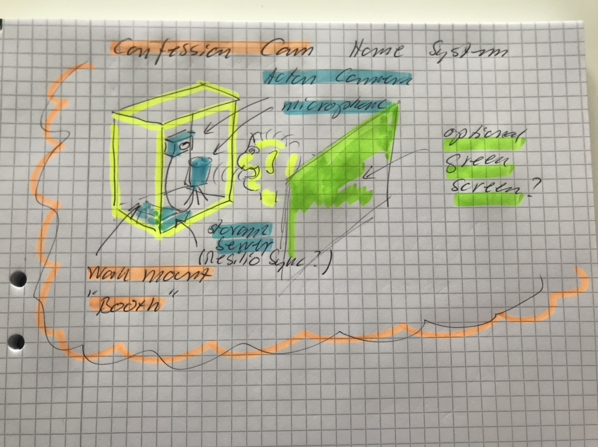

# Todo: Consider a home "Confession Cam" system setup for me to quickly and easy make "Confessional Recordings" to use in Youtube project videos or just for my own "figuring out" and life assessment (observations) and planning process?

```#790540bc``` *As of 2020-10-30 11:06*

[mail plain/text](mail.txt)


I am interested in how to use my rational reasoning to most effectively affect my life situation in a "good" way?

1) Consider a home "Confessional Cam" setup to enable me to quick and easy record "video diary" like recordings where I can comment or think out loud on what is currently going on?

> 

...


