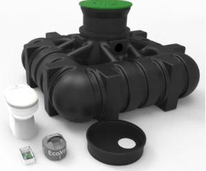

# Todo: House Build - Consider the site avloppsguiden.se for information about closed-system sewage solutions?

```#7946c489``` *As of 2019-10-08 23:34*

[mail plain/text](mail.txt)


I need more information to choose my closed system toilette solution.

1) Consider the Swedish site toalettguiden (<https://avloppsguiden.se/informationssidor/toaletter/> )?

...

2) It seems I can get a vacuum WC with one seat and 3 cubic meter tank as a kit for 33 000 SEK (<https://www.avloppscenter.se/vara-produkter/vakuumtoaletter/vakuumpaket-med-tank/ecovac-base-paket-med-1st-wc-tank-hamtpris.html> )?

>   
> *Example of a complete EcoVac kit for 33 000 SEK (ex shipping)*

...


