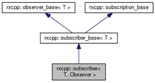

# Todo: RxCpp - Consider to delve into this library to understand the core concepts to use it with easy and confidence?

```#7aa51a6b``` *As of 2017-07-28 11:57*

[mail plain/text](mail.txt)


It seems the RxCpp is at its heart based on a quite simple concept using operator expressions to bind asynchronous “actors” together into data sequence processing algorithms?

1) Consider this generated documentation of the RxCpp source code (<http://reactive-extensions.github.io/RxCpp/>)?

==&gt; Hm…it seems I have some difficulty reading the documentation and the code because it uses passive form (it does not clearly state who does what)?

**==&gt; Consider to re-write selected parts in active form to understand what is actually stated?**

...

==&gt; Aha - it seems observable&lt;…&gt; is an assembly of factory methods that creates specialised observables of the original observable (source) (<http://reactive-extensions.github.io/RxCpp/group__group-core.html>)?

> class [rxcpp::observer&lt; T, State, OnNext, OnError, OnCompleted &gt;](http://reactive-extensions.github.io/RxCpp/classrxcpp_1_1observer.html) consumes values from an observable using `State` that may implement on_next, on_error and on_completed with optional overrides of each function. [More...](http://reactive-extensions.github.io/RxCpp/classrxcpp_1_1observer.html#details)  
> class [rxcpp::observer&lt; T, void, void, void, void &gt;](http://reactive-extensions.github.io/RxCpp/classrxcpp_1_1observer_3_01_t_00_01void_00_01void_00_01void_00_01void_01_4.html) consumes values from an observable using type-forgetting (shared allocated state with virtual methods) [More...](http://reactive-extensions.github.io/RxCpp/classrxcpp_1_1observer_3_01_t_00_01void_00_01void_00_01void_00_01void_01_4.html#details)  
> class [rxcpp::schedulers::scheduler](http://reactive-extensions.github.io/RxCpp/classrxcpp_1_1schedulers_1_1scheduler.html) allows functions to be called at specified times and possibly in other contexts. [More...](http://reactive-extensions.github.io/RxCpp/classrxcpp_1_1schedulers_1_1scheduler.html#details)  
> class [rxcpp::subscriber&lt; T, Observer &gt;](http://reactive-extensions.github.io/RxCpp/classrxcpp_1_1subscriber.html) binds an observer that consumes values with a [composite_subscription](http://reactive-extensions.github.io/RxCpp/classrxcpp_1_1composite__subscription.html) that controls lifetime. [More...](http://reactive-extensions.github.io/RxCpp/classrxcpp_1_1subscriber.html#details)  
> class [rxcpp::composite_subscription](http://reactive-extensions.github.io/RxCpp/classrxcpp_1_1composite__subscription.html) controls lifetime for scheduler::schedule and [observable&lt;T, SourceOperator&gt;::subscribe](http://reactive-extensions.github.io/RxCpp/classrxcpp_1_1observable.html#aee091cb373e1c0d392b2b2d208cedfda). [More...](http://reactive-extensions.github.io/RxCpp/classrxcpp_1_1composite__subscription.html#details)  
> class [rxcpp::observable&lt; T, SourceOperator &gt;](http://reactive-extensions.github.io/RxCpp/classrxcpp_1_1observable.html) a source of values. subscribe or use one of the operator methods that return a new observable, which uses this observable as a source. [More...](http://reactive-extensions.github.io/RxCpp/classrxcpp_1_1observable.html#details)  
> class [rxcpp::observable&lt; void, void &gt;](http://reactive-extensions.github.io/RxCpp/classrxcpp_1_1observable_3_01void_00_01void_01_4.html) typed as `[rxcpp::observable](http://reactive-extensions.github.io/RxCpp/classrxcpp_1_1observable.html)&lt;&gt;`, this is a collection of factory methods that return an observable. [More...](http://reactive-extensions.github.io/RxCpp/classrxcpp_1_1observable_3_01void_00_01void_01_4.html#details)

==&gt; It seems the observable::subscribe method can be used in different ways to connect a subscriber to it?

> “The arguments of **subscribe** are forwarded to [rxcpp::make_subscriber](http://reactive-extensions.github.io/RxCpp/namespacerxcpp.html#a242192794ecb4d2fdb69783c5c9fd24f) function"

==&gt; This seem to imply that it is the observable that provides the services to observers to connect to it in different ways?

==&gt; And also that it is able to create observers on behalf of the caller to provide specialised observables from the same value source?

==&gt; In effect the observable passes the same values to all its observers?

...

==&gt; It seems we can make an existing observer subscribe?

> auto **subscriber** = rxcpp::**make_subscriber**&lt;int&gt;(  
> **&#91;&#93;**(int v){printf("OnNext: %d\\n", v);},  
> **&#91;&#93;**(){printf("OnCompleted\\n");});  
> auto values = [rxcpp::observable&lt;&gt;::**range**](http://reactive-extensions.github.io/RxCpp/namespacerxcpp_1_1sources.html#a5b76c2ddb8291eb88060caa818bab729)(1, 3);  
> values.**subscribe**(subscriber);

==&gt; It seems here we use the “empty” [rxcpp::observable&lt;&gt; static **range**](http://reactive-extensions.github.io/RxCpp/namespacerxcpp_1_1sources.html#a5b76c2ddb8291eb88060caa818bab729) factory method?

==&gt; Aha, it seems a subscriber aggregates an observer (the api called by the observable) (<http://reactive-extensions.github.io/RxCpp/classrxcpp_1_1observable.html#aee091cb373e1c0d392b2b2d208cedfda>)?

> auto **subscriber** = rxcpp::make_subscriber&lt;int&gt;(  
> &#91;&#93;(int v){printf("OnNext: %d\\n", v);},  
> &#91;&#93;(){printf("OnCompleted\\n");});  
> auto values1 = [rxcpp::observable&lt;&gt;::range](http://reactive-extensions.github.io/RxCpp/namespacerxcpp_1_1sources.html#a5b76c2ddb8291eb88060caa818bab729)(1, 3);  
> auto values2 = [rxcpp::observable&lt;&gt;::range](http://reactive-extensions.github.io/RxCpp/namespacerxcpp_1_1sources.html#a5b76c2ddb8291eb88060caa818bab729)(4, 6);  
> values1.subscribe(**subscriber.get_observer()**);  
> values2.subscribe(**subscriber.get_observer()**);

**==&gt; Q: Hm… why can’t we use the subscriber object itself twice to subscribe to the two observables?**

...

==&gt; It seems a subscriber is in fact an observer with a life-time (<http://reactive-extensions.github.io/RxCpp/classrxcpp_1_1subscriber.html>)?

> rxcpp::subscriber&lt; T, Observer &gt;

> “binds an observer that consumes values with a [composite_subscription](http://reactive-extensions.github.io/RxCpp/classrxcpp_1_1composite__subscription.html) that controls lifetime”



2) Consider what it means that the pipe operator takes an observable and an Operator Factory?

==&gt; It seems I find the terminology a but strange (I get observable but why is rhs named Operator Factory)?

> //  
> // support range() | filter() | subscribe() syntax  
> // '|' is spelled 'pipe'  
> //  
> template&lt;class T, class SourceOperator, class OperatorFactory&gt;  
> auto operator | (const **rxcpp::observable**&lt;T, SourceOperator&gt;& source, **OperatorFactory**&& of)  
> -&gt; decltype(source.op(std::forward&lt;OperatorFactory&gt;(of))) {  
> return **source.op**(std::forward&lt;OperatorFactory&gt;(of));  
> }

==&gt; Would we not naively call the rhs for “observer”?

3) Consider what it means that observable::subscribe method taker arguments to create a subscriber (it does not take a subscriber per se as input)?

> template&lt;class T, class SourceOperator&gt;  
> class observable  
> : public observable_base&lt;T&gt;  
> {  
> // ...

> ///  
> /// takes any function that will take this observable and produce a result value.  
> /// this is intended to allow externally defined operators, that use subscribe,  
> /// to be connected into the expression.  
> ///  
> template&lt;class OperatorFactory&gt;  
> auto **op**(OperatorFactory&& of) const  
> -&gt; decltype(of(\*(const this_type\*)nullptr)) {  
> return of(\*this);  
> static_assert(is_operator_factory_for&lt;this_type, OperatorFactory&gt;::value  
> ,"Function passed for op() must have the signature Result(SourceObservable)");  
> }

> /\*! @copydoc rx-subscribe.hpp  
> \*/  
> template&lt;class... ArgN&gt;  
> auto subscribe(ArgN&&... an) const  
> -&gt; composite_subscription {  
> return detail_subscribe(make_subscriber&lt;T&gt;(std::forward&lt;ArgN&gt;(an)...));  
> }

> // ...  
> }

4) Consider what it means that an subscriber has a member called destination (which seems to be an observer)?

> template&lt;class T, class Observer = observer&lt;T&gt;&gt;  
> class subscriber : public subscriber_base&lt;T&gt;  
> {  
> //...  
> typedef rxu::decay_t&lt;Observer&gt; **observer_type**;

> composite_subscription lifetime;  
> observer_type **destination**;  
> // ...  
> }

…

Consider to delve more into RxCpp to get a good mental picture of what is going on and how to best use and extend RxCpp for use in my own code?

...


