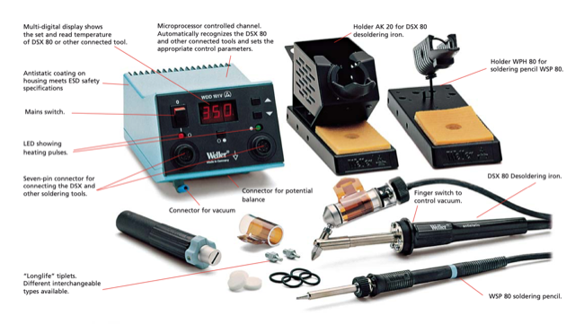
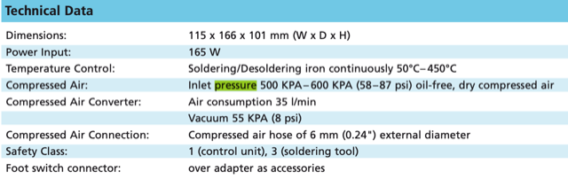
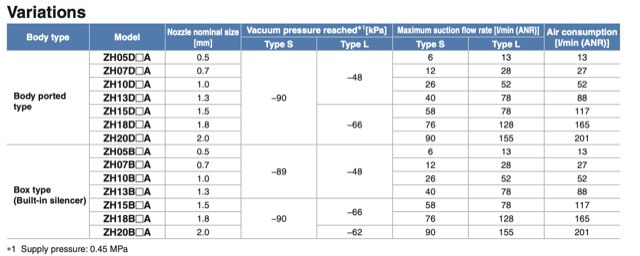
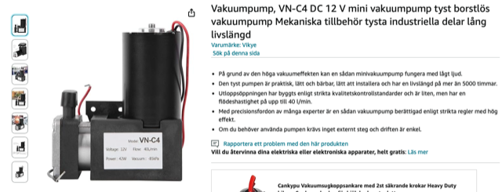
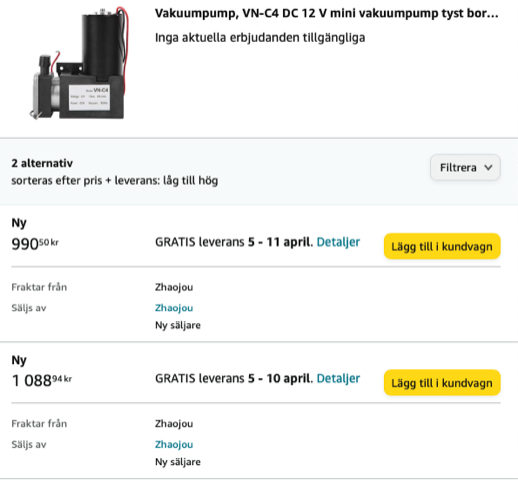

# Todo: Consider that the Weller WDD 161 for WSP 80 soldering pencil and DSX desoldering iron gives insight to required vacuum requirements for a DIY vacuum pump solution?

```#7b443449``` *As of 2024-03-17 12:43*

[mail plain/text](mail.txt)


I would like to have the Weller DSX 80 desoldering iron with my WSD 161 (PU 161) control unit.

1) Consider the Weller WDD 161 data sheet provided on the Farnell web site (<https://www.farnell.com/datasheets/7209.pdf> )?



==&gt; It seems to indicate the WDD 161 generates 55 KPA (8 psi) of vacuum?



==&gt; Now, 8 psi or 55 kpa is around 0,55 bar

==&gt; Consider that the Weller WMD 3 vacuum pump controlled station for DSX 80 generates minimum 0,7 bar at 20l/min?


==&gt; Can we assume that we need vacuum in the ball park off 0,55 to 0,7 bar at 20 l/min capacity?

2) Consider a vacuum generator suitable to generate 55 kpa, 8 psi, 0,55 to 0,7 bar of vacuum with an airflow capacity of above 20 l/min

==&gt; Consider the rs-online -0,88 bar 24 l/min vacuum ejector?


==&gt; It seems I need to supply 0,45 MPa (5,4 bar) to generated the stated vacuum (<https://docs.rs-online.com/427f/A700000008320220.pdf> )?



3) Consider to buy this brushless 12V vacuum pump that seems to provide the required vacuum and flow (<https://www.amazon.se/-/en/Vacuum-Brushless-Mechanical-Accessories-Industrial/dp/B08CHD8WDH> )?





...


