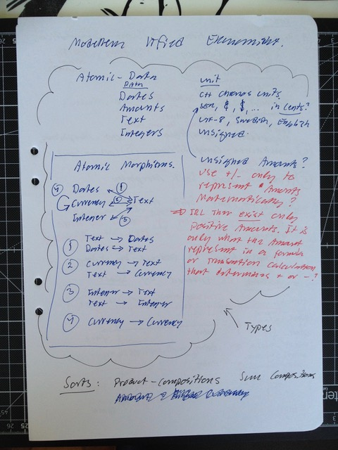
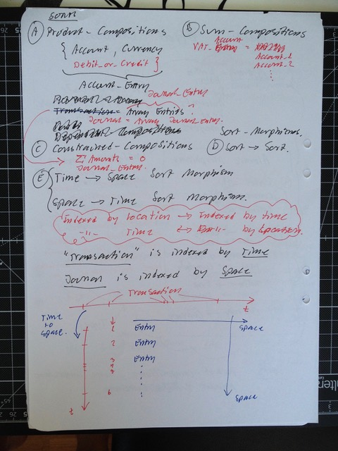
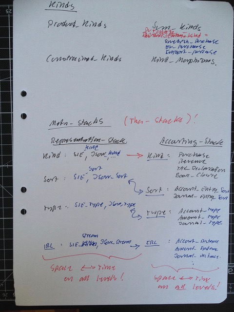
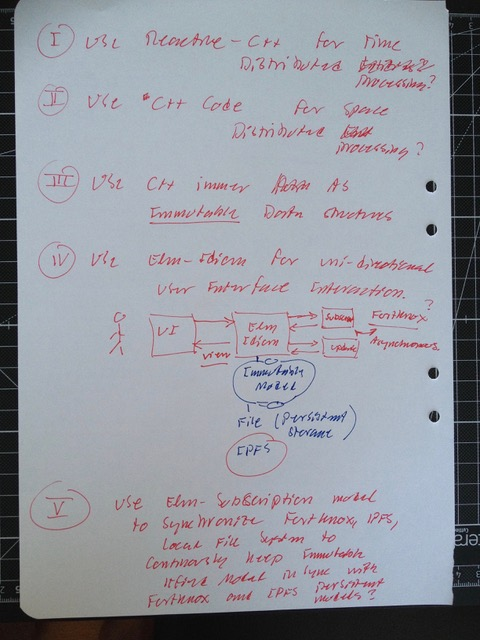

# Todo: Cratchit Book Keeping - Consider to implement a C++ book keeping application using Tha modelling, Elm Idion and Immer Immutable data Struictures asynchronously synchronising with REST Web service (FortKnox) and IPFS file system?

```#7c6907a4``` *As of 2018-05-31 13:12*

[mail plain/text](mail.txt)


Could it be that we are now ready to start building the C++ application for Book Keeping by piecing together a Tha Model with en Elm Idiom unidirectional model, view update, Immer C++ library for immutable dat structure model and asynchronous synchronisation with external models in REST web-services (FortKnox) and IPFS files system?

==&gt; Also see “Todo: Programming Elm Idiom C++ - Consider how we may use the Elm Idiom run-time with an immutable application state (model) to provide different user front-ends to the same core (run-time) and back-end (update)?”

==&gt; Also see “Todo: Consider to understand how to make a C++ back-end work with an Electron front end?”

==&gt; Also see “Todo: Fortknox API - Consider to experiment with the Fortknox API so that I may automate the book keeping of The ITfied AB?”

-1) Consider things to understand and make work to be able to implement Cratchit Book Keeping application as we like to design it?

==&gt; TODO: It seems we need to understand how to make an Electron front end work with a C++ back end on Windows, Linux and OS X?

==&gt; TODO: It seems we need to understand how to use the C++ “Immer” library to implement the Tha Model of “Book Keeping” and SIE, JSON, Fortknox REST distribution

**==&gt; Consider a TCP/IP interface between C++ back-end and Electron Front End?**

==&gt; TODO: It seems we need to design a C++ implementation of the Elm model that can interact with Electron Front End and Asynchronous FortKnox REST interface (IPFS file system)?

==&gt; TODO: It seems we need to understand how we can implement an interface to an IPFS file system?

==&gt; TODO: It seems we need to understand how we can implement Products, Sums and Morphisms and Data Type, Sort and Kind levels of Tha?

==&gt; Consider to implement the whole Tha as a run-time model (i.e., do not hard-code Products and Sums as C++ Class, Union)?

==&gt; Consider to implement Products and Sums using std::tuple and std::variant (that will work an any level of our Tha model implementation)?

...

==&gt; TODO: It seems we need try out Microsoft C++ Rest interface library (to see how it works and how to use it cross platform)?

==&gt; Especially it seems we need to ensure SLL (openssl) is applicable on Windows, Linux and OS X to allow us to interface FortKnox REST interface?

1) Consider a Tha model of Book Keeping data (Data, Types, Sorts and Kinds)?

==&gt; Consider the Atomic data types for the Book Keeping application?



==&gt; Consider to **separate Amount** value (always positive) **from Amount “sign”** (the sign only a representation used in mathematical formulas to reflect calculation)?

...

==&gt; Consider Atomic types are those always handled as one piece (no structure to travel in this data)?

==&gt; Consider the atomic data types (unstructured) Dates, Amounts, Integers and Text?

==&gt; Consider the basic morphisms are Text to and from Dates, Amounts and Integers?

==&gt; Consider the Morphism Amount to Amount (For amount formulas)?

F: Date -&gt; Text  F’: Text -&gt; Date

F: Amount -&gt; Text F’: Text -&gt; Amount

F: Integer -&gt; Text F’: Text -&gt; Integer

F: Amount -&gt; Amount

**==&gt; Actually: Consider Amount is a SUM-Sort with type instances SEK, Euro, Dollar, Pound (i.e., different amount types for different currencies)?**

&lt;Sort&gt;

F: Amount -&gt; Amount

&lt;Type&gt;

F: SEK -&gt; SEK

F: SEK -&gt; Euro

F: Euro -&gt; SEK

2) Consider the Sorts (Product and Sum compositions as morphisms between Sorts)?



Account_Entry = {Account, Amount, Debit_or_Credit} // This composition represents a “Delta” to a T-account (Debitable/Creditable account)?

Journal_Entry = **Constrained_Array** of Account_Entry // A Journal Entry must always comprise of Account_Entries that sum up to **Debit == Credit**!

==&gt; Consider we have “Dependent Types” like the Journal_Entry where composed Account_Entries (Deltas) must sum up to Debits == Credits?

3) Consider to identify Tha models “Distributes in space" versus “Distributed in time”?

==&gt; Consider Journal Entries are distributed in time (occur in and are indexed by time)?

==&gt; Consider a Journal visualisation (print or view) are a morphism form events in time (transactions) to journal entries in space (placed on screen or paper)?

==&gt; Consider a streaming of Journal Entries to and from memory storage as a morphism from Distribution in time (read entries from SIE, JSON file or REST interface) to distribution in space (internal instance of this data structure)?

...

4) Consider the Book keeping application Kinds?



==&gt; Consider Purchase Kinds?

Swedish_Purchase_Sort = Composition of Account Entries to get Swedish VAT correctly recorded?

EU_Purchase_Sort = Composition of Account Entries so that EU VAT is correctly recorded?

...

==&gt; Consider Sort morphisms can be used to turn “Invoiced Purchase” into “Payable”?

5) Consider to identify separate “Tha Stacks” (e.g., to separate Time Distribution processing of SIE, JSON data from internal Tha Model representation)?

==&gt; Consider a Representation-Stack with Tha Model of SIE, JSON processing on all Tha Levels (Kind, Sort, Type, data)?

==&gt; Consider the actual Book Keeping domain to be a separate Tha Stack with Kinds, Sorts, Type and Data used internally to model Book Keeping processing and view?

==&gt; Consider even the view to be modelled as a operate Tha Stack of Kind, Sort, Type and Date?

**==&gt; Consider for example that the GUI layout can be modelled as Product and Sum types of visible elements?**

==&gt; Consider if we need the Electron Front End to have a TCP/IP interface we can model the interaction as Time Distributed (Streamed) GUI view model?

...

6) Consider what existing concepts, models, frameworks and libraries to piece together to implement the Book Keeping Application in C++?



==&gt; Consider the C++ Reactive library for Time Distributed Processing (morphisms from “Distribution in time” to “Distribution in space”)?

==&gt; Consider we may be able to synchronise external REST Interfaced web-service and IPFS files by representing exchange as asynchronous events?

==&gt; Consider to make internal model disregard asynchronous events that are already represented in the internal immutable data model?

==&gt; Consider “normal” processing on data distributed in space (in memory) as ordinary C++ code (loop, if-else, switch) statements?

==&gt; **Consider to pay attention to how data distributed in time or space both turn into C++ statements of operations distributed in time (executed in time)?**

…

==&gt; Consider to use the C++ library “Immer” for the internal data model (immutable data model and immutable GUI)?

==&gt; Consider to use the Elm-Idiom (Single Atom idiom) to make Book Keeping Application implement uni-directional Model, Update, View processing only?

…

6) Consider to use a Web-Kit (Electron) User Interface Front End (to make cross platform application)?

==&gt; Consider if we use an Electron framework front-end and C++ back-end we can make the application multi-platform (Windows, Linux, OS X)?

…

…

Consider to delve into this idea of design concepts to implement the Cratchit Book Keeping application in C++?


