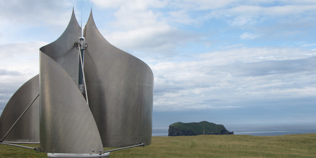

# Todo: Consider to design and build my own vertical axis wind turbine?

```#7ddab667``` *As of 2019-04-15 16:46*

[mail plain/text](mail.txt)


It seems if could be fun and learning to design and build my own vertical axis wind turbine?

1) Consider a vertical wind turbine with no gear box and direct driven in-shaft generator?

==&gt; It seems we can imagine to have the generator rotor at the base with a radius adapted to harvest the energy most optimally?

==&gt; Consider to have rotary permanent magnets and copper windings in the stator (brushless motor style)?

==&gt; Consider the lower efficiency of a vertical axis wind turbine relative the horizontal propeller driven ones are justified by the lower noise and easier ground build possibilities?

…

2) Consider what happened with the Island located company IceWind (<http://icewind.is/en/> )?

==&gt; Consider how hard it can be to make the IceWind seemingly Helical Darreus turbines from sheet metal myself?


A helical Darrieus turbine



*Icewind vertical axis wind turbine for residential and cabins*

==&gt; The last entry in the news section seems to be from Christmas 2016?

==&gt; But on facebook they have an entry from September 2018!

3) Consider Swedish based Vertical Wind that seems to produce VAWTs for large installations (<http://www.verticalwind.se> )?


4) Consider the wikipedia article on vertical axis wind turbine (<https://en.wikipedia.org/wiki/Vertical_axis_wind_turbine> )?

> “*A vertical axis wind turbine has its axis perpendicular to the wind streamlines and vertical to the ground. A more general term that includes this option is "transverse axis wind turbine" or "cross-flow wind turbine."*"

==&gt; It seems VAWTs (Vertical Axis Wind Turbines) have both advantages and disadvantages?

> ## Advantages&#91;[edit](https://en.wikipedia.org/w/index.php?title=Vertical_axis_wind_turbine&action=edit&section=2)&#93;

  
> VAWTs offer a number of advantages over traditional [horizontal-axis wind turbines](https://en.wikipedia.org/wiki/Horizontal-axis_wind_turbine) (HAWTs):
- Being omni-directional, some forms do not need to track the wind. This means they don't require a complex mechanism and motors to yaw the rotor and pitch the blades.[&#91;8&#93;](https://en.wikipedia.org/wiki/Vertical_axis_wind_turbine#cite_note-8)
- VAWTs generally function better than HAWTs in turbulent and gusty winds. HAWTs cannot efficiently harvest such winds, which also cause accelerated fatigue.
- the gearbox of a VAWT takes much less fatigue than that of a HAWT.&#91;[*citation needed](https://en.wikipedia.org/wiki/Wikipedia:Citation_needed)*&#93;
- In VAWTs, gearbox replacement and maintenance are simpler and more efficient, as the gearbox is accessible at ground level, so that that no cranes or other large equipment are needed on-site. This reduces costs and impact on the environment. Motor and gearbox failures generally are significant considerations in the operation and maintenance of HAWTs both on and offshore.
- some designs of VAWTs in suitable situations can use [screw pile](https://en.wikipedia.org/wiki/Screw_pile) foundations, which hugely reduces the road transport of concrete and the carbon cost of installation. Screw piles can be fully recycled at the end of their life.
- wings of the Darrieus type have a constant chord and so are easier to manufacture than the blades of a HAWT, which have a much more complex shape and structure.
- VAWTs can be grouped more closely in wind farms, increasing the generated power per unit of land area.
- VAWTs can be installed on HAWT wind farm below the existing HAWTs; this can supplement the power output of the existing farm.[&#91;9&#93;](https://en.wikipedia.org/wiki/Vertical_axis_wind_turbine#cite_note-9)
- research at [Caltech](https://en.wikipedia.org/wiki/California_Institute_of_Technology) has also shown that a carefully designed wind farm using VAWTs can have an output power ten times that of a HAWT wind farm of the same size.[&#91;10&#93;](https://en.wikipedia.org/wiki/Vertical_axis_wind_turbine#cite_note-10)


> ## Disadvantages&#91;[edit](https://en.wikipedia.org/w/index.php?title=Vertical_axis_wind_turbine&action=edit&section=3)&#93;

  
> One of the major outstanding challenges facing vertical axis wind turbine technology is dynamic stall of the blades as the angle of attack varies rapidly.[&#91;11&#93;](https://en.wikipedia.org/wiki/Vertical_axis_wind_turbine#cite_note-11)[&#91;12&#93;](https://en.wikipedia.org/wiki/Vertical_axis_wind_turbine#cite_note-12)[&#91;13&#93;](https://en.wikipedia.org/wiki/Vertical_axis_wind_turbine#cite_note-13)  
> The blades of a VAWT are fatigue-prone due to the wide variation in applied forces during each rotation. This can be overcome by the use of modern composite materials and improvements in design - including the use of aerodynamic wing tips that cause the spreader wing connections to have a static load. The vertically oriented blades can twist and bend during each turn, causing them to break apart.  
> VAWTs have proven less reliable than [HAWTs](https://en.wikipedia.org/wiki/Wind_turbine#Horizontal_axis),[&#91;14&#93;](https://en.wikipedia.org/wiki/Vertical_axis_wind_turbine#cite_note-14) although modern designs of VAWTs have overcome many of the issues associated with early designs.[&#91;15&#93;](https://en.wikipedia.org/wiki/Vertical_axis_wind_turbine#cite_note-15)[&#91;16&#93;](https://en.wikipedia.org/wiki/Vertical_axis_wind_turbine#cite_note-16)

...


