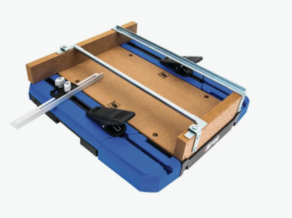
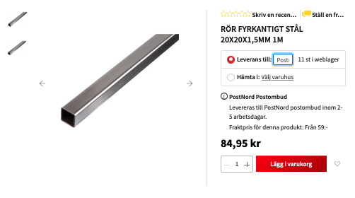

# Todo: Consider to DIY something like the Kreg cross cut station for a hand held circular saw (but "dust free" so I can use it in my apartment woodworking workbench)?

```#7e3602f7``` *As of 2022-07-21 23:01*

[mail plain/text](mail.txt)


I want to be able to easily use my Makita hand-held curcular saw for accurate cross and rip cuts.

1) Consider to be inspired by the Kreg cross cut station (<https://www.kregtool.com/shop/cutting/circular-saw-cutting/crosscut-station/KMA4100.html> )?



==&gt; The kreg cross cut station seems to be available from this Swedish site for about 900 SEK (<https://www.proffsmagasinet.se/maskintillbehor-forbrukning/saga/anslag/kapanslag/kreg-kma4100-int-kapanslag-3058369> )?

NOTE: It is **TO SMALL** for my needs (I need to cut &gt;= 45 mm and this station is limited to 38 mm depth)

2) Imagine some designs to build my own dust free cross cut station for circular saw?

> *I imagine I would be tempted to use Igur linear bearings and rods so that I can use the station also in other orientations (e.g., vertical, sideways or even upside down)?*

> *Hm... The Igus product sortiment is quite large and confusing (and the pricing on the Swedish site *[*https://www.igusab.se](https://www.igusab.se) is somewhat opaque)?*

> *I suppose I could try to 3D-print something to glide on Bauhaus aluminium square tubing? As long as I get down to a play less than half a mm it is good enough)?*

> 

...


