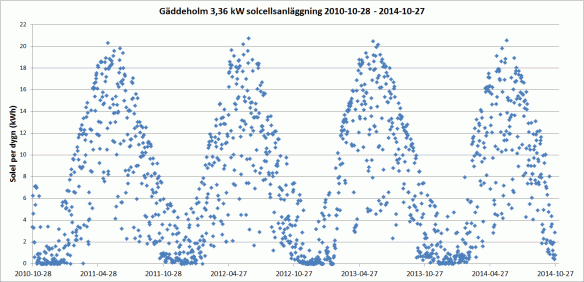
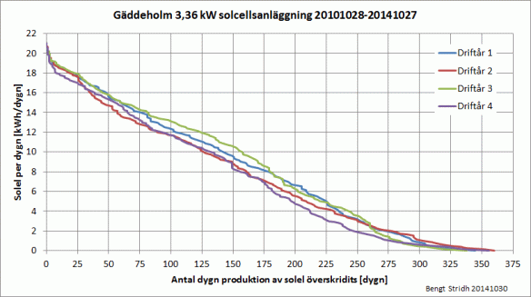

# Todo: Consider that it seems a 3.6 kW solar cell system produces a squared sinusoidal formed energy production with 20 kWh peak daily production?

```#80804f3d``` *As of 2020-01-08 12:40*

[mail plain/text](mail.txt)


I need to get some intuition and heuristics around how much energy I can harvest using solar panels on my house in Sweden.

1) Consider this blog where the blogger seems to state his 3.6 kW solar panel system produces peak 20 kWh down to around only 500 Wh per day over the years (<http://bengtsvillablogg.info/2014/10/29/fyra-ar-med-solceller-dygn-for-dygn/> )?

>   
> *A graph showing daily energy production over four years from a 3.6 kW solar panel system in Sweden*

>   
> *A graph showing how may days per year the plotted energy production has been exceeded (e.g. 50 days exceeded 15 kWh)*

==&gt; It seems the blogger reports he was able to harvest on average over the years 2,28 kWh per panel rated kW?

> *"**Medelvärdet** för de 1460 dygnen har varit 7,16 kWh/dygn = **2,28 kWh/kW och dygn**. Som mest har vi skördat 20,74 kWh = 6,17 kWh/kW under ett dygn."*

> *"**Under **61 (4%) dygn** har vi inte fått någons solel alls. Det är vinterdygn då solcellerna varit snötäckta, med minst ett undantag. Jag minns en mulen och väldigt mörk decemberdag då det faktiskt blev **noll i solelproduktion** trots att solcellsmodulerna var snöfria.**"*

> *"**Under **557 dygn (38%)** har vi fått **mer än 10 kWh** = 2,98 kWh/kW och under 6 dygn (0,04%) har vi passerat vår drömgräns 20 kWh = 5,95 kWh/kW.**"*

1) Consider we may use the heuristic to expect each kW of installed solar panel capacity to produce on average around 2 kWh per day each year?

2) Consider for electric car transports we need around 2 kWh / 10km of highway travel and the double 4 kWh / 10km for trailer transports?

> *Now I have gotten these heuristics from Björn Nyland youtube videos where he reports what his Tesla car reports in energy consumption while driving in different conditions.*

> *But I need to remember that these number may vary quite dramatic depending on regeneration capacity and if the road is wet and if the weather is cold?*

==&gt; It seems with these heuristics I would need a 1.5 kW solar panel system to generate on average 2 kWh per day to be able to consume 20 kWh for a 100 km travel each week?

> *Let's say I want to be able to travel 100 km a week to buy groceries and what have you. This means I live 50 km from where to go shopping or fetching parcels.*

> *Now a Tesla model 3 seems to consume around 200 Wh per km on the highway which means 100 km will require I have 20 kWh to consume.*

> *If a solar panel on average over the year produces at least 2 kWh per kW production capacity per day. And I need to produce 20 kWh / 7 = 2.9 kWh per day for seven days. This would mean I need a 2.9 kWh / 2 kWh per kW = a 1.5 kW capacity solar panel to produce the required energy to make these weekly travels?*

> ***So with a 1.5 kW solar panel I can harvest 20 kWh per week to travel at highway speed 100 km consuming 200 Wh per km.***

==&gt; Consider what inefficiencies I need to account for and or avoid?

> *I need to reduce the inefficiency during charging of the car by charge at a sufficient high rate. In this way I may avoid the inefficiency of spending to must time wasting the 500W overhead that I have heard is a reality of the Tesla charging system.*

> *This in turn means I need some for of "fast charger" in my house and also a battery storage and inverter system able to deliver these powers?*

...


