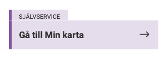
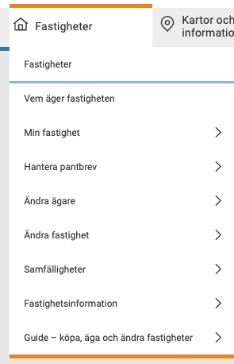
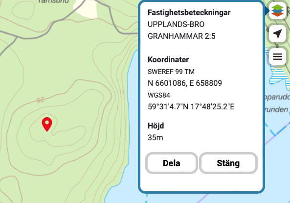
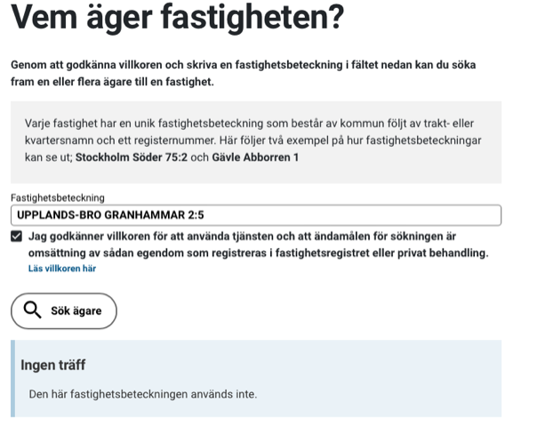

# Todo: Consider how to search for and find who owns potential properties to build my house on?

```#81e6835d``` *As of 2022-02-09 19:12*

[mail plain/text](mail.txt)


1) It seems the "best" maps are available at "Min Karta" at Swedish Lantmäteriet (<https://www.lantmateriet.se/sv/Kartor-och-geografisk-information/Kartor/min-karta/> )?

==&gt; It seems I can log in as a Swedish Citizen with my Mobile ID (and alternatives)?

> 

==&gt; It seems Lantmäteriet provides service on who owns a property as well as other property related information services?

> 

2) This seems to be the URL to login and search for owners of properties (<https://www.lantmateriet.se/sv/Fastigheter/vem-ager-fastigheten/> )?

3) Consider to document how to locate a property, and find the owner?

==&gt; When logged in it seems I can just click on the map and a pop-up will show the ID of the property?

> 

==&gt; I can then search the property ID in the Lantmäteriet "Vem ägen fastigheten"?

> 

...


