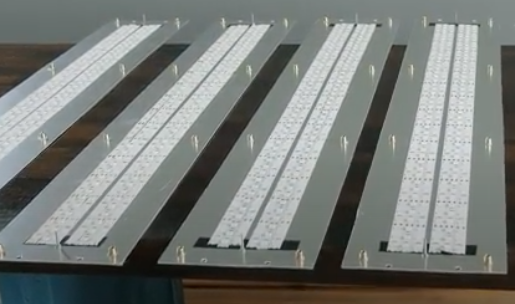
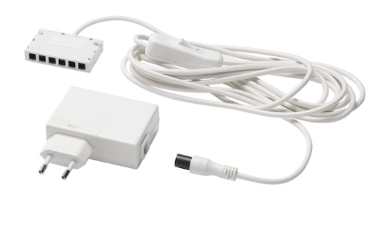
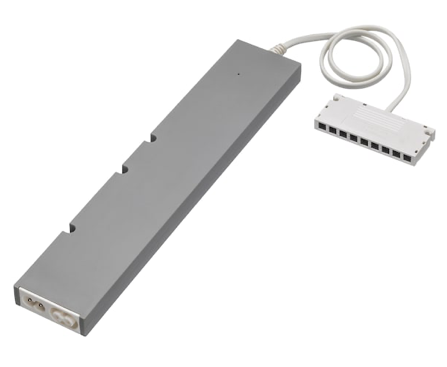
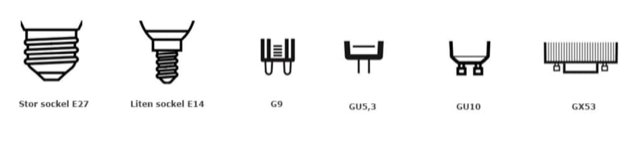
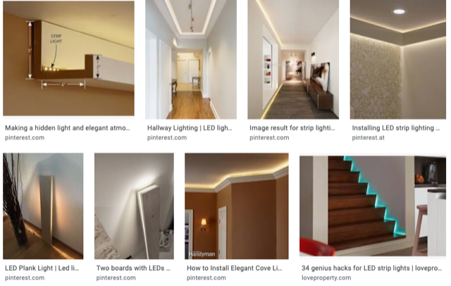

# Todo: Consider to design Hallway Lighting from LED strips and 12V "Standard" transformers?

```#82e3d016``` *As of 2020-11-04 15:10*

[mail plain/text](mail.txt)


I need to light my hallway and it would be fun to design my own lights using LED strips.

1) Consider youtube video "" for inspiration for my hallway lighting design ()?

>   
> *LED strips on aluminium for effective cooling*

2) Consider IKEA 12V transformers?

==&gt; It seems IKEA only have one 19W wall outlet transformer OR a wifi remote controlled 10W or 30W driver "Trådfri"

>   
> [*https://www.ikea.com/se/sv/p/ansluta-led-drivare-med-sladd-vit-80405841/](https://www.ikea.com/se/sv/p/ansluta-led-drivare-med-sladd-vit-80405841/)*

>   
> [*https://www.ikea.com/se/sv/p/tradfri-driver-foer-tradloes-styrning-gra-60342656/](https://www.ikea.com/se/sv/p/tradfri-driver-foer-tradloes-styrning-gra-60342656/) *

3) Consider some lamp sockets to use (<https://www.ikea.com/se/sv/rooms/sa-vaeljer-du-raett-led-ljuskaella-pub48908861> )?

>   
> *Examples of lamp sockets*

3) Consider image googling "DIY LED strip hallway lighting"?

>   
> *Some examples from image googling "DIY LED strip hallway lighting"*

...


