# Todo: Consider different available mechanisms to lock my foldable note stand in its upp position?

```#837193c6``` *As of 2024-03-17 09:42*

[mail plain/text](mail.txt)


I made the note stand on my studio wall build foldable but have yet to make it lockable in its upp position.

1) Consider what in Swedish is called "kullås"?

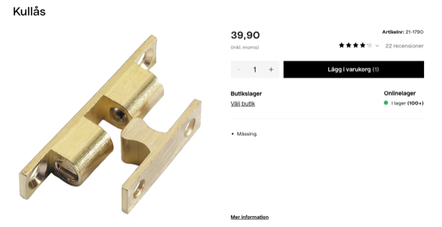

2) Consider what in Swedish is called "kolvlås"?

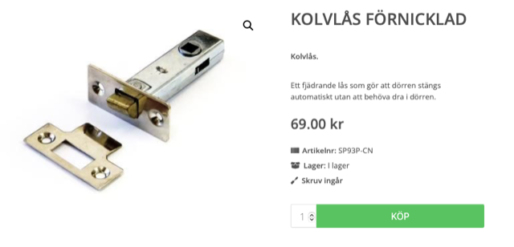

3) Consider what in Swedish is called "Möbellås"?

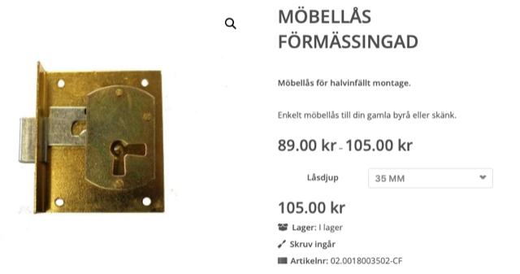

4) Consider what in Swedish is called "Instickslås med rullfälla"?

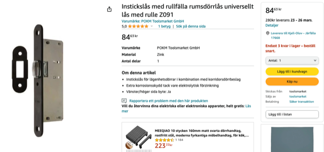

5) Consider what in Swedish is called "Dörrbultar"?

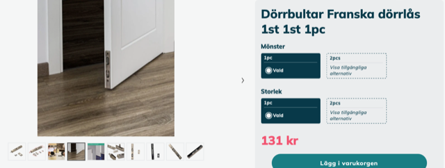

6) Consider what in Swedish is called "rullås"?

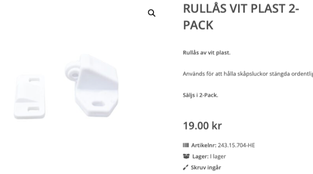

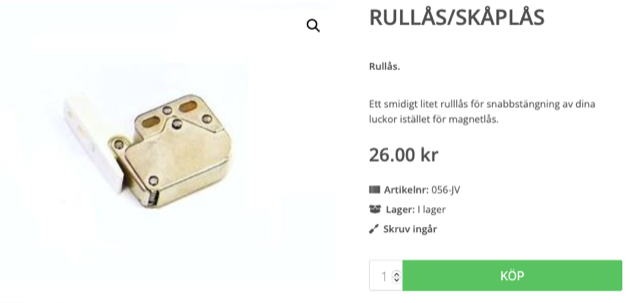

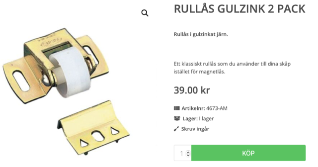

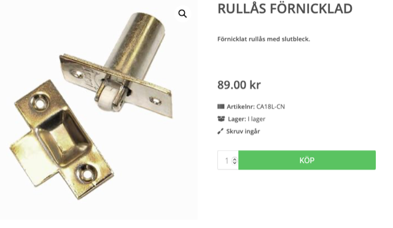

7) Consider what in Swedish is called "Trycklås"?

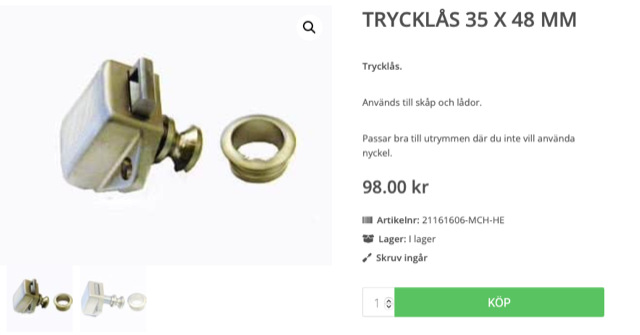

8) Consider what in Swedish is called "fjädrande kolvlås"?

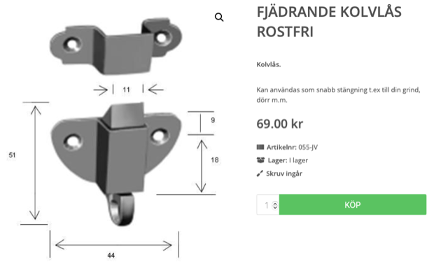

**==&gt; 240317 ordered two of these from <https://www.specialbeslag.se> to try out - 200 SEK**

...


