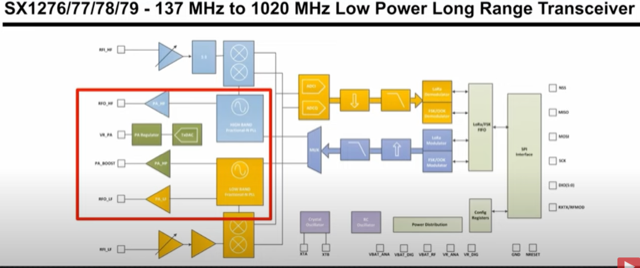
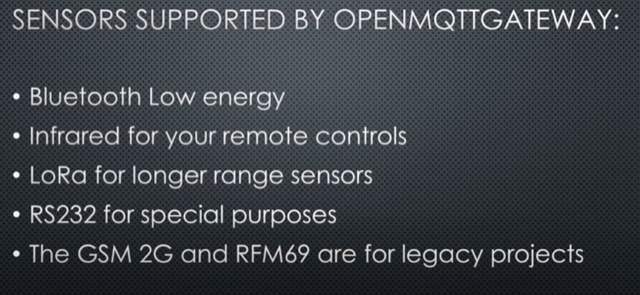
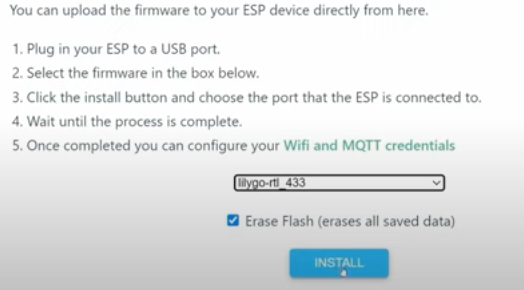
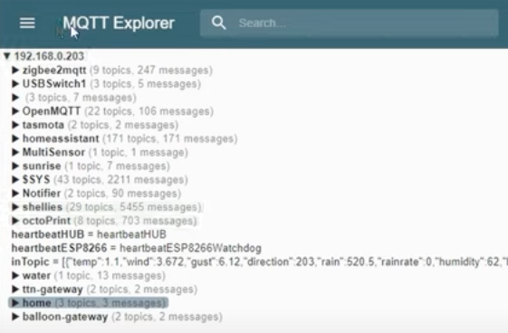
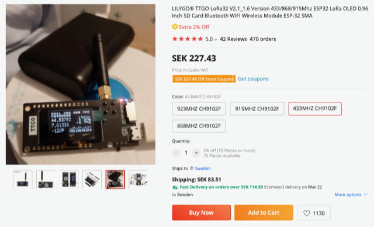
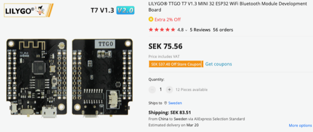
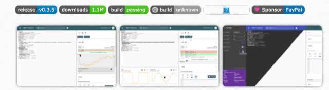
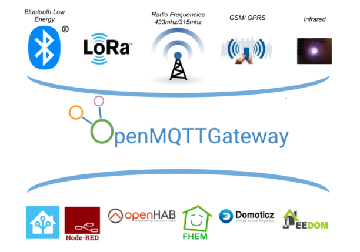

# Todo: Consider to delve into IoT open source projects to use for home automation as presented in youtube video "OpenMQTTGateway Connects Many Things to Your Home Automation"?

```#8404daf1``` *As of 2023-02-19 12:04*

[mail plain/text](mail.txt)


I want to understand what IoT support is available as open source for home automation?

0) Consider what I feel is missing to fully understand and confidently build and use an IoT devices network as described in this video?

> *I still miss the "meta" information on how everything connects together and where each hardware and software "lives"?*

> *Also, how is the open source community evolve to ensure any IoT network I go for will be as future proof as possible? *

==&gt; It sees to me it would be nice if I could use something like Darwinet to share configurations and software / hardware composition as "state" maintained by the community?

> *I feel no one has yet to come up with a way to share "state" of what software goes where, what version and what configuration to work with devices? Like, those who has contributed to make a device work in an IoT network should be able to share this as a "state" so others can get the solution without having to repeat the configuration or installation manually?*

> *Is this feasible with the Tha-model and Darwinet netwrok I have been pondering?*

> *At first glance it seems very complicated to envision a common way to reach into all devices and software of an IoT network to enable it to be changed based on a Darwinet model instantiated as a model state to synchronise into the IoT network?*

> *Like, each device / node needs to be a Darwinet node?*

> *Darwinet state needs to be able to travel over a plethora of IoT device protocols and 433 MHz radio frequency?*

> *...*

1) Consider the leads and information in youtube video "OpenMQTTGateway Connects Many Things to Your Home Automation" (<https://youtu.be/_gdXR1uklaY> )?

==&gt; It seems NO 433 MHz sensors uses LoRa?

> 

==&gt; It seems 433 MHz sensors utilises a plethora of Frequency Shift, Phase Shift, Minimum-Shift keying, Gaussian Minimum Shift Keying and "basic" on-off keying?

==&gt; It seems the LoRa board is "only" used for the "radio frequency stuff" and the software then handles all demodulation required for each device?

> 

==&gt; It seems by running OpenMQTTGateWay on an ESP LoRa board we can interface most 433 MHz devices?

> 

==&gt; It seems we can upload the OpenMQTTGateWay directly from the web site to the ESP Lora Board?

> 

==&gt; Andreas seems to suggest using MQTT Explorer as a good tool to monitor reachable MQTT devices?

> 

2) Consider the Github project "rtl_433_esp" to communicate with 433 MHz devices using an ESP board (<https://github.com/NorthernMan54/rtl_433_ESP> )?

> *"**This is an attempt at creating an Arduino library for use on ESP32 boards with a CC1101 transceiver or SX127X Transceivers with the device decoders from the rtl_433 package. And be available for use with openMQTTGateway as an available module.**"*

3) Consider the LILYGO® TTGO LoRa32 through AliExpress web site?

> 

4) Consider the LILYGO® TTGO T7 through AliExpress we site?

> 

5) Consider the MQTT Explorer to test and monitor reachable MQTT devices (<http://mqtt-explorer.com> )?

> 

> *"**MQTT Explorer is a comprehensive MQTT client that provides a structured overview of your MQTT topics and makes working with devices/services on your broker dead-simple.**"*

6) The OpenMQTTGateway seems to live here on the web (<https://docs.openmqttgateway.com> )?



7) Consider ESPHome web site for sources on using ESP board based devices (<https://esphome.io> )?

==&gt; It seems ESP Home provides interfacing of BLE devices though the "BlueTooth Proxy" (<https://esphome.io/components/bluetooth_proxy.html> )?

> *"This exceptional feature offers fault tolerant connection between the Bluetooth devices and Home Assistant."*

8) Consider "Home Assistant" as the user interface to control IoT devices on the 433 MHz frequency through MQTT network (<https://www.home-assistant.io> )?

9) Consider "Node Red" as a programming environment to build IoT networks using a visual user intertace (<https://nodered.org> )?

> *"Node-RED provides a browser-based flow editor that makes it easy to wire together flows using the wide range of nodes in the palette. Flows can be then deployed to the runtime in a single-click.*

> *JavaScript functions can be created within the editor using a rich text editor."*

10) Consider Andreas Spiess Github "SensorsIOT" repositories (<https://github.com/sensorsiot> )?

...


