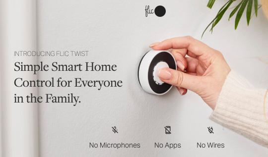

# Todo: Consider to study the wireless smart home remote control device "Flic Twist" to see what it is and what it brings as a technical solution to turning on and dim lights?

```#8504d18b``` *As of 2022-07-30 22:16*

[mail plain/text](mail.txt)


My friend Elin has a husband that works at a startup that develops the "Flic Twist" smart home on off and dimmer controller

1) The Flic Twist campain seems to live here (<https://twist.flic.io> )?



2) The Flic Twist seems to be funded as an Indiegogo campain here (<https://www.indiegogo.com/projects/flic-twist-the-wireless-dial-for-your-smart-home#/> )?

3) Consider to follow my backing of the Flic Twist project?


==&gt; Also see mail 30 July 2022 "Indiegogo contribution #837 receipt for Flic Twist: The Wireless Dial for your Smart Home"

...


