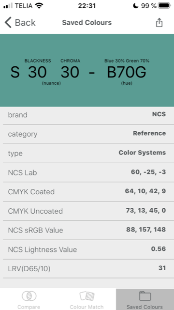
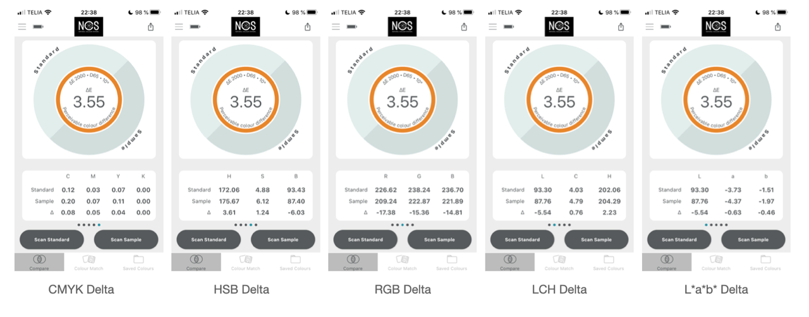
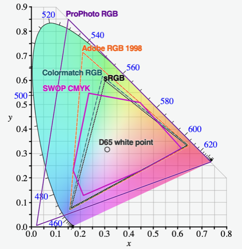
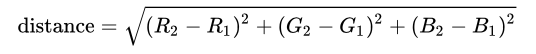

# Todo: Consider how I can use the ColourPIN SE to map colours to other colour systems (e.g., sRGB)?

```#85df0d19``` *As of 2020-11-15 22:52*

[mail plain/text](mail.txt)


I want to understand the information the ColourPIn SE App is showing for read colours.

==&gt; Also see "[Todo: Consider to understand the NCS (Natural Colour System) basics from the short tutorial on their site?](../9e082416/chime.md)"

==&gt; Also see "[Todo: Consider colour design tool chains Image -&gt; RGB -&gt; NCS colour codes on moodboards](../d709381d/chime.md)"  
==&gt; Also see "[Todo: Consider to design a DIY "Color Reader" that can tell the NCS code of a surface like a wall, a fabric or some other (non glossy?) surface like the "NCS Colourpin SE"?](../5d2946e4/chime.md)"

1) Consider the information the ColourPIN SE app gives for scanned colours?

>   
> *An example of the information given by the ColourPIN SE app for a scanned colour*

==&gt; It seems the NCS ColourPIN App can read and compare two colours and give the "distance" in several colour spaces?

>   
> *Example of how ColourPIn SE app shows the "difference" between two scanned colours*

2) It seems sRGB is "Standard RGB" defined by HP and Microsoft (<https://en.wikipedia.org/wiki/SRGB> )?

==&gt; It seems the sRGB is quite "small" compared to what human vision is able to perceive (e.g., see sRGB, Adobe RGB and ProPhoto RGB)?

>   
> *And example of the CIE 1931 mapping between visible light physical properties and human perception in RGB and CMYK colour spaces*

3) It seems "Delta E" is a somewhat subjective definition of a "Euclidean like" difference between two colours in a colour space (<http://www.colorwiki.com/wiki/Delta_E:_The_Color_Difference> )?

> *"**The idea is that a dE of 1.0 is the smallest color difference the human eye can see. So any dE less than 1.0 is imperceptible (as in turn the lights off and head to the pub) and it stands to reason that any dE greater than 1.0 is noticeable (as in put the coffee on, we're going to be here a while). Unfortunately - and probably not surprisingly - it's not that simple. Some color differences greater than 1 are perfectly acceptable, maybe even unnoticeable. Also, the same dE color difference between two yellows and two blues may not look like the same difference to the eye and there are other places where it can fall down.**"*

==&gt; Also see Wikipedia article on Colour Difference (<https://en.wikipedia.org/wiki/Color_difference> )?


> "The difference or distance between two colors is a metric of interest in color science."

> "Common definitions make use of the Euclidean distance in a device independent color space."

> ==&gt; It seems we can define "colour difference" as the Euclidean Distance in sRGB colour space?

> "As most definitions of color difference are distances within a color space, the standard means of determining distances is the Euclidean distance. If one presently has an RGB (Red, Green, Blue) tuple and wishes to find the color difference, computationally one of the easiest is to consider R, G, B linear dimensions defining the color space."

> 

4) It seems the CIE 1931 Colour space maps visible light physical properties to human colour perception as defined by e.g., RGB and CMYK (<https://en.wikipedia.org/wiki/CIE_1931_color_space> )?

> *"**The CIE 1931 color spaces are the first defined quantitative links between distributions of wavelengths in the electromagnetic visible spectrum, and physiologically perceived colors in human color vision. The mathematical relationships that define these color spaces are essential tools for color management, important when dealing with color inks, illuminated displays, and recording devices such as digital cameras. The system was designed in 1931 by the "Commission Internationale de l'éclairage", known in English as the International Commission on Illumination.**"*

5) It seems CIE L\*a\*b\* (or Lab) is CIELAB colourspace with a "distance" close to human perceived distance (<https://en.wikipedia.org/wiki/CIELAB_color_space> )?

> *"expresses color as three values: L\* for the lightness from black (0) to white (100), a\* from green (−) to red (+), and b\* from blue (−) to yellow (+). CIELAB was designed so that the same amount of numerical change in these values cor*responds to roughly the same amount of visually perceived change.*"*

...


