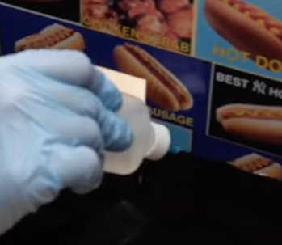
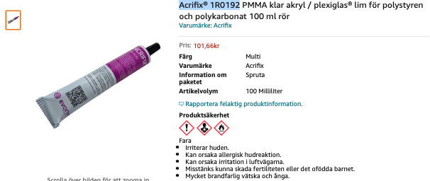

# Todo: Consider to check out methylene chloride to bond (meld) acrylic and other plastics like PLA together?

```#87094a0d``` *As of 2021-12-27 12:34*

[mail plain/text](mail.txt)


I picked up in a youtube video that you can use methylene chloride to meld acrylic sheets together.

1) Consider this youtube video "I made a NYC Hot Dog Experience Machine" at around 5:45 where she melds acrylic together with methylene chloride (<https://youtu.be/1F2ywqzlBd4?t=347> )?



2) It seems methylene chloride (swedish metylenklorid) is forbidden to be sold in Sweden (<https://www.kemi.se/lagar-och-regler/regler-som-endast-galler-i-sverige/nationella-begransningar-och-forbud/klorerade-losningsmedel> )?

> *There is a general ban on certain chlorinated solvents in Sweden. The ban means that chemical products that consist fully or in part of methylene chloride (dichloromethane) or tetrachloroethylene may not be offered for sale or transferred to consumers for private use. Neither may methylene chloride be offered for sale, transferred or used professionally. Exemption from the ban may apply in the case of methylene chloride, and it is possible to apply for a dispensation.*

3) Consider the alternatives available in Sweden to meld or bond acrylic together?

==&gt; It seems the "official" glue is Acrifix® 1R0192 from Evonik (<https://www.amazon.se/Acrifix®-1R0192-plexiglas®-polystyren-polykarbonat/dp/B00TIY449W/ref=asc_df_B00TIY449W/?tag=shpngadsglede-21&linkCode=df0&hvadid=476519744639&hvpos=&hvnetw=g&hvrand=13237513051111246977&hvpone=&hvptwo=&hvqmt=&hvdev=c&hvdvcmdl=&hvlocint=&hvlocphy=1012205&hvtargid=pla-712232154125&psc=1> )?



==&gt; It seems 3M provides a good overview of different plastics and the products they offer to bond or glue them (<https://www.3m.co.uk/3M/en_GB/bonding-and-assembly-uk/substrate/gluing-plastic/> )?

> It seems products labelled as "plexiglas" or "acrylic glass" often can be Polycarbonate (PVC) so care must be taken to use the correct glue?

> "*3: PMMA - polymethyl methacrylate, also known as Plexiglas and acrylic glass, impresses with its optical and surface properties. In everyday life, corrugated sheets, for example for the roofing of garden arbours or pergolas, are often mistakenly offered as plexiglass. In reality, they are made of polycarbonate or PVC &#91;they mean PC? PVC is poly vinyl carbonate?&#93;, which can make a big difference when bonding the material. The same applies to so-called hobby glass from the DIY store.*"

> "*For bonding on low-energy plastics such as PMMA, the surface energy is of central importance. However, caution is advised when using certain solvents for bonding preparation. Otherwise, there is a wide range of high-performance adhesives on the market for efficiently bonding PMMA to numerous other materials.*"

> "9: PC - Polycarbonate  
> The water-clear plastic is characterised above all by its glass-like optical properties. The special advantage, however, is its lower weight compared to glass. This is why the material is often used for lightweight construction purposes, such as panoramic roofs or transparent covers for buildings. Although the solvent-soluble plastic is generally considered to be easy to bond, it reacts sensitively. As a result, stress cracks can occur."

...


