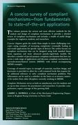
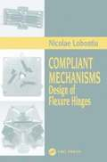
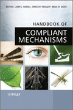
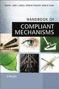
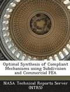
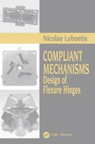
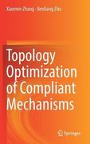
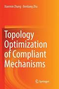
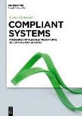

# Todo: Consider to research and learn about "Compliant Mechanisms" that allows for rigid homogeneous materials to replace multi-part designs with additive or subtractive manufactured parts (e.g., 3D printed mechanisms)?

```#87cd81d2``` *As of 2019-03-13 10:31*

[mail plain/text](mail.txt)


I really felt joy when I stumbled on a youtube video with an interview of a researcher showing of the designs and possibilities of Compliant Mechanisms which are mechanisms made out of single homogeneous parts that replaces relative linear or rotational movement with bending?

-1) Consider to follow up on ordered (and possibly read) books?

190313: Ordered three books by Laryy L Howell

> Din beställning

> Skickas inom 3-6 vardagar: Antal Pris/st Summa  
> Y Origami?  
> Morgan, David C./Halverson, Denise M./Magleby, Spencer P./Bateman, Terri C./Howell, Larry L.. Häftad, 2018 (ISBN: 9781470436742)  
> 1 404.72 404.72

> Skickas inom 7-10 vardagar: Antal Pris/st Summa  
> Compliant Mechanisms  
> Howell, Larry L. Inbunden, 2001 (ISBN: 9780471384786)  
> 1 1451.89 1451.89

> Skickas inom 11-20 vardagar: Antal Pris/st Summa  
> Handbook of Compliant Mechanisms  
> Howell, Larry L/Magleby, Spencer P./Olsen, Brian M.. Inbunden, 2013 (ISBN: 9781119953456)  
> 1 961.32 961.32

> Varor (3): 2817.93  
> Fraktavgift 82.08  
> Moms: 174.00

> TOTALT SEK: 3074.00

==&gt; Consider to also buy and read "Compliant Mechanisms - Designs of Flexure Hinges" by Nicolae Lobontiu?


1) Consider this youtube video "How Flexible Machines Could Save The World" that really got me interested (<https://www.youtube.com/watch?v=97t7Xj_iBv0>)?

==&gt; It seems Larry Howell is a prominent name and works at Brigham Young University "Compliant Mechanisms Research group"?

> "I visited the Compliant Mechanisms Research group at Brigham Young University and spoke to Professor Larry Howell"

2) Consider the wikipedia article on Larry Howell (<https://en.wikipedia.org/wiki/Larry_Howell> )?

3) Consider books to read about compliant mechanisms?

==&gt; Consider these titles available from bokus?

1.
2.

>   ### [Compliant Mechanisms](https://www.bokus.com/bok/9780471384786/compliant-mechanisms/)

>   #### av [Larry L Howell](https://www.bokus.com/cgi-bin/product_search.cgi?authors=Larry%20L%20Howell)

  
>   INBUNDEN, Engelska, 2001-07-01  
>   1539  
>   [Köp](https://www.bokus.com/basket/add?product=9780471384786)  
>   Skickas inom 7-10 vardagar.  
>   [](https://www.bokus.com/bok/9780471384786/compliant-mechanisms/)

>   A concise survey of compliant mechanisms-from fundamentals to state-of-the-art applications This volume presents the newest and most effective methods for the analysis and design of compliant mechanisms. It provides a detailed review of compliant ...

>   [Läs mer »](https://www.bokus.com/bok/9780471384786/compliant-mechanisms/)

  
3.

>   ### [Compliant Mechanisms](https://www.bokus.com/bok/9780849313677/compliant-mechanisms/)

>   #### av [Nicolae Lobontiu](https://www.bokus.com/cgi-bin/product_search.cgi?authors=Nicolae%20Lobontiu)

  
>   INBUNDEN, Engelska, 2002-12-01  
>   3339  
>   [Köp](https://www.bokus.com/basket/add?product=9780849313677)  
>   Skickas inom 10-15 vardagar.  
>   [](https://www.bokus.com/bok/9780849313677/compliant-mechanisms/)

>   Flexure hinges hold several advantages over classical rotation joints, including no friction losses, no need for lubrication, no hysteresis, compactness, capacity to be utilized in small-scale applications, ease of fabrication, virtually no assemb...

>   [Läs mer »](https://www.bokus.com/bok/9780849313677/compliant-mechanisms/)

  
4.

>   ### [Handbook of Compliant Mechanisms E-bok](https://www.bokus.com/bok/9781118516508/handbook-of-compliant-mechanisms/)

>   #### av [Larry L Howell](https://www.bokus.com/cgi-bin/product_search.cgi?authors=Larry%20L%20Howell), [Spencer P Magleby](https://www.bokus.com/cgi-bin/product_search.cgi?authors=Spencer%20P%20Magleby), [Brian M Olsen](https://www.bokus.com/cgi-bin/product_search.cgi?authors=Brian%20M%20Olsen)

  
>   E-BOK, Engelska, 2013-01-25  
>   1439  
>   [Ladda ned](https://www.bokus.com/cgi-bin/purchase_download.cgi?articleid=9781118516508)  
>   Laddas ned direkt  
>   [](https://www.bokus.com/bok/9781118516508/handbook-of-compliant-mechanisms/)

>   A fully illustrated reference book giving an easy-to-understand introduction to compliant mechanisms A broad compilation of compliant mechanisms to give inspiration and guidance to those interested in using compliant mechanisms in their designs, t...

>   [Läs mer »](https://www.bokus.com/bok/9781118516508/handbook-of-compliant-mechanisms/)

  
5.

>   ### [Handbook of Compliant Mechanisms E-bok](https://www.bokus.com/bok/9781118516515/handbook-of-compliant-mechanisms/)

  
>   E-BOK, Engelska, 2013-01-25  
>   1439  
>   [Ladda ned](https://www.bokus.com/cgi-bin/purchase_download.cgi?articleid=9781118516515)  
>   Laddas ned direkt  
>   [](https://www.bokus.com/bok/9781118516515/handbook-of-compliant-mechanisms/)

>   A fully illustrated reference book giving an easy-to-understand introduction to compliant mechanisms A broad compilation of compliant mechanisms to give inspiration and guidance to those interested in using compliant mechanisms in their designs, t...

>   [Läs mer »](https://www.bokus.com/bok/9781118516515/handbook-of-compliant-mechanisms/)

  
6.

>   ### [Handbook of Compliant Mechanisms](https://www.bokus.com/bok/9781119953456/handbook-of-compliant-mechanisms/)

>   #### av [Larry L Howell](https://www.bokus.com/cgi-bin/product_search.cgi?authors=Larry%20L%20Howell), [Spencer P Magleby](https://www.bokus.com/cgi-bin/product_search.cgi?authors=Spencer%20P%20Magleby), [Brian M Olsen](https://www.bokus.com/cgi-bin/product_search.cgi?authors=Brian%20M%20Olsen)

  
>   INBUNDEN, Engelska, 2013-02-22  
>   1019  
>   [Köp](https://www.bokus.com/basket/add?product=9781119953456)  
>   Specialorder (osäker tillgång). Skickas inom 11-20 vardagar.  
>   [](https://www.bokus.com/bok/9781119953456/handbook-of-compliant-mechanisms/)

>   A fully illustrated reference book giving an easy-to-understand introduction to compliant mechanisms A broad compilation of compliant mechanisms to give inspiration and guidance to those interested in using compliant mechanisms in their designs, t...

>   [Läs mer »](https://www.bokus.com/bok/9781119953456/handbook-of-compliant-mechanisms/)

  
7.

>   ### [Compliant Mechanisms](https://www.bokus.com/bok/9781138748187/compliant-mechanisms/)

>   #### av [Nicolae Lobontiu](https://www.bokus.com/cgi-bin/product_search.cgi?authors=Nicolae%20Lobontiu)

  
>   HÄFTAD, Engelska, 2019-10-08  
>   819  
>   [Köp](https://www.bokus.com/basket/add?product=9781138748187)  
>   Specialorder (osäker tillgång). Skickas inom 11-20 vardagar.  
>   [](https://www.bokus.com/bok/9781138748187/compliant-mechanisms/)

>   Flexure hinges hold several advantages over classical rotation joints, including no friction losses, no need for lubrication, no hysteresis, compactness, capacity to be utilized in small-scale applications, ease of fabrication, virtually no assemb...

>   [Läs mer »](https://www.bokus.com/bok/9781138748187/compliant-mechanisms/)

  
8.

>   ### [Optimal Synthesis of Compliant Mechanisms Using Subdivision and Commercial Fea](https://www.bokus.com/bok/9781287280675/optimal-synthesis-of-compliant-mechanisms-using-subdivision-and-commercial-fea/)

>   #### av [Nasa Technical Reports Server](https://www.bokus.com/cgi-bin/product_search.cgi?authors=Nasa%20Technical%20Reports%20Server)

  
>   HÄFTAD, Engelska, 2013-08-06  
>   289  
>   [Köp](https://www.bokus.com/basket/add?product=9781287280675)  
>   Specialorder (osäker tillgång). Skickas inom 11-20 vardagar.  
>   [](https://www.bokus.com/bok/9781287280675/optimal-synthesis-of-compliant-mechanisms-using-subdivision-and-commercial-fea/)  
9.

>   ### [Compliant Mechanisms E-bok](https://www.bokus.com/bok/9781420040272/compliant-mechanisms/)

>   #### av [Nicolae Lobontiu](https://www.bokus.com/cgi-bin/product_search.cgi?authors=Nicolae%20Lobontiu), [Nicolae Lobontiu](https://www.bokus.com/cgi-bin/product_search.cgi?authors=Nicolae%20Lobontiu)

  
>   E-BOK, Engelska, 2002-12-27  
>   2199  
>   [Bevaka](https://www.bokus.com/cgi-bin/book_watch_customer.cgi?in=9781420040272)  
>   Tillfälligt slut  
>   [](https://www.bokus.com/bok/9781420040272/compliant-mechanisms/)

>   Flexure hinges hold several advantages over classical rotation joints, including no friction losses, no need for lubrication, no hysteresis, compactness, capacity to be utilized in small-scale applications, ease of fabrication, virtually no assemb...

>   [Läs mer »](https://www.bokus.com/bok/9781420040272/compliant-mechanisms/)


10.

>   ### [Compliant Mechanisms](https://www.bokus.com/bok/9781439893692/compliant-mechanisms/)

>   #### av [Nicolae Lobontiu](https://www.bokus.com/cgi-bin/product_search.cgi?authors=Nicolae%20Lobontiu)

  
>   INBUNDEN, Engelska, 2019-03-22  
>   2869  
>   [Bevaka](https://www.bokus.com/cgi-bin/book_watch_customer.cgi?in=9781439893692)  
>   Ännu ej utkommen  
>   [](https://www.bokus.com/bok/9781439893692/compliant-mechanisms/)  
11.

>   ### [Topology Optimization of Compliant Mechanisms](https://www.bokus.com/bok/9789811304316/topology-optimization-of-compliant-mechanisms/)

>   #### av [Xianmin Zhang](https://www.bokus.com/cgi-bin/product_search.cgi?authors=Xianmin%20Zhang), [Benliang Zhu](https://www.bokus.com/cgi-bin/product_search.cgi?authors=Benliang%20Zhu)

  
>   INBUNDEN, Engelska, 2018-09-26  
>   1379  
>   [Köp](https://www.bokus.com/basket/add?product=9789811304316)  
>   Skickas inom 2-5 vardagar.  
>   [](https://www.bokus.com/bok/9789811304316/topology-optimization-of-compliant-mechanisms/)

>   This book covers various topics regarding the design of compliant mechanisms using topology optimization that have attracted a great deal of attention in recent decades. After comprehensively describing state-of-the-art methods for designing compl...

>   [Läs mer »](https://www.bokus.com/bok/9789811304316/topology-optimization-of-compliant-mechanisms/)

  
12.

>   ### [Topology Optimization of Compliant Mechanisms E-bok](https://www.bokus.com/bok/9789811304323/topology-optimization-of-compliant-mechanisms/)

>   #### av [Xianmin Zhang](https://www.bokus.com/cgi-bin/product_search.cgi?authors=Xianmin%20Zhang), [Benliang Zhu](https://www.bokus.com/cgi-bin/product_search.cgi?authors=Benliang%20Zhu)

  
>   E-BOK, Engelska, 2018-05-02  
>   1579  
>   [Ladda ned](https://www.bokus.com/cgi-bin/purchase_download.cgi?articleid=9789811304323)  
>   Laddas ned direkt  
>   [](https://www.bokus.com/bok/9789811304323/topology-optimization-of-compliant-mechanisms/)

>   This book covers various topics regarding the design of compliant mechanisms using topology optimization that have attracted a great deal of attention in recent decades. After comprehensively describing state-of-the-art methods for designing compl...

>   [Läs mer »](https://www.bokus.com/bok/9789811304323/topology-optimization-of-compliant-mechanisms/)


13.

>   ### [Topology Optimization of Compliant Mechanisms](https://www.bokus.com/bok/9789811344152/topology-optimization-of-compliant-mechanisms/)

>   #### av [Xianmin Zhang](https://www.bokus.com/cgi-bin/product_search.cgi?authors=Xianmin%20Zhang), [Benliang Zhu](https://www.bokus.com/cgi-bin/product_search.cgi?authors=Benliang%20Zhu)

  
>   HÄFTAD, Engelska, 2019-10-10  
>   1639  
>   [Köp](https://www.bokus.com/basket/add?product=9789811344152)  
>   Skickas inom 5-8 vardagar.  
>   [](https://www.bokus.com/bok/9789811344152/topology-optimization-of-compliant-mechanisms/)  
14.

>   ### [Compliant Systems: Mechanics of Flexible Mechanisms, Actuators and Sensors](https://www.bokus.com/bok/9783110477313/compliant-systems-mechanics-of-flexible-mechanisms-actuators-and-sensors/)

>   #### av [Lena Zentner](https://www.bokus.com/cgi-bin/product_search.cgi?authors=Lena%20Zentner), [Sebastian Lin](https://www.bokus.com/cgi-bin/product_search.cgi?authors=Sebastian%20Lin)

  
>   INBUNDEN, Engelska, 2018-09-01  
>   1699  
>   [Bevaka](https://www.bokus.com/cgi-bin/book_watch_customer.cgi?in=9783110477313)  
>   Ännu ej utkommen  
>   [](https://www.bokus.com/bok/9783110477313/compliant-systems-mechanics-of-flexible-mechanisms-actuators-and-sensors/)

>   Compliant mechanisms and actuators are growing in importance due to their benefits in robotics, medical technology, sensor applications, or in handling compressible objects. This book helps to understand the mechanical behavior of compliant system...

>   [Läs mer »](https://www.bokus.com/bok/9783110477313/compliant-systems-mechanics-of-flexible-mechanisms-actuators-and-sensors/)

  
15.

>   ### [Compliant Mechanism Design](https://www.bokus.com/bok/9783838328591/compliant-mechanism-design/)

>   #### av [Merve Acer](https://www.bokus.com/cgi-bin/product_search.cgi?authors=Merve%20Acer), [Asif Sabanovic](https://www.bokus.com/cgi-bin/product_search.cgi?authors=Asif%20Sabanovic)

  
>   HÄFTAD, Engelska, 2012-11-01  
>   589  
>   [Köp](https://www.bokus.com/basket/add?product=9783838328591)  
>   Skickas inom 7-10 vardagar.  
>   [](https://www.bokus.com/bok/9783838328591/compliant-mechanism-design/)

...


