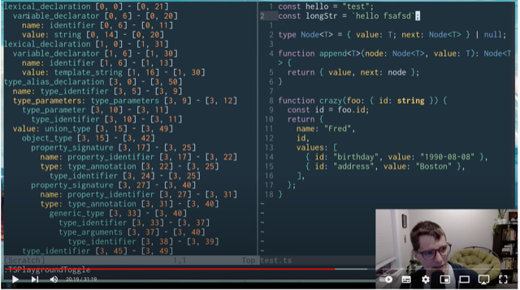
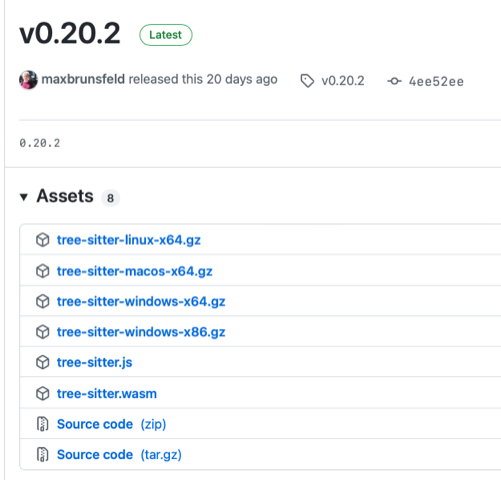

# Todo: Consider to check out the Tree-Sitter incremental language parser for IDE syntax highlighting support?

```#87f3e0c1``` *As of 2022-01-21 13:50*

[mail plain/text](mail.txt)


I want ways to experiment with parsing C++ for tooling and possibly extension with Tha.

==&gt; Also see "Todo: Consider to try out Neovim with the Tree-sitter playground and syntax highlighting?"

1) Consider this youtube video "Tree-sitter - a new parsing system for programming tools by Max Brunsfeld" about the Tree-Sitter goal and inner workings (<https://youtu.be/Jes3bD6P0To> )?

2) It seems there is a Tree-sitter plugin for Neovim as shown in this youtube video "Tree-sitter for Dummies" (<https://youtu.be/oSrXK8ovBfQ?t=1219> )?

>   
> *Example of Tree-Sitter playground used inside Neovim that shows the AST of the parsed file*

3) It seems the Tre-Sitter multi-language parser is opens source and lives here on Github (<https://github.com/tree-sitter/tree-sitter> )?

> Tree-sitter is a parser generator tool and an incremental parsing library. It can build a concrete syntax tree for a source file and efficiently update the syntax tree as the source file is edited. Tree-sitter aims to be:

- General enough to parse any programming language
- Fast enough to parse on every keystroke in a text editor
- Robust enough to provide useful results even in the presence of syntax errors
- Dependency-free so that the runtime library (which is written in pure C) can be embedded in any application


4) Consider to play with the Tree-Sitter command line tool (<https://github.com/tree-sitter/tree-sitter/blob/master/cli/README.md> )?

==&gt; It seems I can install the Tree-sitter command line tool as a Rust "cargo" or as an npm package?

> ### Installation

> You can install the `tree-sitter-cli` with `cargo`:

  
> ```
> cargo install tree-sitter-cli
> ```

> or with `npm`:

  
> ```
> npm install tree-sitter-cli
> ```

  
==&gt; It seems tree-sitter is also available as a binary download for selected frameworks and OS:es (<https://github.com/tree-sitter/tree-sitter/releases/tag/v0.20.2> )?

> 

...


