# Todo: Consider to use words from other languages to find names for C++ Open Source Libraries?

```#8896049f``` *As of 2016-08-03 14:38*

[mail plain/text](mail.txt)


Could it be a good idea to find words in other languages when searching for good names of new C++ open source libraries?

1) Consider to use words from some african language?

==&gt; This seem to be a good wikipedia page ranking the languages spoken in Africa (<https://en.wikipedia.org/wiki/Languages_of_Africa>)?

==&gt; These seem to be candidate languages that are of original african origin?

> > Language Family Native speakers (L1) Official status per country
- **Arabic** Afro-Asiatic 150,000,000 &#91;18&#93; but with separate unintelligible varieties 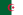 Algeria, 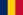 Chad, 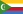 Comoros, 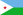 Djibouti, 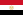 Egypt, 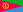 Eritrea, 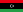 Libya, 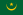 Mauritania,  Morocco,  Somalia, 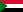 Sudan,  Tunisia
- Hausa Afro-Asiatic 34,000,000 &#91;20&#93;
- **Yoruba** Niger–Congo 28,000,000 &#91;16&#93;
- Oromo Afro-Asiatic 26,000,000 &#91;16&#93; 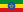 Ethiopia
- Fulani Niger–Congo 25,000,000 &#91;16&#93;
- Amharic Afro-Asiatic 22,000,000 &#91;17&#93;  Ethiopia
- **Igbo** Niger–Congo 18,000,000 &#91;21&#93;
- Malagasy Austronesian 18,000,000 &#91;23&#93; 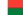 Madagascar
- Somali Afro-Asiatic 16,600,000 &#91;29&#93;  Somalia
- **Swahili** Niger–Congo 15,000,000 &#91;30&#93; official in 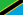 Tanzania,  Kenya, 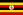 Uganda, national language of 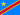 Democratic Republic of Congo
- Shona Niger–Congo 14,200,000 incl. Manyika, Ndau (2000–2006)&#91;28&#93; 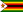 Zimbabwe
- Shilha Afro-Asiatic 14,000,000 (estimated) &#91;27&#93;
- Portuguese Indo-European 13,700,000 (estimated) &#91;25&#93; 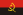 Angola, 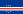 Cape Verde, 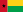 Guinea-Bissau, 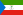 Equatorial Guinea, 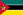 Mozambique, 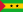 São Tomé and Príncipe
- Chewa Niger–Congo 11,500,000 &#91;16&#93; 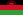 Malawi,  Zimbabwe
- Akan Niger–Congo 11,000,000 &#91;16&#93; None. Government sponsored language of 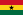 Ghana
- Zulu Niger–Congo 10,400,000 &#91;16&#93; 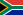 South Africa
- Kinyarwanda Niger–Congo 9,800,000 &#91;16&#93; 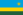 Rwanda
- Kirundi Niger–Congo 8,800,000 &#91;16&#93;  Burundi
- Mõõré Niger–Congo 7,600,000 &#91;16&#93; Recognised regional language in 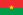 Burkina Faso
- Xhosa Niger–Congo 7,600,000 &#91;16&#93;  South Africa,  Zimbabwe
- Afrikaans Indo-European 7,200,000 &#91;15&#93;  South Africa
- Tigrinya Afro-Asiatic 7,000,000 &#91;31&#93;  Eritrea
- Gikuyu Niger–Congo 6,600,000 &#91;19&#93;
- Tshiluba Niger–Congo 6,300,000 (1991) &#91;32&#93; national language of  Democratic Republic of the Congo
- Umbundu Niger–Congo 6,000,000 &#91;33&#93; recognised national language of  Angola
- Kongo Niger–Congo 5,600,000 &#91;22&#93; recognised national language of  Angola
- Sesotho Niger–Congo 5,600,000 &#91;26&#93; 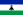 Lesotho,  South Africa,  Zimbabwe
- Lingala Niger–Congo 5,500,000 &#91;16&#93; national language of  Democratic Republic of the Congo
- Northern Sotho Niger–Congo 4,600,000 &#91;24&#93;  South Africa
- Berber Afro-Asiatic   Morocco
- English Indo-European  see List of territorial entities where English is an official language
- French Indo-European  see List of territorial entities where French is an official language

2) Consider good online dictionaries to find words in other languages?

==&gt; Consider google translate (<https://translate.google.com>)?

==&gt; NOTE: One gets the output in the script of the language!

==&gt; Consider to translate ”Hello” into other languages?

Arabic:  مرحبا (Script: Arabic, Script Type: Abjad (<http://www.ontopia.net/i18n/script.jsp?id=458>) )

Yoruba:  Pẹlẹ o (Sript: ??, Script Type: ?? ())

Igbo: Nnọọ (Sript: ??, Script Type: ?? ())

Swahili: Habari (Sript: ??, Script Type: ?? ())

==&gt; This seem to be the languages Google Translate know of?


3) Consider what scripts there exists in the world and ways of representing them in western script (i.e. english for use in C++)?

==&gt; This seem like a good page on scripts and their mappings to languages and countries (<http://www.ontopia.net/i18n/scripts.jsp>)?

==&gt; This seem to be information about Arabic scripts (<http://www.ontopia.net/i18n/script.jsp?id=458>)?

==&gt; BBC seem to have web-sites in Arabic scripts (<http://www.bbc.com/arabic>)?

==&gt; This seem like a good start for listing script types (<http://www.ontopia.net/i18n/script-types.jsp>)?

> > ”  
> > Scripts work in many different ways: some use one symbol per letter, others use one symbol per syllable, and some use one symbol per word. Below you can find descriptions of the different types of scripts, and see what scripts belong to each type.

> > **Abjad**

> > A type of writing system where only consonants are generally written. Some abjads have signs for vowels, but use them only in special cases, such as loanwords or special kinds of texts. The name itself comes from the first three letters of the Arabic script.

> > There are 30 instances: Arabic script, Aramaic script, Berber script, Classical syriac, Early Sogdian, Early cursive Pahlavi, Edessan script, Elymaic script, Hatran script, Hebrew, Hebrew linear, Himyarite, Kök Turki runes, Mandaic script, Manichaean, Nabatean script, Northern Linear, Old North Arabic scripts, Pahlavi, Palmyran script, Parthian, Phoenician script, Psalter script, Punic script, Samaritan script, Sogdian, Southern Linear, Tifinagh, Ugaritic, Uighur.

> > **Abugida**

> > A type of writing system in which each character represents a consonant followed by a specific vowel, and the other vowels are represented by a consistent modification of the consonant symbols.

> > There are 55 instances: Alibata, Amharic script, Bangla, Batak, Brahmi, Buhid, Burmese script, Calukya, Cham, Champa, Cree, Devanagari, Dives akuru, Evela, Grantha, Gujarati, Gupta, Gurmukhi, Javanese, Kadamba, Kaganga, Kaithi, Kalinga, Kannada, Kharoshthi, Khmer script, Landa, Lanna script, Lao script, Liek, Lontara, Malayalam script, Mangyan, Meroitic, Mon script, Nagari, Old Javanese, Old kannada, Oriya script, Oromo script, Pallava grantha, 'Phags pa, Proto-bengali, Ranjana, Rong, Sharada, Siddham, Sinhalese, Sukhothai, Syloti Nagri, Tagbanwa, Tamil script, Telugu script, Thai script, Tibetan script.

> > **Alphabet**

> > A type of writing system that denotes consonants and vowels with separate characters.

> > There are 44 instances: Avestan, Aybuben, Beitha Kukju, Beithe-luis-nin, Buryat, Carian, Cirth, Coptic script, Cyrillic, Dania, Deseret, Elbasan, Etruscan script, Ewellic, Geyinzi, Glagolithic, Gothic script, Greek, Hungarian runes, Kutxovani, Latin script, Lycian, Lydian, Manchu, Mkhedruli, Modern syriac, Mongolian clear script, Mongolian script, Mrglovani, N'ko, Ol, Osmanya, Quikscript, Runic, Sarati, Shaw alphabet, Sidetic, Sorang Sompeng, Tai Lue, Thaana, Theban alphabet, Utopian, Varang Kshiti, Wawa writing.

> > **Featural**

> > A type of writing system where the shape of each character has a systematic relation to the phonetic features of its sound value.

> > There are 4 instances: Camion code, Hangul, Tengwar, Visible Speech.

> > Logosyllabary

> > A type of writing system whose characters denote morphemes, and a subset of whose characters can be used for their phonetic syllabic values without regard to their semantic values.

> > There are 22 instances: Chinese script, Chu-nôm, Cretan hieroglyhpic, Cypro-minoan, Egyptian demotic, Egyptian hieratic, Egyptian hieroglyphic, Elamite cuneiform, Hittite hieroglyphics, Indus script, Jurchin script, Kitan large script, Kitan small script, Linear A, Linear B, Maya hieroglyphs, Nushu, Proto-Elamite, Proto-cuneiform, Sumero-akkadian cuneiform, Xi Xia, Yi.

> > **Syllabary**

> > A type of writing system whose characters denote syllables, with no deliberate graphic similarity between characters denoting phonetically similar syllables.

> > There are 18 instances: Bamum script, Caroline Islands script, type 1, Caroline Islands script, type 2, Cherokee script, Chu Yin, Cypriote syllabary, Eskaya, Hiragana, Jindai Moji, Katakana, Man'yoogana, Mende Kikakui, Ndjuka script, Northeast Iberian, Old Elamite, Old Persian, South Iberian, Vai.

> > **Unclassified**

> > I haven't been able to classify all the scripts on this site yet, and below are listed the ones that have no classification yet. If you can suggest classifications for some of these I would be happy to hear it. Note that some of these, like Rongorongo, are unclassified because nobody knows how they work yet, and so nobody has enough information to classify them properly.

> > There are 8 unclassifieds: Alaska script, Byblos syllabary, Duployé shorthand, Fraser script, Miao, Pitt's shorthand, Pollard script, Rongorongo

> > "

4) Consider ways to ”romanize” (represent in western script) words in other scripting languages?

==&gt; Consider this page about romanization of Arabic script (<http://www.loc.gov/catdir/cpso/romanization/arabic.pdf>)?

…

Consider to elaborate on this idea to use words from cool languages to find names for C++ open source libraries?

...


