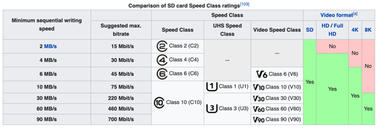
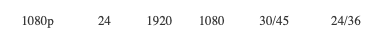
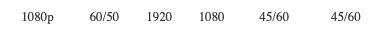
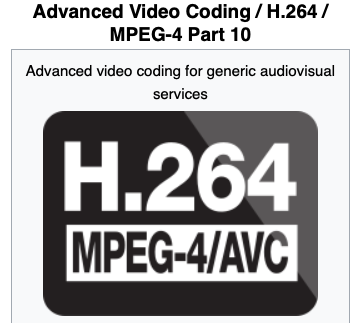

# Todo: Consider SD cards for GoPro Hero 8 Black and DJI Osmo Pocket?

```#891fde0b``` *As of 2022-08-11 11:24*

[mail plain/text](mail.txt)


I want to understand what SD cards I need for my GoPro Hero 8 Black and DJI Osmo Pocket.

1) The Gopro Hero 8 Black seems to require Micro SD Card C10 or UHS-I U1 (10 MB / s capacity)?

2) The DJI Osmo Pocket seems to require Micro SD UHS-I U3 or V30 (30 MB / s capacity)?

3) Consider brands and models to buy for my GoPro Hero 8 Black and DJI Osmo Pocket?

==&gt; Consider 2 x 32 GB C10 and 2 x U3 or V30?

> *Buying the "lower" rating SD cards for the Hero 8 will enable me to try them in the Osmo Pocket to see if they actually has sufficient performance for my use cases (1080 60 fps)?*

==&gt; Consider 4 x 32 GB U3 or V30?

4) Consider to investigate if these Micro SD-cards can be used in my Canon D60 that now has 16 GB full size SDHC C10 cards?

5) Consider the wikipedia article on SD cards (<https://en.wikipedia.org/wiki/SD_card> )?



6) Consider the bit or byte rate for recording in different resolution and frame rates using the encodings used by Hero 8 and Osmo Pocket?

> *The data we are looking for here is the actual data transfer rate required by the camera to write to the SD card for different resolutions and frame rates?*

> *let's look at the Hero 8 1080 movie (24 fps) and double (60 fps) video modes*

> 

>   
> 

> *This would suggest the camera requires an SD card with 30 to 45 Mbit / s or 3 to 4,5 MB / s writing speed capacity for 1080 between 24 fps to 60 fps?*

> *The cheapest SD card will do!*

> *...*

==&gt; These seems to be a comprehensive losting of all the video modes and corresponding bit rates of the Hero 8 (<https://community.gopro.com/s/article/HERO8-Black-Video-Resolutions?language=en_US> )?

> HERO8 Black Video Settings and Resolutions (16:9)  
> ResolutionFPSWidthHeightH.264  
> Bitrate  
> Low/HighH.265  
> Bitrate  
> Low/HighDigital Lens OptionsZoomAuto Low Light?4k60/5038402160NA60/100Wide, LinearNAYes4k30/253840216060/10045/100Wide, Superview, LinearNANo4k 243840216060/10045/100Wide, Superview, LinearNANo2.7k120/10027041520NA60/100WideNANo2.7k60/502704152060/10045/100Wide, Superview, Linear, NarrowWide, LinearYes2.7k30/252704152030/10045/100Wide, Superview, Linear, NarrowWide, LinearNo2.7k242704152030/10045/100Wide, Superview, Linear, NarrowWide, LinearNo1080p240/20019201080NA60/78WideNoNo1080p120/1001920108060/7845/60Wide, Superview, Linear, NarrowWide, LinearNo1080p60/501920108045/6045/60Wide, Superview, Linear, NarrowWide, LinearYes1080p30/251920108030/4524/36Wide, Superview, Linear, NarrowWide, LinearNo1080p241920108030/4524/36Wide, Superview, Linear, NarrowWide, LinearNo  
> HERO8 Black Video Settings and Resolutions (4:3)  
> ResolutionFPSWidthHeighH.264 Bitrate  
> Low/HighH.265 Bitrate  
> Low/HighDigital Lens OptionsZoomAuto Low Light?4k30/2540003000NA60/100Wide, LinearNANo4k2440003000NA60/100Wide, LinearNANo2.7k60/5027042028NA60/100WideWideYes2.7k30/252704202860/10045/100Wide, Linear, NarrowWide, LinearNo2.7k242704202860/10045/100Wide, Linear, NarrowWide, LinearNo1440p120/10019201440NA60/78WideNANo1440p60/501920144060/7845/60Wide, Linear, NarrowWide, LinearYes1440p30/251920144030/4524/36Wide, Linear, NarrowWide, LinearNo1440p241920144030/4524/36Wide, Linear, NarrowWide, LinearNo

> Looping Mode:  
> \*\*\*Looping Mode is only available when making a Custom Preset in Video Mode. Begin the Custom Preset and select Mode. This will give you the Looping Mode option.  
> ResolutionFPSDigital Lens OptionsZoomAuto LowLightIntervals  
> (minutes)H.264 BitrateH.265 Bitrate4k30/25SuperView, Wide, LinearNANo5, 20, 60, 12055.5451440p60/50Wide, LinearWide, LinearYesMAX, 5, 20, 60, 12055.5451080p120/100SuperView, Wide, LinearWide, LinearNo5, 20, 60, 12055.5451080p60/50SuperView, Wide, LinearWide, LinearYesMAX, 5, 20, 60, 1203024

==&gt; It seems the DJI manual lists the video modes (<https://www.dji.com/se/osmo-pocket/info> )?

> Video Formats MP4 / MOV (MPEG-4 AVC / H.264)

> 4K Ultra HD: 3840×2160 24/25/30/48/50/60fps

> 2.7K: 2720x1530 24/25/30/48/50/60 fps

> FHD: 1920×1080 24/25/30/48/50/60/120fps

7) It seems MPEG-4 AVC and H.264 are related and even in some sense the same encoding (<https://en.wikipedia.org/wiki/Advanced_Video_Coding> )?

> *"Advanced Video Coding (AVC), also referred to as H.264 or MPEG-4 Part 10"*

> 

...


