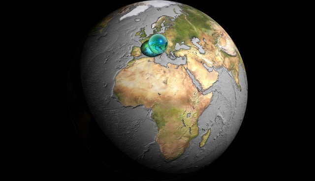
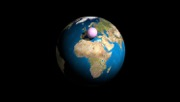
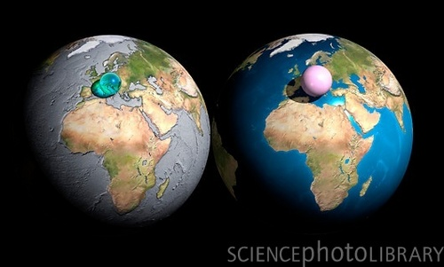

# Todo: Consider to delve into the visualizations made by Adam Nieman (Carbon Visuals), e.g. the "All water on earth into a ball" image?

```#89430cbd``` *As of 2016-06-08 13:54*

[mail plain/text](mail.txt)


Watching BBC QI Series C, episode 7 ”Constellations” (<http://www.bbc.co.uk/programmes/b0074rtk>) they showed an illustration of All water and all Air as a ball compared to earth itself.

1) The Qi episode talks about this at about 6:20 into (<https://www.youtube.com/watch?v=taAV9qcmK1k>)

2) The images seem to have been made by Adam Nieman and he seems to be working at Carbin Visuals (<http://www.carbonvisuals.com/blog/carbon-visuals-wins-trophy-at-information-is-beautiful-awards?rq=Adam%20Nieman>)?

3) The image of all water seem to be available here (<http://www.carbonvisuals.com/homepage-gallery/fihe3ja1j0y2brb4b58vyyv55cicxm>)



4) The image of a ball of all air compared to the earth seems to be available here (<http://www.carbonvisuals.com/blog/look-at-the-earth>)



5) There seem to be a lot of re-makes and alternatives on this theme on the web by searching on ”All water on earth as a ball”

==&gt; <http://www.whoi.edu/cms/images/EarthWater-3spheres-1_286095.jpg>

==&gt; <http://refugioantiaereo.com/wp-content/uploads/2008/03/todo-agua-aire-tierra2.jpg>



…

Consider to use these illustrations for future publications arguing about a better society, Shared Planet and stuff like that?

...


