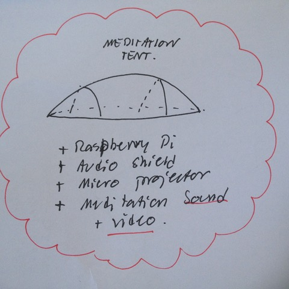

# Todo: Meditation Tent - Consider to make make a meditation tent with a micro-projector and raspberry Pi to fill tent with meditation audio and video?

```#89a8e121``` *As of 2018-07-01 16:04*

[mail plain/text](mail.txt)


Consider we can make a mediation tent from bamboo sticks and canvas with a raspberry Pi audio and video projector to fill tent with mediation meditation audio and video?

1) Consider how to best design the meditation tent?

==&gt; Consider to design the tent from bamboo sticks and white canvas?



==&gt; Consider to use the “Mick Makes” micro projector shield?

==&gt; Consider to use some Pi audio shield to play OGG or WAV files?

==&gt; Consider how to enable the raspberry pi to play video from SD card?

==&gt; Consider to attach some self-powered audio speakers to get good sound?

…

…

2) Consider to compose my own Audio for mediation using OSASYS 88?

…

3) Consider ways to produce mediation video?

==&gt; Consider some way of making a video with slowly moving colours?

==&gt; Consider to compose with FCPX free-to-use backgrounds of slowly moving colours and patterns?

…

4) Consider to start of with composing meditation Audio and Video using OASYS 88 and FCPX and then play it on my existing projector?

**TODO: Make a FCPX video using available backgrounds and OSASYS 88 to get a meditative video and audio to try out?**

...

…

Consider to delve into this idea of creating a meditation tent to fill with meditative audio and video?


