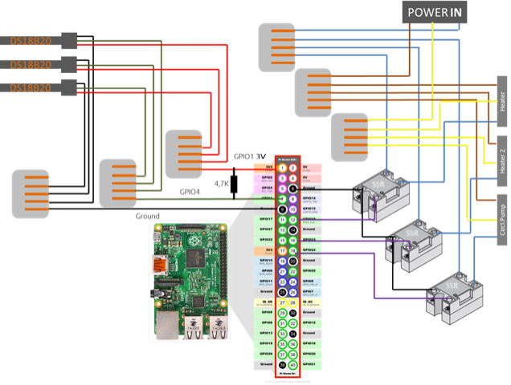
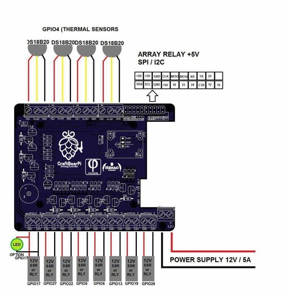
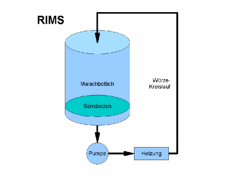
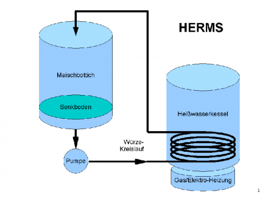

# Todo: Consider to check out DIY beer brewing automation with Raspberry Pi based CraftbeerPi

```#8a77788a``` *As of 2019-04-21 12:15*

[mail plain/text](mail.txt)


I stumbled on a reference to CraftbeerPi in an Andreas Spiess video and thought it could be fun to check out?

1) It seem CraftbeerPi lives here (<http://web.craftbeerpi.com> )?

==&gt; It seems one can DIY a wiring with solid state relays or use the CraftBeerPi extension shield (<http://web.craftbeerpi.com/hardware/> )?



*Wiring with GPIO and Solid State Relay DS18B20 Temperature Sensors*



*The CraftBeerPi Extension Board*

2) It seems the Craftbeerpi software is open spource and available on Github here (<https://github.com/manuel83/craftbeerpi> )?

3) Consider to understand some acronyms used in DIY bear brewing?

==&gt; Consider this article explaining RIMS and HERMS (<https://beerandbrewing.com/rims-herms/> )?

> *"**In a Recirculating Infusion Mash System (RIMS), wort is pumped from the base of the mash lauter tun (MLT) through a heater and returned to the same vessel near the top. Recirculating the wort in this way promotes clarity by filtering wort through the grain bed during the mash. It also helps maintain an even temperature throughout the mash and permits brewers to raise the mash temperature easily when necessary.**"*

> *"**A Heat Exchange Recirculating Mash System (HERMS) is very similar in theory to the RIMS setup described above. The difference lies in the way wort is heated after it leaves the MLT. While a RIMS system relies on direct heat, a HERMS system takes advantage of the hot water contained within the hot liquor tank (HLT) that will eventually be used for sparging. Wort passes through a coil of metal tubing, usually copper, that is within the HLT. As wort flows through the coil, heat is transferred from the hot water, through the metal tubing, and into the wort. In all other aspects, HERMS is the same as RIMS and achieves the same goals.**"*

==&gt; Consider this model of a RIMS, Recirculation Infusion Mash System (<https://hobbybrauer.de/forum/wiki/lib/exe/fetch.php/diagramme-zeichnungen-tabellen:800px-rims.gif.png?w=500&tok=00a880> )?



[*https://hobbybrauer.de/forum/wiki/lib/exe/fetch.php/diagramme-zeichnungen-tabellen:800px-rims.gif.png?w=500&tok=00a880](https://hobbybrauer.de/forum/wiki/lib/exe/fetch.php/diagramme-zeichnungen-tabellen:800px-rims.gif.png?w=500&tok=00a880) *

==&gt; It seems in a Recirculation Infusion Mash System the water is directly heated (as opposed to the Heat Exchange ReCirculation Mash System where heating is indirect)?

==&gt; Consider this model of a HERMS, Heat Exchange ReCirculation Mash System (<https://hobbybrauer.de/forum/wiki/lib/exe/fetch.php/diagramme-zeichnungen-tabellen:800px-herms.gif.png?w=450&tok=9bedb9> )



[*https://hobbybrauer.de/forum/wiki/lib/exe/fetch.php/diagramme-zeichnungen-tabellen:800px-herms.gif.png?w=450&tok=9bedb9](https://hobbybrauer.de/forum/wiki/lib/exe/fetch.php/diagramme-zeichnungen-tabellen:800px-herms.gif.png?w=450&tok=9bedb9) *

==&gt; It seems in a Heat Exchange ReCirculation Mash System the water is indirectly heated by heat exchange with a separate heated water volume?

==&gt; Consider in a Heat Exchange ReCirculation Mash System the heating is much more subtle and less prone to involuntary over-heating of the

3) Consider this youtube video "Pressure Monitoring incl. Fusion360 Tricks" (<https://www.youtube.com/watch?v=gi1WKhnM4nw> )?

...

4) Consider the available solutions for home beer brewing is till just too complicated and too manual?

> *I just can't help but feel that how home brewing is done by my friend Pär Moritz and what I have seen on forums and youtube videos are just - too manual, complicated, over engineered and plain messy. There seems to be room for massive improvement in making home brewing of beer much more press-a-button and get-bottled-bair process? All you have to do is to replace all the manual steps of operating the ingredients with some automated ones. You put the ingredients and water in compartments and the machine does the rest.*

> *Consider we would even like the dishing and clean-up to be automated? **How hard can it bee?***

...


