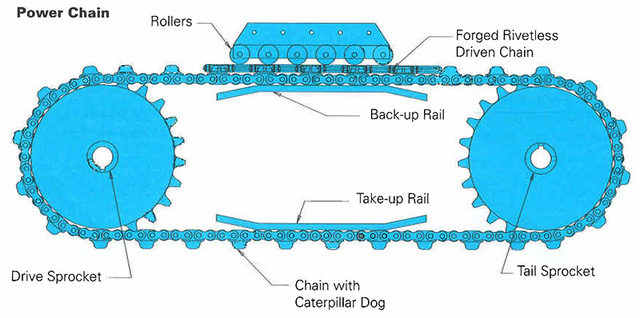
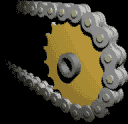

# Todo: DIY Power Feeder - Consider a caterpillar drive using available drive chains and sprockets for e.g., bicycles or robots or RC model?

```#8b376ef3``` *As of 2018-12-16 20:28*

[mail plain/text](mail.txt)


When I saw the drive chains of a caterpillar drive the idea struck we may “simply” use an ordinary bicycle chain and sprockets with “drive dogs” to wrap some rubber drive bel or rubber dogs to grab onto the fed wood?

==&gt; Also see “[Todo: Power Feeder - Consider to design a Power Feeder using an RC Tank chassis and motor?](../e143fe14/chime.md)”

==&gt; Also see “[Todo: Table Saw Power Feeder - Consider to design a Power Feeder from self balancing electric skateboard or cycle wheel?](../ec2c8971/chime.md)"

==&gt; Also see “[Todo: Table Saw Power Feeder - Consider to design a Power Feeder from Conrad web-shop parts?](../9001ef5d/chime.md)"

==&gt; Also see “[Todo: Table Saw Power Feeder + Table Saw Rip Fence - Consider Adafruit CNC and Robot parts?](../4cabff46/chime.md)"

==&gt; Also see “[Todo: Table Saw Power Feeder - Consider to design a Power Feeder from CNC parts (from Accu web shop)?](../872a6397/chime.md)"

==&gt; Also see “[Todo: Table Saw Power Feeder - Consider to design a Power Feeder from CNC parts (from ratRig provider)?](../65915dfb/chime.md)"

==&gt; Also see “[Todo: DIY - Consider to build a power feeder for my table saw module?](../10c92e8a/chime.md)”

1) Consider this site for a vendor of caterpillar drive chains ([https://chains.ustsubaki.com/item/roller-conveyo](https://chains.ustsubaki.com/item/roller-conveyor-chains/caterpillar-drive-chains-4/160-348-2)[r-chains/caterpillar-drive-chains-4/160-348-2](https://chains.ustsubaki.com/item/roller-conveyor-chains/caterpillar-drive-chains-4/160-348-2))?



Image from <https://www.ustsubaki.com/index.html> site.

…

2) Consider wikipedia article on Sprocket (<https://en.wikipedia.org/wiki/Sprocket>)?



3) Consider products from Robotshop (<https://www.robotshop.com/en/gears-belts-pulleys-tracks-sprockets-chains.html>)?


4) Consider we can use a bicycle chain and some suitable attached “drive dogs” to create a “caterpillar like” drive belt for a table saw power feeder?

==&gt; It seems the problem of using Bicycle sprockets is that it will be hard to get enough reduction of the motor rotation to the feeding wheel (bicycle normally gear up, not down)?

==&gt; Consider to use 22T bicycle chain drive sprocket like this one (<https://www.cykelkraft.se/kedjedrev-22t-fc-m532-64mm-silver-9vxl>)?


==&gt; Consider to use 14T back wheel sprocket like this one (<https://www.cykelkraft.se/bakdrev-nav-14-tander-rakt-torpedosram>)?


NOTE: back wheel sprockets dos NOT have fastening holes?!

…

…

Consider to delve deeper into this idea of a caterpillar drive as a power feeder for my table saw?


