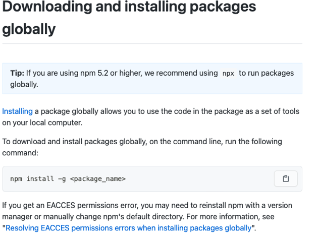

# Todo: Consider to explore Exercism v3 to learn new porgramming languages or mentor others to learn (engage in community)?

```#8b79a8b4``` *As of 2022-01-23 16:43*

[mail plain/text](mail.txt)


Exercism seems like a good community and tools to enange in learning how to program and now v3 is out and is potentially even better?

==&gt; Also see "[Todo: Programming - Consider to try out <http://exercism.io/languages/cpp>](../c4f0f1ae/chime.md)"

1) Exercism seems to live here (<https://exercism.org/dashboard> )?

==&gt; It seems almost 900 000 have joined Exercism (and I joined 1 sep 2021)?

> 

2) Consider to try out the local CLI version of Exercism (<https://exercism.org/docs/using/solving-exercises/working-locally> )?

==&gt; It seems I configure my Exercism CLI to access the "web-page / cloud" by providing my account token (token truncated in my log below)?

> kjell-olovhogdal@Kjell-Olovs-Mac-Pro chapter_2 % exercism configure --token=c91ea373-8527...

> You have configured the Exercism command-line client:

> Config dir: /Users/kjell-olovhogdal/.config/exercism  
> Token: (-t, --token) c91ea373-...  
> Workspace: (-w, --workspace) /Users/kjell-olovhogdal/Exercism  
> API Base URL: (-a, --api) <https://api.exercism.io/v1>

> kjell-olovhogdal@Kjell-Olovs-Mac-Pro chapter_2 %

3) It seems Exercism uses macOS local path &lt;User account folder&gt;/Exercism/&lt;track&gt;/&lt;exersice&gt; for the CLI version?

> kjell-olovhogdal@Kjell-Olovs-Mac-Pro chapter_2 % exercism download --exercise=hello-world --track=cpp

> Downloaded to  
> /Users/kjell-olovhogdal/Exercism/cpp/hello-world  
> kjell-olovhogdal@Kjell-Olovs-Mac-Pro chapter_2 %

==&gt; It seems a C++ exercise in Exercism is based on CMake build and Catch2 testing?

> kjell-olovhogdal@Kjell-Olovs-Mac-Pro hello-world % pwd  
> /Users/kjell-olovhogdal/Exercism/cpp/hello-world  
> kjell-olovhogdal@Kjell-Olovs-Mac-Pro hello-world % tree  
> .  
> ├── CMakeLists.txt  
> ├── HELP.md  
> ├── README.md  
> ├── hello_world.cpp  
> ├── hello_world.h  
> ├── hello_world_test.cpp  
> └── test  
> ├── catch.hpp  
> └── tests-main.cpp

> 1 directory, 8 files  
> kjell-olovhogdal@Kjell-Olovs-Mac-Pro hello-world %

==&gt; It seems the suggested procedure to solve exercises in C++ is based on cmake -G to get a build tool chain and then edit and build until the test passes (<https://exercism.org/docs/tracks/cpp/tests> )?

> kjell-olovhogdal@Kjell-Olovs-Mac-Pro hello-world % pwd  
> /Users/kjell-olovhogdal/Exercism/cpp/hello-world  
> kjell-olovhogdal@Kjell-Olovs-Mac-Pro hello-world % cat HELP.md  
> # Help

> ## Running the tests

> ...

> &#91;0&#93; \`**cmake -G**\` and then using the build command

> ...

> ## Passing the Tests

> ...

> following the &#91;three rules of test-driven development&#93;(<http://butunclebob.com/ArticleS.UncleBob.TheThreeRulesOfTdd>).

> ...

> &#91;iter&#93; get the test to pass.  
> ...

> &#91;iter + 1&#93; uncomment the next test by moving the following line past the next test.

> \`\`\`C++  
> #if defined(EXERCISM_RUN_ALL_TESTS)  
> \`\`\`  
> ...

> kjell-olovhogdal@Kjell-Olovs-Mac-Pro hello-world %

==&gt; It seems for Elm exersices there is this instruction on the Exercism we (<https://exercism.org/docs/tracks/elm/installation> )?

> npm install --global elm-test@latest-0.19.1  
> npm install --global elm-format@latest-0.19.1

==&gt; It seems we install npm packages globally to have them work for ALL elm exersices (<https://docs.npmjs.com/downloading-and-installing-packages-globally> )?

> 

==&gt; But they seem to refer to the official Elm home on the web (<https://guide.elm-lang.org/install/elm.html> )?

==&gt; And they seem to refer to the npm home for the elm-test package (<https://www.npmjs.com/package/elm-test> )?

==&gt; It seems I can install elm using Brew?

> kjell-olovhogdal@Kjell-Olovs-Mac-Pro hello-world % brew install elm  
> Running \`brew update --preinstall\`...  
> ==&gt; **Downloading <https://ghcr.io/v2/homebrew/core/elm/manifests/0.19.1-2>**  
> ######################################################################## 100.0%  
> ==&gt; **Downloading <https://ghcr.io/v2/homebrew/core/elm/blobs/sha256:fef837b97895efeb899730e1381953b637f34910dd9e94d8c0a60e1da00d4b32>**  
> ==&gt; **Downloading from <https://pkg-containers.githubusercontent.com/ghcr1/blobs/sha256:fef837b97895efeb899730e1381953b637f34910dd9e94d8c0a60e1da00d4b32?se=2022-01-23T15%3A25%3A00Z&sig=X3cetgnmQMq2KPANDy7UAnzVq%2Baa09K2k3wjWnZPXlg%3D&sp=r&spr=https&sr=b&sv=2019-12-12>**  
> ######################################################################## 100.0%  
> ==&gt; **Pouring elm--0.19.1.monterey.bottle.2.tar.gz**  
> Error: The \`brew link\` step did not complete successfully  
> The formula built, but is not symlinked into /usr/local  
> Could not symlink bin/elm  
> Target /usr/local/bin/elm  
> already exists. You may want to remove it:  
> rm '/usr/local/bin/elm'

> To force the link and overwrite all conflicting files:  
> brew link --overwrite elm

> To list all files that would be deleted:  
> brew link --overwrite --dry-run elm

> Possible conflicting files are:  
> /usr/local/bin/elm  
> ==&gt; **Summary**  
> 🍺 /usr/local/Cellar/elm/0.19.1: 5 files, 25.3MB  
> ==&gt; **Running \`brew cleanup elm\`...**  
> Disable this behaviour by setting HOMEBREW_NO_INSTALL_CLEANUP.  
> Hide these hints with HOMEBREW_NO_ENV_HINTS (see \`man brew\`).  
> Warning: Use python3.9 instead of deprecated freecad/freecad/python3.9  
> kjell-olovhogdal@Kjell-Olovs-Mac-Pro hello-world % brew link --overwrite elm  
> Linking /usr/local/Cellar/elm/0.19.1... 1 symlinks created.  
> kjell-olovhogdal@Kjell-Olovs-Mac-Pro hello-world % which elm  
> /usr/local/bin/elm  
> kjell-olovhogdal@Kjell-Olovs-Mac-Pro hello-world %

3) It seems Exercism can be installed with Brew on macOS (<https://exercism.org/cli-walkthrough> )?

> kjell-olovhogdal@Kjell-Olovs-Mac-Pro chapter_2 % **brew install exercism**  
> ==&gt; **Downloading <https://ghcr.io/v2/homebrew/core/exercism/manifests/3.0.13-2>**  
> ######################################################################## 100.0%  
> ==&gt; **Downloading <https://ghcr.io/v2/homebrew/core/exercism/blobs/sha256:1158f1a109a2cbe3c861950b009499df8a3dc52f5bd63b809d504cb7b3adcca1>**  
> ==&gt; **Downloading from <https://pkg-containers.githubusercontent.com/ghcr1/blobs/sha256:1158f1a109a2cbe3c861950b009499df8a3dc52f5bd63b809d504cb7b3adcca1?se=2022-01-23T14%3A25%3A00Z&sig=E2QNulnxTVJGzpn0STefzXgYD2Qt8mf2AzY0ELi89gI%3D&sp=r&spr=https&sr=b&sv=2019-12-12>**  
> ######################################################################## 100.0%  
> ==&gt; **Pouring exercism--3.0.13.monterey.bottle.2.tar.gz**  
> ==&gt; **Caveats**  
> zsh completions have been installed to:  
> /usr/local/share/zsh/site-functions  
> ==&gt; **Summary**  
> 🍺 /usr/local/Cellar/exercism/3.0.13: 9 files, 8.8MB  
> ==&gt; **Running \`brew cleanup exercism\`...**  
> Disable this behaviour by setting HOMEBREW_NO_INSTALL_CLEANUP.  
> Hide these hints with HOMEBREW_NO_ENV_HINTS (see \`man brew\`).  
> Warning: Use python3.9 instead of deprecated freecad/freecad/python3.9  
> kjell-olovhogdal@Kjell-Olovs-Mac-Pro chapter_2 %

4) Consider if I can integrate the exercises from Robert Sedgewick into Exercism?

> *The main idea here being if I can define new exercises in the "Exercism format" and add them as I go througn solving them myself in the book?*

...


