# Todo: Consider to document my investigation to find spare parts for my 90's vintage Marvil 521 Shimano drive train?

```#8b8288f0``` *As of 2023-03-16 18:48*

[mail plain/text](mail.txt)


My Marvil 521 drive train is in desperate need of service!

0) Consider to document teh information I require to find spare parts for those on my actual bike?

> Rear Derailleur: STX RD-MC36

1) I suspect I have the Shimano 105 Groupset mounted on the bike?

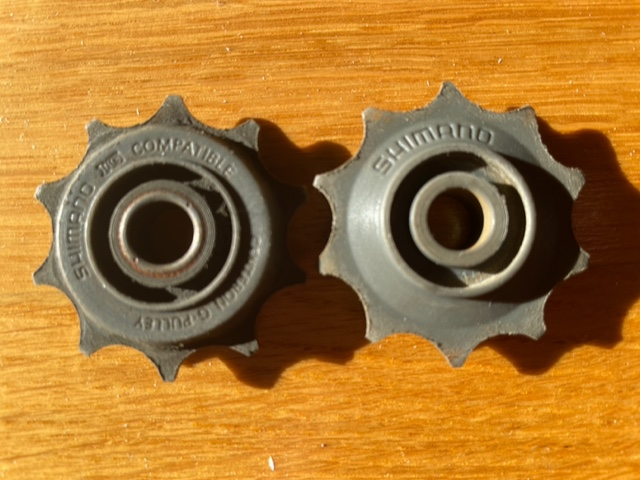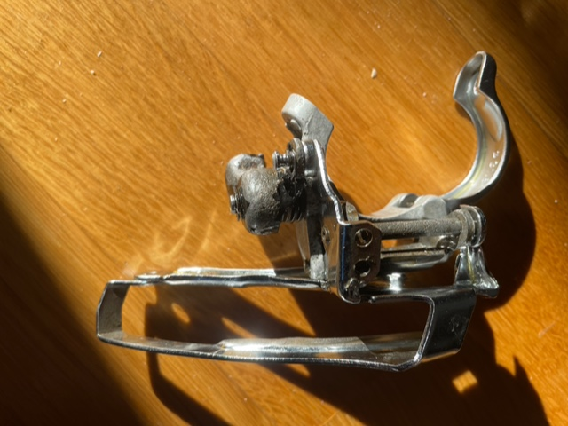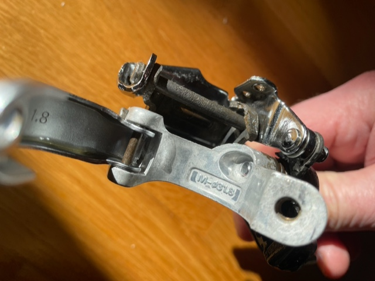

2) It seems my rear derailleur is marked Shimano STX RC RD-MC36?

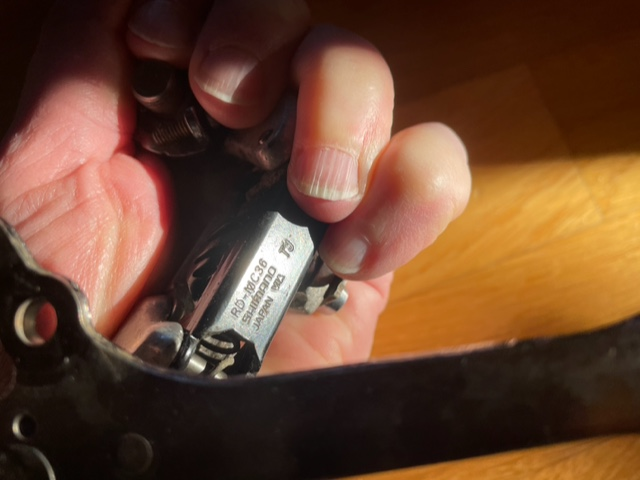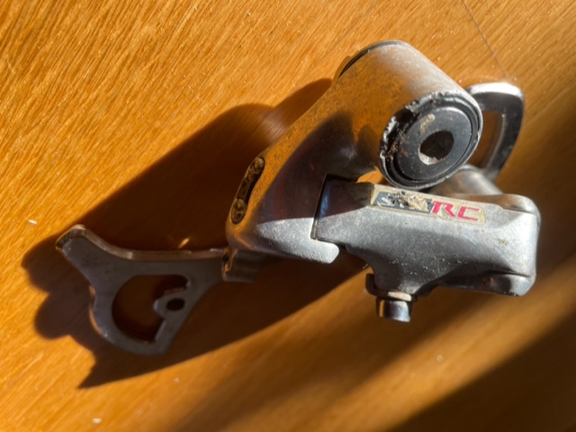

3) It seems I can find Shimano STX-RC components on [si.shimano.com](http://si.shimano.com/) ()?

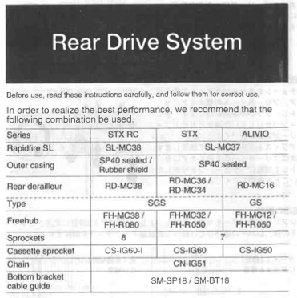

*From <https://si.shimano.com/en/pdfs/si/R420B/SI-R420B-000-00-ENG.pdf> *

==&gt; Maybe 7 speed shift lever is named SL-MC37 and goes together with RD-MC36 Rear Derailleur?

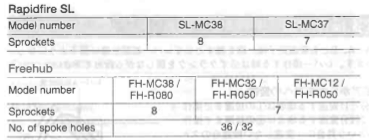

*From <https://si.shimano.com/en/pdfs/si/R420B/SI-R420B-000-00-ENG.pdf> *

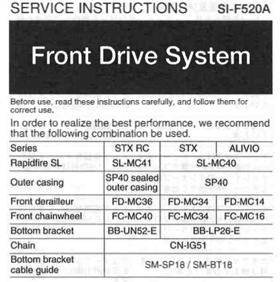

*From <https://si.shimano.com/en/pdfs/si/F520A/SI-F520A-000-00-ENG.pdf> *

==&gt; It seems I have the FC-MC34 42,32,22 teeth front chainwheel?

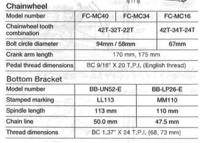

*From <https://si.shimano.com/en/pdfs/si/F520A/SI-F520A-000-00-ENG.pdf> *

==&gt; It seems my rear derailleur have 10 teeth?

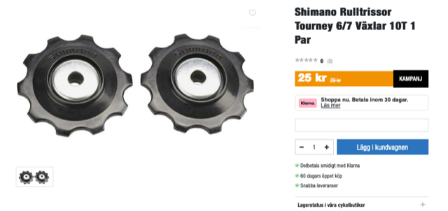

4) Consider a list of components to buy?

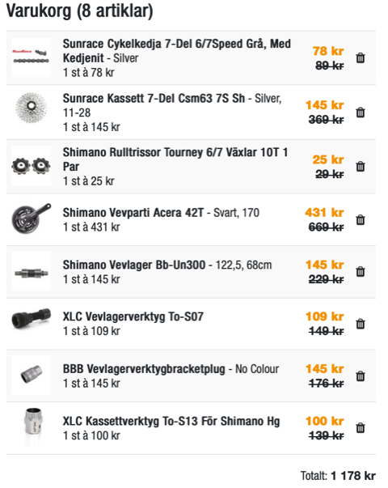


