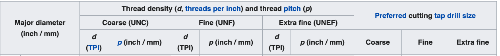
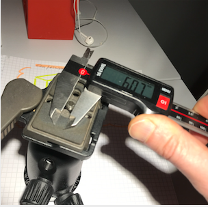
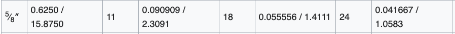
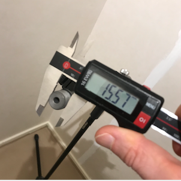
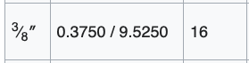
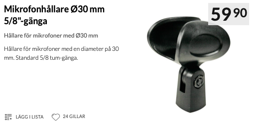
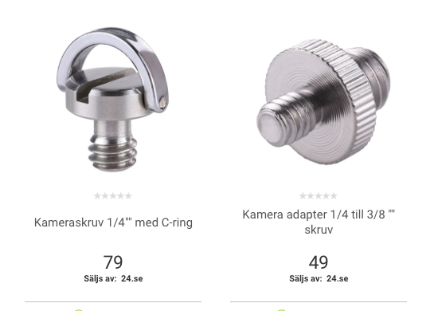

# Todo: Consider the threads and dimension of my Microphone Boom Stand and Camera mount screw hole are 5/8" 27 TPI and 1/4" 20 TPI  (With Manfrotto tripod head mount 3/8" 16 TPI) ?

```#8d0b368f``` *As of 2020-10-30 17:28*

[mail plain/text](mail.txt)


-1) Consider the Bottom Line conclusion of mount screw diameters and pitches?

> > • **⅝″ 27** threads per inch (tpi) Unified Special thread (UNS, U.S. and the rest of the world)  
> > • ½" 12 threads per inch (tpi) BSW used in older German and European stands  
> > • **⅜″ 16** threads per inch (tpi) BSW (uncommon in the U.S., used in the rest of the world)  
> > • **¼″ 20** threads per inch (tpi) BSW (uncommon in the U.S., used in the rest of the world)"

> *I conclude that:*

> *My Microphone Boom Stand has a **5/8" 27 TPI **thread mount?*

> *My Canon EDS60 camera mounts with an **1/4" 20 TPI **screw?*

> *My Manfrotto tripod uses a **3/8" 16 TPI **head mount screw?*

1) It seems the end of my Microphone Boom Stand is a "Standard" 5/8" 27 TPI male?

2) It seems the screw mount on my camera is a "standard" 1/4" 20 TPI male

3) Consider the wikipedia page "<https://en.wikipedia.org/wiki/Unified_Thread_Standard>" ()?

> 

>   
> My camera seems to mount with an imperial 1/4" (6,35mm) Coarse (UNC) with 20 TPI

> 

>   
> My Microphone Boom Stand seems to have a 5/8" (15,87 mm) thread with a 27 (!) TPI?

> 

> ==&gt; Also see "Microphone stand" (<https://en.wikipedia.org/wiki/Microphone_stand> )?

> > "The most basic microphone stand is a straight stand. It uses a dome-shaped round metal base, or a tripod base, into which is threaded a post for mounting the microphone (most commonly a 5/8-27 threaded hole). "

> > "Microphones typically attach to the stand via a detachable microphone holder screwed to the end of the boom. (Some microphones screw directly onto the boom.) Commonly used screw threads (from large to small) are:

> > • **⅝″ 27** threads per inch (tpi) Unified Special thread (UNS, U.S. and the rest of the world)  
> > • ½" 12 threads per inch (tpi) BSW used in older German and European stands  
> > • **⅜″ 16** threads per inch (tpi) BSW (uncommon in the U.S., used in the rest of the world)  
> > • **¼″ 20** threads per inch (tpi) BSW (uncommon in the U.S., used in the rest of the world)"

>   
> My Manfrotto tripod seems to have a 3/8" head mount?

> ==&gt; Also see Manfrotto tripod 190XPRO (<https://www.manfrotto.com/se-sv/190xpro-3-sektioners-alustativ-med-horisontell-mittpelare-mt190xpro3/> )?

> 

4) Consider Kjell&Co 5/8" Microphone mount (<https://www.kjell.com/se/produkter/ljud-bild/pa-ljud-underhallning/mikrofoner-tillbehor/mikrofonstativ-adaptrar/mikrofonhallare-o30-mm-58-ganga-p24152> )?

> 

5) Consider Elgiganten 1/4" camera fasteners and adapters (<https://www.elgiganten.se/product/foto-video/kameratillbehor/diverse-kameratillbehor/56913/kameraskruv-1-4-med-c-ring> )?

>   
> *Swedish Elgiganten seems to confirm that cameras mounts to a "standard" 1/4" screw*

...


