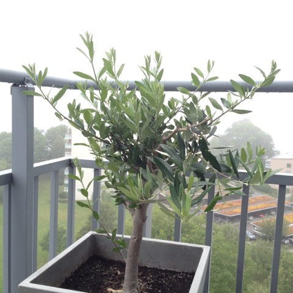

# Todo: Skriv om Olivträdets Sökande efter Sanning

```#8d4b1ea5``` *As of 2016-08-22 19:57*

[mail plain/text](mail.txt)




På min balkong växer ett olivträd i en kruka. När denna sommar började klippte jag ner det till baka några nakna grenar. Och under några få veckor har det trevande men med stor kraft växt till sig till sin nuvarande form. Saken är den att trädet har fått kämpa mot naturens krafter i form av perioder av hårda vindar. varje gång har några av de “modigaste” grenarna blåst av och bara de med “rätt” form och längd har överlevt. processen har varit intressant att följa. Borde jag ingripa? Borde jag själv ha klippt och skurit för att forma det på bössa sätt? Eller skulle jag låta den själv “komma fram till” vilken form den skall ha? Jag har valt det senare och resultat är intressant. Den har på egen hand “hittat” en ganska jäshög form med grenar och ganska likartad form och längd. Och en tanke har fötts i mig. Olivträdet “tänker” genom att göra ansatser och se hur de faller ut. Dess “vilja” att växa ut grenar och dess “slutsatser” i form av grenar som överlevt är ju en form av resonemang? Kanske inte ett medvetet resonemang som vi töeker oss det. Men ett resonemang baserat på en drift att handla-i-tillit till sin egen genetiska kod för hur grenar skall växa till. Och slutsatser i form av vad som visat sig vara en “sanning” om vilka grenar den kan ha för att stå på min balkong?

==&gt; Sanning = det som visar sig sant när vi handlar i tillit till sanningen?

==&gt; Liv = sanningsskapande processer?

==&gt; Självmedvetenhet bara ytterligare en nivå av sanningssökande (baserad på förmåga att simulera framtid)?

==&gt; Vilja = driften att söka sanning.

==&gt; Vår fria vilja = driften att söka framtida sanning?

==&gt; Evolution = universums omedvetna sökande efter sanning (omedvetet tänkande)

==&gt; Minskad entropi = sanning i form av mer ordning (förenkling av universums beteende)?

...

…

Överväg att utveckla detta resonemang om att Olivträdets agerande kan ses som ett sökande efter sanningen om vad som fungerar? Och att denna form av “resonemang” inte skiljer sig från hur vi använder vårt rationella tänkande till att söka “sanning”?

...


