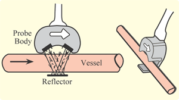
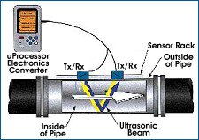
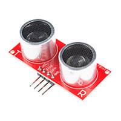

# Todo: Consider an ultrasonic based fluid flow sensor (e.g., for measuring the airflow of my indoor shed dust extraction system)?

```#8d889b3f``` *As of 2019-01-24 20:53*

[mail plain/text](mail.txt)


It seems we can measure the flow of fluids by send out ultrasonic sound with and against the flow and measure the delay between the two echos (and thus determine the flow rate)?

==&gt; Also see “Todo: Consider to design and build a U-tube pressure gauge to measure sufficient flow through my Oneida dust cyclone (&gt; 24 l/m)”

==&gt; Also see “Todo: Dust Extraction - Consider my Oneida Dust Extractor Cyclone requires a minimum air flow of 24 litres per second?”

==&gt; Also see “Todo: DIY Vacuum - Consider to use a EDF (Electric Ducted Fan) brushless unit as the "impeller" unit to get efficient air suction?"

1) Consider this youtube video “SthlmHW #20: "Hardware in 2019"” describing an ultrasonic water flow sensor (<https://www.youtube.com/watch?v=lIpqP-bnpvc>)?

==&gt; The speaker i listened to seems to use illustrations from the wikipedia page on “Ultrasonic Flow Meter” (<https://en.wikipedia.org/wiki/Ultrasonic_flow_meter>)?



==&gt; The speaker I listened to seems to have been part of Boverket study 2014:29 that lives here (<https://www.boverket.se/globalassets/publikationer/dokument/2014/individuell-matning-och-debitering-vid-ny-och-ombyggnad.pdf>)?


*Kamstrup Multical 21 seems to be an example of an ultrasonic water fluid sensor?*

==&gt; Consider the product page of Kampstrup Multical 21 ultrasonic water fluid sensor (<https://www.kamstrup.com/se-se/products-and-solutions/water-meters/residential-water-meter?gclid=Cj0KCQiA4aXiBRCRARIsAMBZGz-4vz302ymyb75JCYU8a1DSZtsMTHKsp-HVF566_8kFwLfwPCXg3OsaAkRKEALw_wcB&gclsrc=aw.ds>)?

2) Consider this article on ultrasonic flow meter principles (<https://www.sensorsmag.com/components/ultrasonic-flowmeter-basics>)?



3) Consider to use two cheap ultrasonic sensors like this SparkFun sensor from DigiKey for about 35 SEK each (<https://www.digikey.se/product-detail/en/sparkfun-electronics/SEN-13959/1568-1421-ND/6193598> )?



*SparkFun ULTRASONIC SENSOR - HC-SR04*

==&gt; Consider to measure air flow we can mount these sensors inside the dust extraction tube but cover the sensors with some ultrasonic transparent material (to protect them from dust)?

==&gt; Or, Consider the tube is penetrable by the ultrasonic sound and we can place them outside with an ultrasonic reflector on the opposite of the pipe?

…

4) Consider to find existing DIY projects to measure airflow with ultrasonic sensors?

==&gt; Consider this lackaday project “MEASURING AIR FLOW WITH ULTRASONIC SENSORS” (<https://hackaday.com/2017/07/26/measuring-air-flow-with-ultrasonic-sensors/>)?

==&gt; Consider this youtube video “Building homemade ultrasonic air flow measurement device.” that seems to describe the hackaday project (<https://youtu.be/BNTSSxzm1GM> )?


==&gt; It seems to use information from this paper “Development of an Ultrasonic Airflow Measurement Device for Ducted Air” (<https://www.ncbi.nlm.nih.gov/pmc/articles/PMC4481905/>)?

==&gt; It seems they have not yet applied volume flow correction for the actual flow profile in the duct?

> > “ • Add corrections required for inaccuracies caused by duct airflow profile."

…

…

Consider to delve deeper into this idea of measuring dust extraction air flow using cheap Arduino ultrasonic transducers (and possibly build a simple monitor of sufficient air flow through my Oneida cyclone)?


