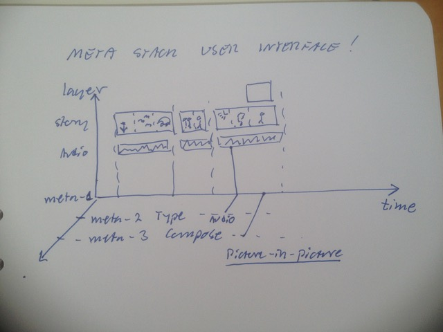

# Todo: Meta Stack User Interface - Consider to organise a User Interface according to a Meta Stack Model?

```#8e7b4d0b``` *As of 2018-05-09 09:41*

[mail plain/text](mail.txt)


It seems it could prove valuable and a good idea to investigate hos a Meta-Stack organised User Interface would look like?

1) Consider a Film Edit (e.g., iMovie, KDenlive, Final Cut Pro) user interface organised into Meta Stack Layers?



==&gt; Consider Meta-1 layer is the actual “stuff” (data) we are morphing?

==&gt; Consider Meta-2 may be used to model “Types” of data (e.g., Video, Audio, Image…)?

==&gt; Consider Meta-3 may be used to model “Composition” both in space (e.g., picture-in-picture) and in time (sequence of cuts and transitions)?

2) Consider how we can use the Meta-model to model environment changes (e-g-, tool changes like cursor select, hand, blade…)

==&gt; It would seem changes in select too is in fact a change of the cursor type (select, hand, blade…)

==&gt; Consider workspace view changes are Meta-3 Composition changes (The view is a meta-2 type and the view change is a meta-3 view-kind change)?

3) Consider how Meta-3 as Sum, Product compositions may manifest as User Interface components?

==&gt; Consider picture-in-picture is a Product-composition indexed by lane-names (lanes compose as stacked frame elements)?

==&gt; Consider if we can imagine SUM-compositions in space or time?

==&gt; A SUM composition in space would be a set of alternative elements at some location in space (indexed by what?)

==&gt; A SUM composition in time would be a set of alternative elements at some location in time (indexed by what?)

4) Consider how a film edit user interface actually models the meta layer model both in space (layers) and time (lanes)?

==&gt; It seems we here have a good example of how a Meta Stack Model may manifest in **both space and time**?

…

…

Consider to delve deeper into this idea to imagine a new or model an existing user interface using the Meta Stack Model?

...


