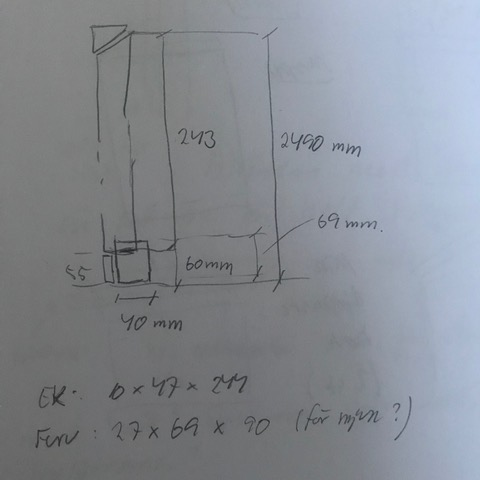
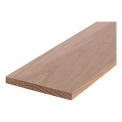
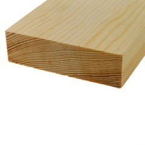

# Todo: Consider to design and build flexible and removable wall storage shelves?

```#8f64ff40``` *As of 2019-06-02 21:29*

[mail plain/text](mail.txt)


Maybe I can design and build wall shelf system (console style) fastened in roof moulding T-track?

==&gt; Also see "Todo: Consider a roof moulding with routed T-slot and sliding wing-nut fastened mount for nylon thread hanging of paintings?"

1) Consider a design of two perpendicular wood consoles fastened in T-slot in roof moulding and resting on wood "soles"?

NOTE: I still have not settled on a design of the T-slot roof mouldings?



*Flexible wall shelf system with 10x47 oak consoles and 27x69 pine soles*

...

2) Consider materials to build some proof of concept?

==&gt; Consider consoles from 10x47 plane oak timber (<https://www.bauhaus.se/planhyvlat-ek-10x47x2440mm> )



==&gt; Consider floor "soles" from pine (<https://www.bauhaus.se/planhyvlat-furu-27x69x1000mm> )?



...


