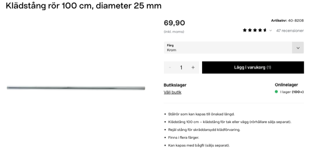
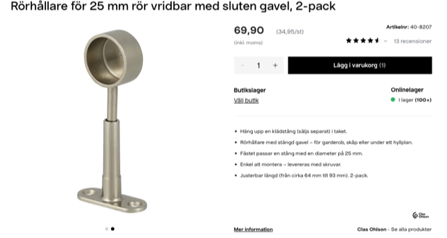
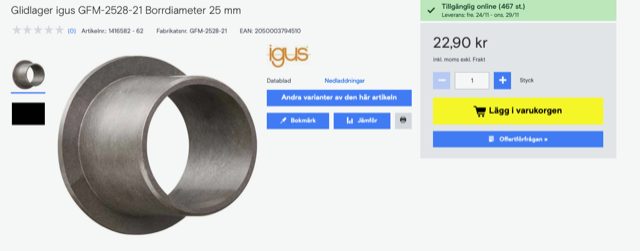

# Todo: Consider an adjustable XY "rails" ceiling lamp fixture?

```#8fb4e426``` *As of 2023-11-22 14:55*

[mail plain/text](mail.txt)


I need to make the ceiling lamp fixture over my kitchen table to be adjustable for me moving the kitchen table around.

1) Consider one based on chrome tubes and Igus linear bearings?



<https://www.clasohlson.com/se/Kladstang-ror-100-cm,-diameter-25-mm/p/40-8208>



<https://www.clasohlson.com/se/Rorhallare-for-25-mm-ror-vridbar-med-sluten-gavel,-2-pack/p/40-8207>



<https://www.conrad.se/sv/p/glidlager-igus-gfm-2528-21-borrdiameter-25-mm-1416582.html#productTechData>

==&gt; Consider I need 6 Igus linear "bushings" three chromed rods and four rod fasteners?

...


