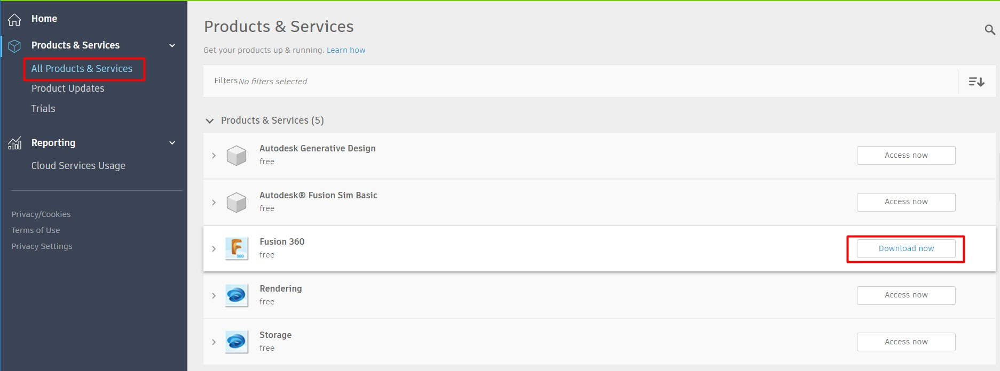

# Todo: Fusion 360 transition - Consider to document how I (as forced to by Autodesk) transitioned from Apple Store subscription to Autodesk own subscripiton?

```#920b975e``` *As of 2019-05-22 10:47*

[mail plain/text](mail.txt)


As of April 9th my existing Apple Store subscription on Autodesk Fusion 360 is no longer supported by Autodesk and I am forced to transition to their own model.

1) Consider this Autodesk article on how to do this (<http://knowledge.autodesk.com/article/Fusion-360-MAS-Transition> )?

> *"**Fusion 360 is no longer being released from the Mac App Store. This document contains all of the information regarding the transition of Fusion 360 in the Mac App Store, after April 9th, 2019. **"*

==&gt; It seems I "simply" download and re-install the Fusion 360 App to make "the jump"?

> *"**The April 9th release will be the last one that will update from Mac App Store. You will need to visit your Autodesk Account and reinstall Fusion 360 from this location...**"*

==&gt; It seems I log in to my Autodesk account to download and install the Fusion 360 App from this source?

> *"*From your Autodesk Account management page, find your Fusion 360 product and select Download Now. This will ensure your access to automatic updates of Fusion 360. After installation, sign-in with your Autodesk Account and all of your models will be exactly as you left them.*"*

==&gt; Consider the complete article by Autodesk on how to transition from Mac App Store subscription to Autodesk own managed subscription?

  
> ### Issue:

> Fusion 360 is no longer being released from the Mac App Store. This document contains all of the information regarding the transition of Fusion 360 in the Mac App Store, after April 9th, 2019.

> ### Solution:

> ### **Fusion 360 Mac App Store Transition**

> If you are using Fusion 360 on MacOS and installed from the **Mac App Store** (MAS), be aware that we are retiring this installation source effective 05/14/2019. We are fully committed to delivering a great experience for Mac users, and this change only impacts the source from **where you download and manage the product**. Please follow the instructions below to install the latest Fusion 360 MacOS version directly from our website.

> This change ensures the best experience for your use of Fusion 360, including performance improvements and faster updates.

> #### For commercial users with a monthly subscription:

> Auto-renewals from Mac App Store will stop in May 2019. To continue using, subscribe to Fusion 360 [here](https://www.autodesk.com/products/fusion-360/subscribe).

> #### For commercial users with an annual subscription:

> Your contract will still be valid. Once you download Fusion 360 using the instructions below, you will simply Sign In and continue working with Fusion 360 until your contract expires. As you plan to renew, please visit this [page](https://www.autodesk.com/products/fusion-360/subscribe).

> #### For all users (including non-commercial users) on MacOS that are using Fusion 360 from Mac App Store:

> The April 9th release will be the last one that will update from Mac App Store. You will need to visit your [Autodesk Account](http://manage.autodesk.com/) and reinstall Fusion 360 from this location.

> From your Autodesk Account management page, find your Fusion 360 product and select Download Now. This will ensure your access to automatic updates of Fusion 360. After installation, sign-in with your Autodesk Account and all of your models will be exactly as you left them.

> **The step by step process to uninstall the MAS version and reinstall is:**

1. Go online in Fusion 360 to sync all of your offline data to the cloud. Once completed, exit Fusion 360.
2. Uninstall Fusion 360 from the Launchpad
  - Drag the Fusion 360 icon from the LaunchPad to the trash.

3. Using Finder, navigate to /Users/%username%/Library/Containers.

  
> **Note: **This is a hidden directory. For more information on how to enable the Library folder, see:  
> [How to Access Hidden User Library folder on Mac OS](https://knowledge.autodesk.com/support/fusion-360/learn-explore/caas/sfdcarticles/sfdcarticles/How-to-Access-Hidden-User-Library-folder-on-Mac-OS.html)
1. Delete the following:
  - com.autodesk.mas.fusion360
  - com.autodesk.mas

2. Visit the [Autodesk Account Management](http://manage.autodesk.com/) Page
3. Next to Fusion 360 in Products and Services, select the Download Now button

  
> 
1. Run the installation file that just downloaded
2. Sign in and keep designing!

  
...


