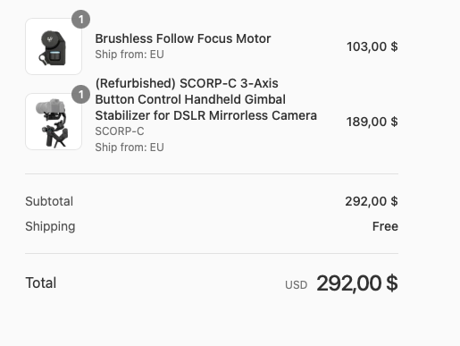
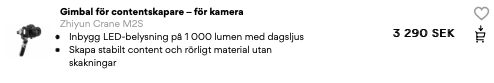
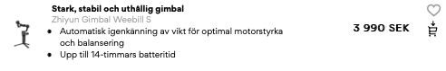
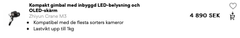
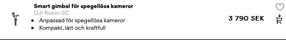
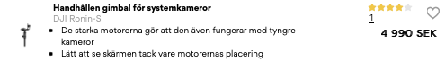
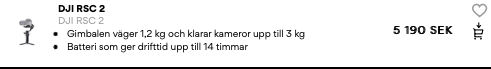

# Todo: Consider to understand what Camera Gimbals exist and which one that has the longest life and valuable functionality?

```#93795aa7``` *As of 2022-10-29 18:39*

[mail plain/text](mail.txt)


I want a gimbal but maybe just because it looks cool or maybe because it will help me to create the shots I want to use in my youtube vidoes?

0) Consider to document the properties that I find valuable to me?

> *To get a gimbal with a long life it seems to me I should value one with a few "gadgets" and accessories as possible? As each additional peace of technology put on the gimbal rises the probability that it will at some point in time fail.*

> *So a gimbal with no screen should be considered "better" that one with a screen? And a screen without touch display should be considered "better" that one with a touch screen?*

> *On the other hand, screens have a long life expectancy so maybe it is no big deal if there is a screen on there.*

> *But at least the controls should be tactile and NOT as touch controls on the screen? Should the touch screen fail the gimbal becomes inoperable and it may prove very hard to repair it if the screen is a proprietary one.*

> *Tactile switches on the other hand should prove to be reparable even if the exact switch is not available. I mean, there will be ways to shorten a circuit also in the future?*

> *I want some for of "standard" batteries that I can also swap out and charge while using the gimbal with another battery.*

> *For use with my Canon 60D that does NOT have video auto-focus I would like to have a focus motor I can operate from the gimbal handle?*

==&gt; Consider the list of preferred traits of the gimbal I am looking for?

==&gt; Good and long life basic gimbal stabilisation (long life motors, mechanics and control electronics).

==&gt; High degree of repairability (replaceable motors, bearings and electronics if possible)

==&gt; As few additional gadgets as possible (and for those present they should not make the gimbal inoperable if they fail)

==&gt; Swappable batteries and preferably "standard" batteries I can use for other gadgets too (like the Canon LP-E6 or universal batteries for JVC / PANASONIC / SAMSUNG / SHARP / SONY like <https://www.batteriexperten.com/sv/artiklar/universal-batteri-4200-mah-jvc-_-panasonic-_-samsung-_-sharp-_-sony.html> )

==&gt; The gimbal should be based on open source hardware and/or software (is there an Arduino or ESP-32 based gimbal out there)

==&gt; The gimbal should have something like a magsafe connector to connect to battery power I wear on my body (to NOT have a / remove the battery in the gimbal)

1) Consider the DJI Ronin SC vs FeiyuTech G6 Max Gimbal?

==&gt; I can get the DJI Ronin SC on sale on [amazon.se](http://amazon.se) for 2800 SEK?

==&gt; I can get the FeiyuTech G6 Max from Rajala Proshop for 2500 SEK?

> *The FeiyuTech G6 Max got a bad review on youtube for lack of quality and starting to behave badly after just a few month? So the quality does not seem to be so good?*

> *The DJI Ronin SC does not have a "carry case" handle. But apart from that still gets good reviews?*

2) Consider the Zhiyun Weebill-S vs the Feiyutech SCORP?

==&gt; I can get the Zhiyun Weebill-S for 3500 SEK on [Amazon.se](http://Amazon.se)?

==&gt; I can get the Feiyutech SCORP from Rajala Prosho for 3900 SEK?

> *Both have briefcase handle mode. *

3) Consider the FeiyuTech SCORP-C plus focus motor?

==&gt; I placed an order to the FeiyuTech online shop and was able to get a delivery from their EU warehouse (<https://store.feiyu-tech.com> )



> *I went for a refurbished Scorp-C and the matching Follow Focus motor. From my two day survey of available gimbals I placed my bet on this one. The price was reasonable, I could get it from their online web-site, and the delivery time was within a week.*

> *I liked the design with the briefcase grip. And when they made it easy for me to also pick a follow focus motor and concluded the search was over for this time.*

2) Consider a list of gimbals tagged with properties like price, life expectancy and functionality?

&lt;Zhiyn&gt;

Zhiyn Crane M2S 3300 SEK. Dåligt: Inbyggd LED-belysning

Zhiyn Gimbal Weebill S 4000 SEK.

Zhiyn Crane M3 4900 SEK Dåligt: Inbyggd LED-belysning

&lt;DJI&gt;

DJI Ronin-SC 3800 SEK

DJI Ronin-S 5000 SEK

DJI RSC 2 5200 SEK

3) Consider the gimbals sold by Swedish vendor "Scandinavian Photo" (<https://www.scandinavianphoto.se/kameratillbehor/gimbals-stabilisering/gimbal-for-kameror?sortBy=price&count=24> )?

==&gt; Consider Zhiyn



<https://www.scandinavianphoto.se/kameratillbehor/gimbals-stabilisering/gimbal-for-kameror/crane-m2s-1054955>



<https://www.scandinavianphoto.se/kameratillbehor/gimbals-stabilisering/gimbal-for-kameror/gimbal-weebill-s-1046188>



<https://www.scandinavianphoto.se/kameratillbehor/gimbals-stabilisering/gimbal-for-kameror/crane-m3-1056426>

==&gt; Consider DJI



<https://www.scandinavianphoto.se/kameratillbehor/gimbals-stabilisering/gimbal-for-kameror/ronin-sc-1045056>



<https://www.scandinavianphoto.se/kameratillbehor/gimbals-stabilisering/gimbal-for-kameror/ronin-s-1038018>



<https://www.scandinavianphoto.se/kameratillbehor/gimbals-stabilisering/gimbal-for-kameror/rsc-2-1049598>

...


