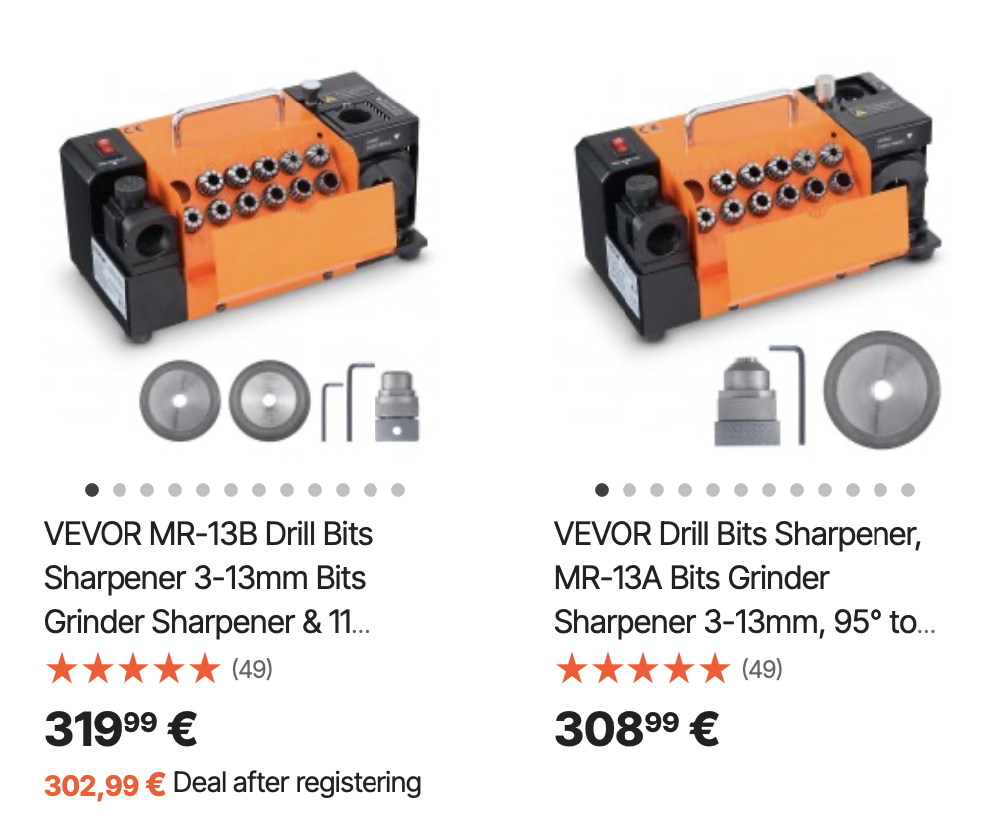

# Todo: Consider youtube video "" and the Vevor Drill Sharpener?

```#93885f7b``` *As of 2025-02-11 20:53*

[mail plain/text](mail.txt)


I like to maintain instead of buying new so a drill sharpener may become handy some day.

1) Consider youtube video "Was I Wrong about the Drill Doctor?" (<https://www.youtube.com/watch?v=7nI9n_Mudyg> )?

==&gt; He seem to think the 'Drill Doctor' to be for cheap drills with thin flute only (<https://youtu.be/7nI9n_Mudyg?t=210> )?

> none of the parts are made here but at  
> 3:30  
> least they're trying it does a pretty  
> 3:32  
> good job with 118 degree drills that  
> 3:35  
> have a thin web we talked about that in  
> 3:38  
> the last video the thicker the web the  
> 3:41  
> tougher the drill but also the tougher  
> 3:44  
> it is to sharpen these are the only 118

2) Consider the Vevor drill sharpener (<https://eur.vevor.com/end-mill-sharpener-c_10118> )?



...


