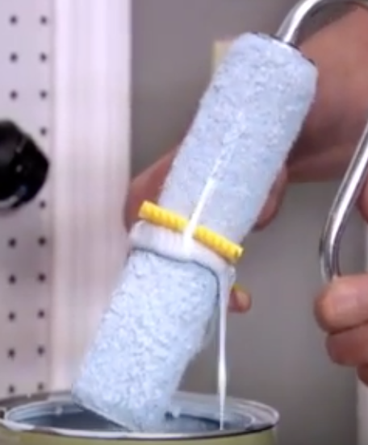
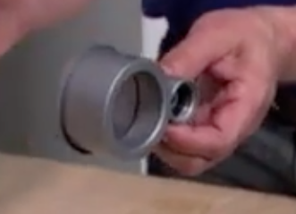
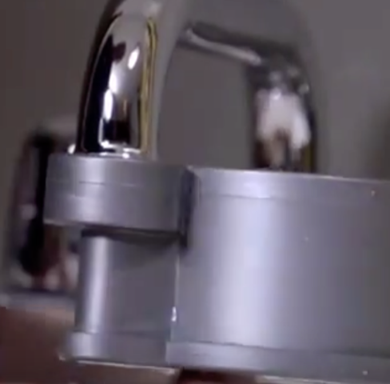
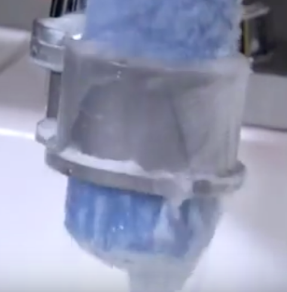
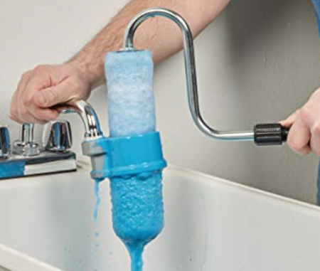
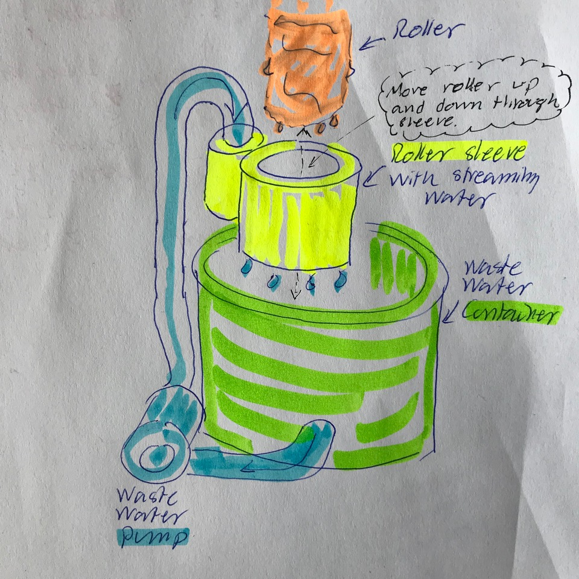

# Todo: Paint Tools Cleaning - Consider to 3D print some kind of sleeve to clean rollers from paint?

```#93918993``` *As of 2019-08-30 17:19*

[mail plain/text](mail.txt)


It seems I should be able to 3D print something that goes on a roller like a sleeve and that I can stream water through and get the roller cleaned?

1) Consider to be inspired by the products from HomeRight that works in this way?

==&gt; Consider the youtube video "HomeRight Roller Cleaner" (<https://www.youtube.com/watch?v=u-fLW4RPDak> )?

>   
> *The HomeRight mechanical manual roller "sleeve" to force paint off the roller*

>   
> *The HomeWright "Roller Cleaner" attaches to a USA standard faucet*

> 

>   
> *The HomeWright "Roller Cleaner" streams water from an USA standard faucet into a roller "sleeve" that cleans the roller*

*==&gt; It seems HomeWright sells on Amazon but their "Roller Cleaner" is currently out of stock (<https://www.amazon.com/gp/product/B002R4YN7S/ref=as_li_qf_sp_asin_il_tl?ie=UTF8&tag=home03d3-20&camp=1789&creative=9325&linkCode=as2&creativeASIN=B002R4YN7S&linkId=1f2076ab3ca6ffecf2f71e3cbf3eae35> )?*

> 

>   
> *The HomeWright "Roller Cleaner" streams water from an USA standard faucet into a roller "sleeve" that cleans the roller*

2) Consider we can design and build a "Roller Cleaner" with a 3D printed "water sleeve" on a faucet in a closed system with a pump circulating paint waste water?

>   
> *En example design of a closed waste water system roller cleaner using a "sleeve" to stream water onto roller*

...


