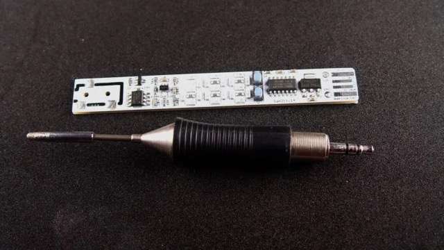
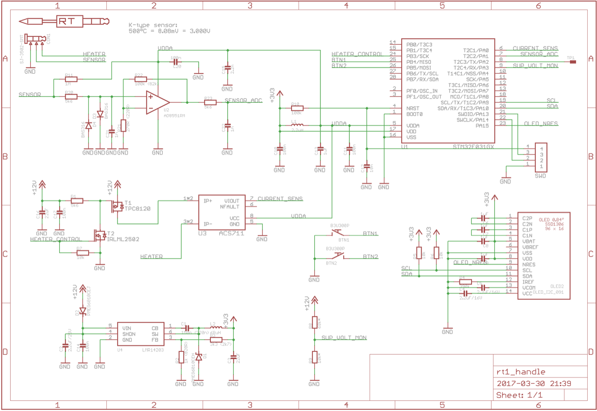

# Todo: Consider to delve into DIY projects creating soldering irons for Weller RT tips and open source PCB designs?

```#93f90a71``` *As of 2023-03-26 19:51*

[mail plain/text](mail.txt)


Weller calls their active tips for "RT tips" and they come with a 3,5 mm barrel jack.

1) Consider youtube video "My All in one Weller PEN solder controller for Weller RT Tips (WXMP hadle)" (<https://youtu.be/0tno5tp7Y6E> )?

==&gt; It seems you can buy these soldering irons on etsy (<https://www.tindie.com/products/mike_menci/weller-rt-tip-all-in-one-controller-pen-wmrp/> )?

/i/24691/products/2021-06-24T15%3A14%3A01.455Z-My%20Weller%20PEN.jpg?1624523004>)

==&gt; This seems to be the Github page with firmware and references to to tindie for purchase (<https://github.com/pavelrevak/rt_soldering_pen> )?

2) Consider Hackaday projects using the Weller RT tip platform?

==&gt; Consider "SOLDERING YOUR OWN SOLDERING IRON" (<https://hackaday.com/2019/10/06/soldering-your-own-soldering-iron/> )?



==&gt; Consider this schematic from one of the RT Tip solering iron designs (<https://cdn.hackaday.io/files/18899808574816/rt_soldering_pen_sch.png> )?



...


