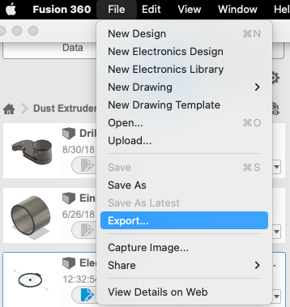
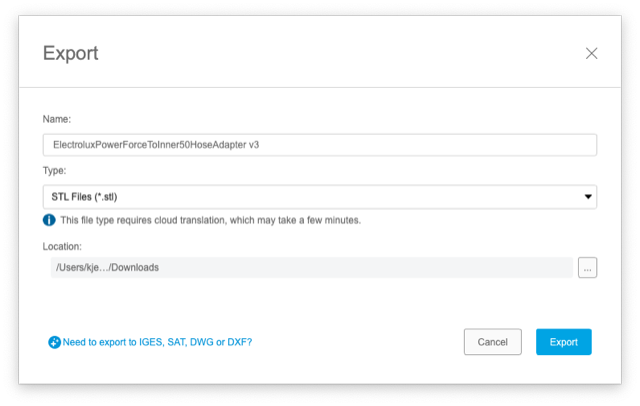
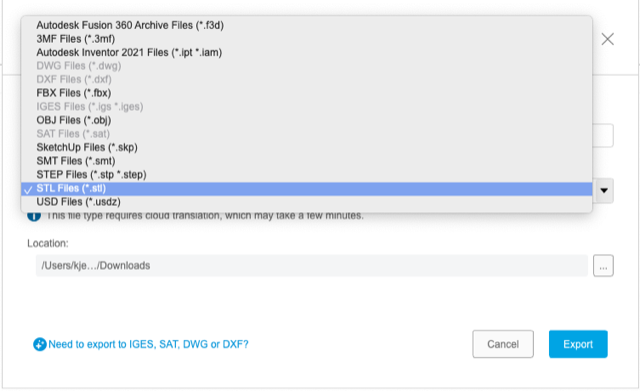
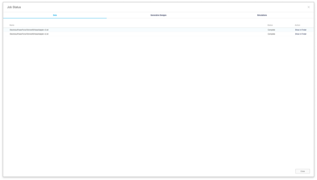
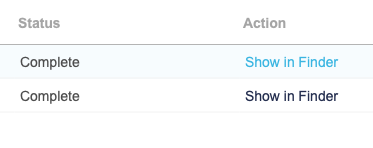
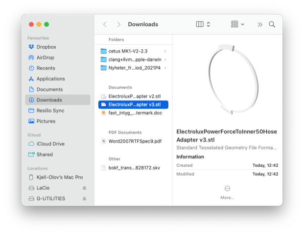

# Todo: Fusin 360 - Consider to document how to export a body as an STL file for 3D printing using Online free version as of Aug 2022

```#948b0901``` *As of 2022-08-06 12:48*

[mail plain/text](mail.txt)


I switched to the Free online Fusion 360 version and was unable to export my design as STL the way I was used to.

1) If seems the free version of Fusion 360 is "browser like" (runs online) and you have to &lt;File&gt; / &lt;Export&gt; to generate an STL file?



*Select main meny &lt;File&gt; and drop down &lt;Export&gt;*



*In the pop-up, klick the drop-down for "Type:"*



*In the drop-down list select "STL Files (\*.stl)"*



*You get a "Job Status" window showing the progress of the export*



*When status is "Complete" you can click "Show in Finder" to have macOS open a finder window where the STL-file has been downloaded*



*The Finder in macOS is able to show a pre-view of STL-files :)*

...


