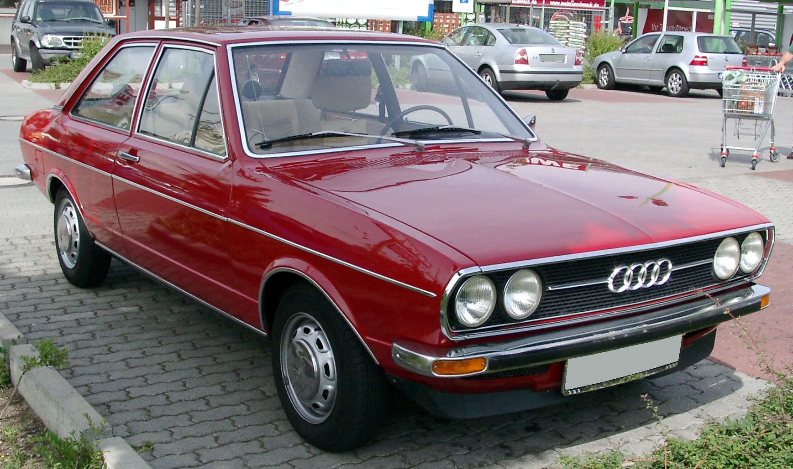
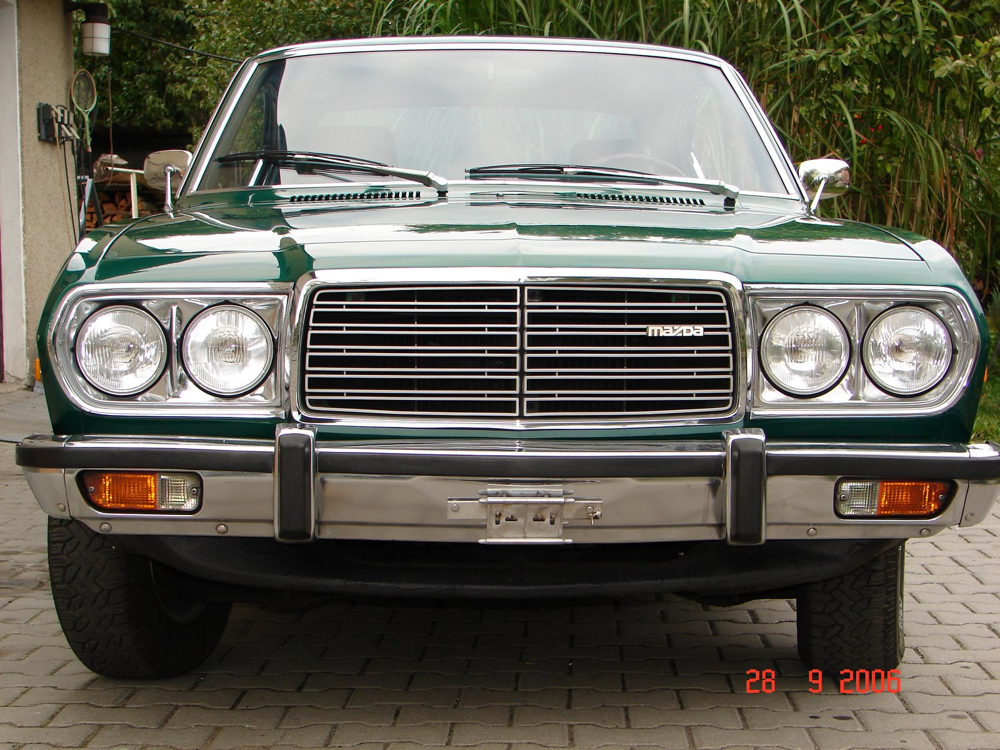

# Todo: Privat - Överväg att nostalgiskt kolla upp bilarna jag växte upp med?

```#9576d04f``` *As of 2015-12-25 23:11*

[mail plain/text](mail.txt)


Kan det vara ett sätt att bearbeta sorgen av min uppväxt genom att ta reda på mer om de bilar jag växte upp med?

1) Under 70-talet tror jag vi garde en Audi 80 Gl (<https://upload.wikimedia.org/wikipedia/commons/6/6b/Audi_80_B1_front_20080620.jpg>)?



2) När pappa gick bort köpte mamma en Mazda 929 Sedan 1977 för arvet (<http://static.cargurus.com/images/site/2009/10/23/04/37/1977_mazda_929-pic-7041969134341606432.jpeg>)?



…

Överväg att skriva och spekulera lite i vem mamma och pappa var baserat på vilka bilar de valde att köpa?

...


