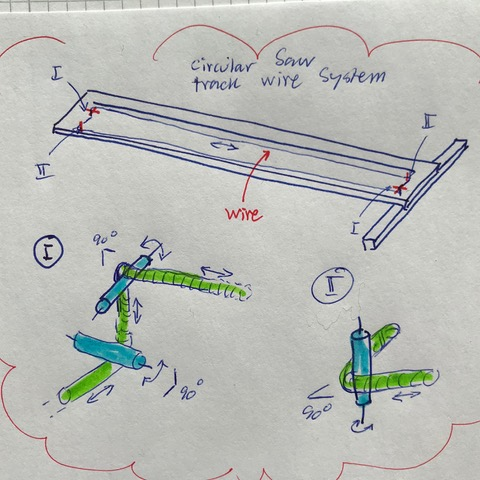
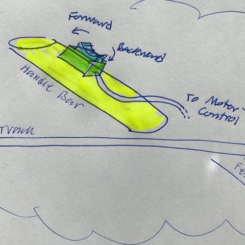
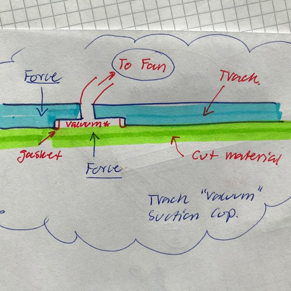
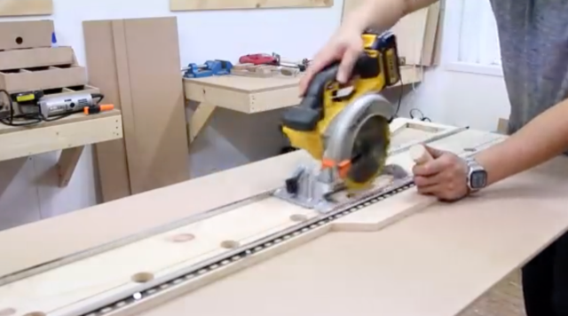

# Todo: Consider a circular saw track where the operator can drive (push pull) the saw along the track using a hand crank or battery driven motor from the end of the track?

```#9713e636``` *As of 2019-09-26 10:47*

[mail plain/text](mail.txt)


Would it not be convenient if one could remain at the end of a circular saw track and still push or pull the saw along the track to make the cut?

1) Consider a circular saw track design that allows for the operator to both hold and drive the saw along the track while standing at the end of the track?

> *The idea here is that it seems it could be convenient if one did not have to move along with the saw while making the cut using a circular saw track? For one it may not be possible because the material we cut is in the way. And secondly when we move we risk to inadvertently move the track out of position because we fail to apply the correct stabilising forces to the track. So if we could stand firmly at the end of the track and still be able to push or pull the saw along the track we may be able to more conveniently and reliably make straight and accurate cuts using a circualr saw and the track.*

==&gt; Consider that we can use a wire loop to drive the saw along the track?

>   
> *An example of threading a wire into a loop to drive the saw along the track*

==&gt; Consider that if we make the saw drive electrically controlled we could mount a forward-backward and speed control into the handle bar of the track?

> 

2) Also consider we may try to add "sucking cups" that uses vacuum created by small electrical fans to have the track stick more firmly to the board we are cutting?

> *The idea here is that maybe most boards we may use the track to cut is smooth enough so that some amount of created vacuum can help having the track "stick" to the board we are cutting? What we would need are some openings with an airtight gasket around the rim on the underside of the track. And then attack a tube to a fan that can create an under pressure in the opening so that the air pressure will have the track be pressed against the material we are cutting.*

>   
> *Example of a fan created "vacuum" into a gasket sealed cavity to have track "suck" against the cut material *

2) Consider to use the design in this youtube video "DIY 목공용 원형톱 가이드 트랙 │ Circular Saw Guide Track" as inspiration for the base design of the track (<https://www.youtube.com/watch?v=c5pc_4wcQ2k> )?

>   
> *A DIY light weight circular saw track with handle bar and square fence*

...


