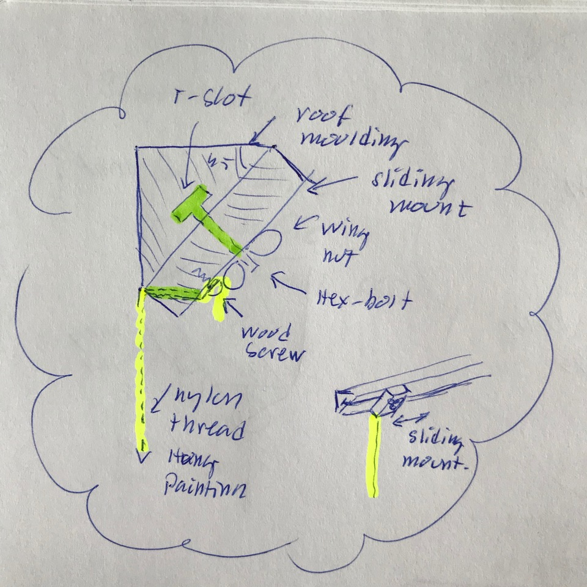

# Todo: Consider a roof moulding with routed T-slot and sliding wing-nut fastened mount for nylon thread hanging of paintings?

```#972441a9``` *As of 2019-05-26 10:25*

[mail plain/text](mail.txt)


I think I may have figured out a way to make a roof moulding that can serve as a sliding nylon thread hung paintings mount.

1) Consider a triangular shaped roof moulding with routed T-slot for hex bolt and wing nut fastened sliding nylon thread hung paining mount?

> *The idea here is to make a triangular roof moulding with a T-slot routed along the beveled side. In this slot we slide an hex bolt to which we attach a sliding piece of wood we can fixate with a wing nut. Finally, in the attached piece of wood we drill a hole that becomes perpendicular to the wall in which we can thread a nylon string and fastened to a wood screw. Now we can hang picture frames on the nylon string and slide the mount to a suitable position along the roof moulding and fasten it with the wing nut.*



*Rood moulding with T-slot for mounting a sliding nylon thread hung picture frame mount*

2) Consider the process of making these roof moulding picture frame nylon thread hung sliding mounts?

==&gt; I need to figure out how to cut these 45 degrees moulding on my table saw (from 45 x 45 wood)?

==&gt; I need to figure out how to route a T-slot on the beveled face of the moulding?

==&gt; I need to figure out how to drill the hole for the nylon string (at 45 degrees through the corner of the mount)?

==&gt; I need to figure out how to paint the mouldings white (tricky to paint because they are long and thin)?

==&gt; Ideally I would like to have the moulding pass through some device that applies an even coat of paint?

NOTE: I only need to paint the beveled side (the straight sides will face the wall and ceiling)?

...

...


