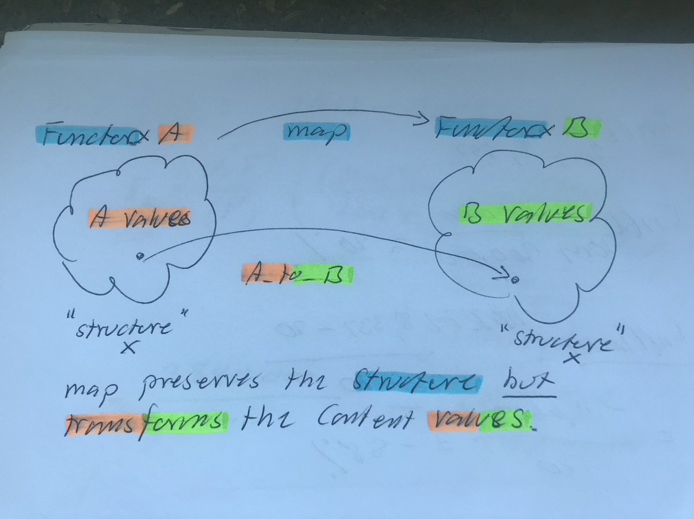

# Todo: Consider to visualise Monoids, Functors and Monads to enhance my understanding of the youtube video "Monoids, Monads, and Applicative Functors: Repeated Software Patterns - David Sankel - CppCon 2020"?

```#972a395d``` *As of 2020-10-06 09:43*

[mail plain/text](mail.txt)


I suspect I differ from "typical" C++ presenters in that they often explain in textual form while I understand things better in visual form.

==&gt; Also see "Todo: C++ std::function - Consider why I can't instantiate a std::function from std::to_string (hint - can't resolve overloaded functions and std::to_string is overloaded)?"

1) Consider to "visualise" the youtube presentation "Monoids, Monads, and Applicative Functors: Repeated Software Patterns - David Sankel - CppCon 2020" to better suit how I like to understand things (<https://youtu.be/giWCdQ7fnQU> )?

==&gt; Consider a "Functor" as something able to preserve a data structure but transform (map) the type of the structured value from type A to type B (<https://youtu.be/giWCdQ7fnQU?t=924> )?

>   
> *A type behaves as a "Functor" if it can create the "its own structure" but transform its values using a function provided by the caller (eg, remain a vector, optional etc. but transform the stored values with an external function)*

> /\*\*  
> The Functor Pattern defines how a data structure of values A can be "mapped" to the same structure bot for values of B.

> It seems we say a structure (in C++ a class type) "Is" a Functor if it has a member operation that takes in a function that converts values of type A to type B and then returns the same structure but with all A values converted to B values.

> An example is std::vector&lt;T&gt; that we can "make" to behave as a Functor by writing a function that takes a function from type A -&gt; B (say an int to a string) and the vector of ints to "map" into a vector of strings.

> So the functor preserves the structure (for example a vector, an optional etc.) but provides means to map the values in the structure to another type by prodiding a suitable mapping function that works on each value in a time.

> \*/

> // Make std::vector behave "as a Functor" (vector&lt;A&gt; to vector&lt;B&gt; using A_to_B : A-&gt;B)  
> **template** &lt;**typename** A, **typename** B&gt;  
> std::vector&lt;B&gt; map(std::function&lt;B (A)&gt; A_to_B, std::vector&lt;A&gt;& vector_A) {  
> std::vector&lt;B&gt; result {};  
> **for** (**auto** **const**& a : vector_A) {  
> result.push_back(A_to_B(a)); // Keep vector structure but "map" each value  
> }  
> **return** result;  
> }

> **int** main(**int** argc, **const** **char** \* argv&#91;&#93;) {  
> std::vector&lt;**int**&gt; vector_a {0, 17,34,4711};  
> **auto** vector_b {map&lt;**int**,std::string&gt;(&#91;&#93;(**int** x) { **return** std::to_string(x);},vector_a)};  
> // Note: std::to_string is overloaded so we use a lambda to resolve before pass to template argument resolution (allows std::function to "know" what to wrap)  
> **return** 0;  
> }

...


