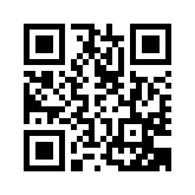

# Todo: SPC - Can we make QR-codes from the SPC logo?

```#9965ee13``` *As of 2015-08-12 14:36*

[mail plain/text](mail.txt)


It would be convenient if we could make QR-codes of spc-hashtags. What are our options and possible gains here?

1) May we use a QR-code that is simply the SPC-logo? What then is the resulting code in binary/text form?

2) May we encode a compete spc-hashtag in a QR-code? &#91;YES&#93; Or are QR-codes only URL:s? &#91;NO, we may encode any text&#93;

On <http://sv.qr-code-generator.com> i was able to generate a QR-code for #spcEgAMgMP4TmOdxkGOY3coOQ.



3) On <http://sv.qr-code-generator.com> they state that we are able to put a logo inside the QR-code! Thus it would be nice to have the SPC-logo in the middle of the SPC-QR-code!


4) On <https://sv.wikipedia.org/wiki/QR-kod> they state that we may encode up to 4 296 characters or 2953 bytes (70% compression for characters would mean each character uses 5 or 6 bits?)


