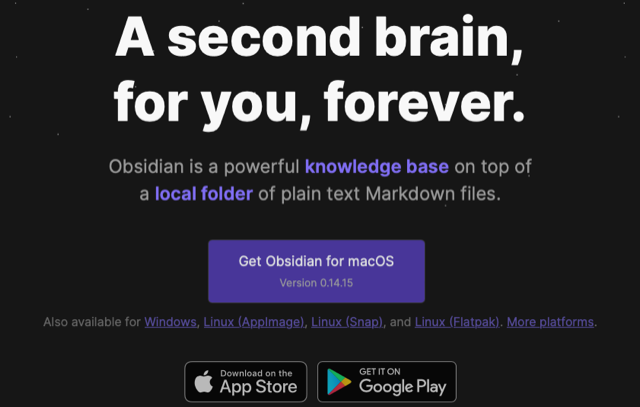
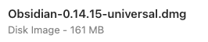
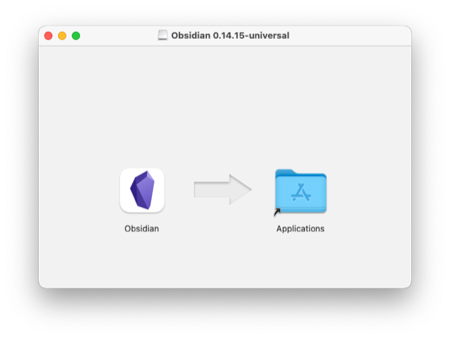
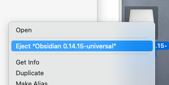
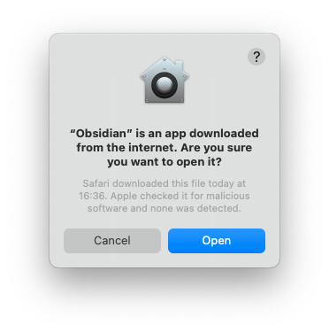
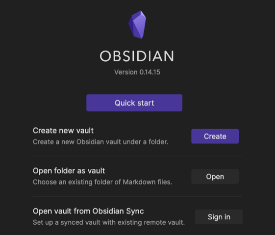
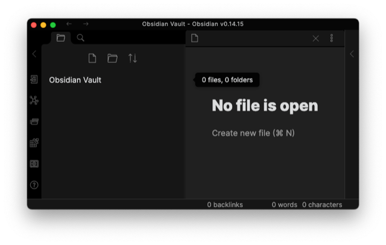
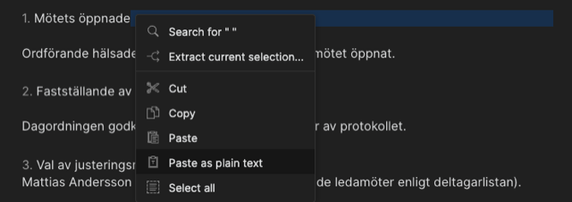

# Todo: Consider to try out the cross platform Obsidian text editing "platform" (and optionally how it can work together with Pandoc format transformation tool)?

```#99e89356``` *As of 2022-06-18 17:41*

[mail plain/text](mail.txt)


I want a light weight and cross platform note taking application for my role as secretary in an my local housing association.

==&gt; Also see "Todo: Consider the open source and cross platform document format transformer "Pandoc" for docx to markdown, RTF and type setting formats like LaTex and Troff? "

0) Consider the bottom line of my evaluation of Obsidian?

> *Obsidian lacks control of typesetting to physical pages like pdf:s and printed media. There is a "Export to pdf" but you only get your text wrapped to pages as required, not where you may want them.*

> *So, Obsidian "out of the box" is NOT my tool of choice for note taking to make protocols of meetings with my **local housing association!*

1) It seems "obsidian" lives here on the web (<https://obsidian.md> )?

> 

==&gt; It seems Obsidian is both a mark-down text editor and a knowledge base network manager (<https://help.obsidian.md/Obsidian/Obsidian> )?

> *"What is Obsidian

> *  
> *Obsidian is a both a Markdown editor and a knowledge base app.

> Used in the most basic way, you can edit and preview Markdown files. But its true power lies in managing densely networked knowledge base."  
> *

2) Consider to evaluate Obsidian on macOS?

==&gt; It seems the downloaded package is around 160 MB?

> 

==&gt; It seems Obsidian comes as a singleton binary to just drag into the Application folder?

> 

==&gt; It seems I have to manually eject and delet the downloaded package?

> 

==&gt; It seems macOS allows me to open Obsidian from macOS launchpad after an OK from me?

> 

3) Consider to document my experience with using Obsidian?

==&gt; It seems to use Obsidian I need to setup a local or cloud located "Vault"?

> 

==&gt; It seems Obsidian does not support the notion of "open and edit single file"?

> 

==&gt; It seems to get text into Obsidian I can cut and paste "as plain text"?

>   
> *I succeeded in first opening a text file in macOS, perform "Select All" and "Copy" and the in Obsidian right click and do "Paste as plain text"*

==&gt; Obsidian does NOT seem to have any buttons or menu options to format text?

==&gt; This seems to be the online help page (<https://help.obsidian.md/Obsidian/Index> )?

==&gt; It seems I can use html inside markdown to force a page break?

> &lt;div style="page-break-after: always"&gt;&lt;/div&gt;

NOTE: It seems I need to have an empty line after this html to have markdown formatting keep working into created pdf for text after this html?

...


