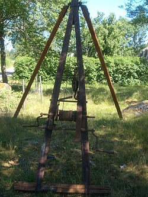
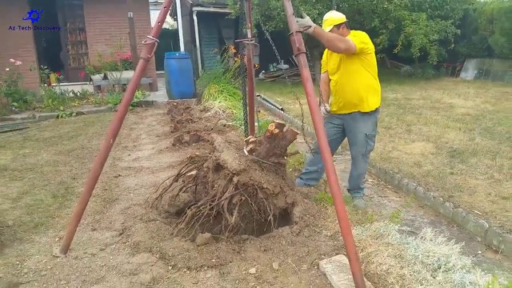

# Todo: Consider to build and try out a manual "stump harvester" (Swedish "Stubbrytare") based on a tripod and a rope or chain driven block and tackle (Swedish "block och Talja")?

```#9c26c60a``` *As of 2022-06-12 12:50*

[mail plain/text](mail.txt)


I want to be able to remove tree stumps out of the soil using the old ways with man power and a block and tackle mechanism.

1) It seems the Swedish name for this is "Stubbrytare" (<https://sv.wikipedia.org/wiki/Stubbrytare>)?



2) It seems the english term is "stump puller" or "stump pulling machine" as shown in youtube vidoe "Amazing Stump pulling machine, There Are Many Ways To Remove Stump In Your Garden" (<https://youtu.be/eFfvdPbgPO0> )?



*From Youtube video "" at around 2:14 (<https://youtu.be/eFfvdPbgPO0?t=134> )*

...


