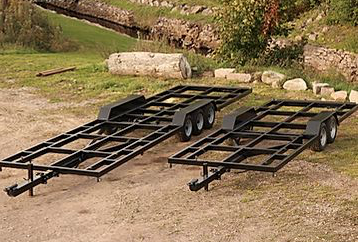

# Todo: House Build - Consider a modular house design on a trailer designed for Tiny Houses that you can assemble and disassemble and move on EU pallets (empty trailer separate)?

```#9c574ff8``` *As of 2020-01-14 17:49*

[mail plain/text](mail.txt)


I want to build a house you can move as modules that fit on standard EU pallets.

==&gt; Also see "[Todo: House Build - Consider if I can live in a Tiny House on trailer (e.g. from Swedish Treesign) placed on my property while I build my permanent house?](../cbcdb2ec/chime.md)"

==&gt; Also see "[Todo: House Build - Consider if I can live in a Tiny House on trailer (e.g. from Swedish Treesign) placed on my property while I build my permanent house?](../cbcdb2ec/chime.md)"

> *The idea here is to actually use a trailer designed for Tiny House builds but make the house come together from parts that fit on standard EU pallets.*

*1) Consider trailers from Swedish Treesign (*<https://www.treesign.se/goer-det-sjaelv> )?

>   
> *Bare trailers for Tiny Home from Treesign*

> *"* *avtagbar draganordning *  
> *- LED-belysning runtom  
> - 7-polig kontakt  
> - dragögla anpassad för traktor  
> - låg lastyta (54cm från mark) för maximal bygghöjd  
> - hydrauliska bromsar**"*

> *"*TF-60

2-axlad

​

Plan byggyta: **6,6 m x 2,5 m**

(rekommenderad husbredd max 3,10 m)

​

Totallängd ink. draganordning: ca 8,16 m

(ca 1,3 m av draganordningen är avtagbar)

​

Totalvikt: 8,2 ton (8200 kg)

​

Lastvikt: 7 ton (7000 kg)

​

Pris: **69 000 SEK**

TF-80

2-axlad

Plan byggyta: **8 m x 2,5 m**

(rekommenderad husbredd max 3,10 m)

Totallängd ink. draganordning: 9,56 m

(ca 1,3 m av draganordningen är avtagbar)

Totalvikt: 10,5 ton (10500 kg)

Lastvikt: 9 ton (9000 kg)

Pris: **76 000 SEK**

TF-10

3-axlad

Plan byggyta: **10 m x 2,5 m **

(rekommenderad husbredd max 3,10 m)

Totallängd inkl. draganordning: 11,56 m

(ca 1,3 m av draganordningen är avtagbar)

Totalvikt: 14 ton (14000 kg)

Lastvikt: 12 ton (12000 kg)

Pris: **82 000 SE**

> *"*

2) Consider we can, after assembly of the inner shell on the trailer, drive the trailer into a second outer insulation shell to get a low energy permanent house?

> *The idea here is to have the house on the trailer to be the "inner" shell. This shell we can build from modules that we can move on standard EU pallets. These modules weighs a maximum of 750 Kg, 750/2 kg and 750/3 kg so we can pull them using a standard EU drivers license.*

> *Then after having assembled the house on the trailer we can imagine we have built a permanent outer shell on the property with a ramp to allow the trailer house to be moved into it!*

> *With some clever way of fixating the trailer house shell to the property permanent shell we get a well insulated low energy permanent house!*

> *The upside is that the inner shell on the trailer has NO outer weather shell. It has only the inner living area coating with an outer exposed isolation. But this does not matter as we are to back this into the outer shell that has the second layer of insulation as well as the actual weather outer shell!*


