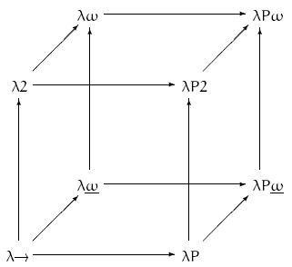

# Todo: Consider in programming that a "Dispatch" may be modeled as an "Indexing by pattern" (in addition to known indexing by term or type)?

```#9c922c70``` *As of 2019-01-31 15:58*

[mail plain/text](mail.txt)


It seems it could be valuable to follow up on my intuition that Dispatching in programming is in fact an indexing (selection) based on pattern matching (in addition to the term and type indexing in type theory)?

==&gt; Also see “[Todo: Meh and Tha and Type Theory and Systems - Consider to delve deeper into Type Theory and the Lambda Cube to understand how we may think about Meh and Tha?](../77f52160/chime.md)"

==&gt; Also see “[Todo: Type Systems - Consider Strange Loop talk "Type Systems - The Good, Bad and Ugly" by Paul Snively and Amanda Laucher as having good leads into good and bad type systems and the need for a better programming language?](../9b0ab729/chime.md)”

==&gt; Also see “[Todo: Cratchit Book Keeping - Consider to implement a C++ book keeping application using Tha modelling, Elm Idion and Immer Immutable data Struictures asynchronously synchronising with REST Web service (FortKnox) and IPFS file system?](../7c6907a4/chime.md)"

==&gt; Also see “[Todo: Tha - Consider to name the "Meta stack model" the Tha model and define what this model implies and used?](../2927db2a/chime.md)”

==&gt; Also see “[Todo: Tha C++ - Consider to discover the C++ meta-layer objects by viewing C++ code as meta-layer expressions expressed in Haskel syntax?](../f03f3b43/chime.md)”

==&gt; Also see “[Todo: Tha - Consider Haskel "kind values" are in fact Tha meta-2 values?](../bba1c0c9/chime.md)”

1) Consider in what ways we can argue that Dispatching is a selection based on an index that is a pattern?

==&gt; Consider for functions the C++ allows overloading and selects the correct function to call based on provided argument types and count)?

==&gt; It seems (See below and “Type Theory” and "The Lambda Cube”) that function overload (also virtual methods) are already an example of value depending on types (indexed by type?)?

==&gt; Consider we can model template instantiation as a compile time function call with syntax F&lt;args&gt; that returns a template, a type, a value or a function (never a kind, F itself is a kind)?

==&gt; Consider for templates C++ allows specialisation and the compiler instantiates (compile-time dispatches) to the correct specialisation based on provided argument types and values (type and integer indexation)?

==&gt; Consider that in C++ both function overloading and template specialisation can be seen as pattern indexation (the proper function or template is inferred from the provided pattern in the “call”)?

...

2) Consider to compare with the Lambda Cube in type theory as defined by Wikipedia (<https://en.wikipedia.org/wiki/Lambda_cube> )?

TODO: Consider to research if I have misunderstood “depending” in that it is NOT “indexing” (as in selecting based on provided index value or type)?

==&gt; It seems the Lambda cube is a way to model a type system in its ability to relate values (sometimes terms) and types (categories of values, terms)?



> “Each axis of the cube represents a new form of abstraction:
- Values depending on types, or [polymorphism](<https://en.wikipedia.org/wiki/Polymorphism_(computer_science)>). [System F](https://en.wikipedia.org/wiki/System_F), also known as second-order lambda calculus (written as λ2 in the diagram), is obtained by imposing only this property.
- Types depending on types, or [type operators](https://en.wikipedia.org/wiki/Type_constructor). [Simply typed lambda calculus with type operators](https://en.wikipedia.org/w/index.php?title=Simply_typed_lambda_calculus_with_type_operators&action=edit&redlink=1) (λω in the diagram) is obtained by imposing only this property. Combined with [System F](https://en.wikipedia.org/wiki/System_F) it yields [System Fω](https://en.wikipedia.org/wiki/System_F#System_F%CF%89)(written as λω without the underline in the diagram).
- Types depending on values, or [dependent types](https://en.wikipedia.org/wiki/Dependent_type_theory). Imposing only this property yields [λΠ](https://en.wikipedia.org/wiki/Dependent_type#First-order_dependent_type_theory) (written as λP in the diagram), a type system closely related to [LF](<https://en.wikipedia.org/wiki/LF_(logical_framework)>)."

==&gt; Consider if I am correct in that “depending” can be understood as “indexed by” (values depending on type then becomes “the value at the entry “marked” or “indexed" with the provided type”)?

==&gt; Consider Why “Value dependent on types” is polymorphism, and not F: Type -&gt; Value (e.g., C++ template specialisation)?

> **template** &lt;**class** T&gt;  
> **struct** type_dependent_value {T t{};};

> **template** &lt;&gt;  
> **struct** type_dependent_value&lt;**int**&gt; {**int** t{4};};

> **template** &lt;&gt;  
> **struct** type_dependent_value&lt;**float**&gt; {**float** t{5.0};};

> **void** test() {  
> type_dependent_value&lt;**char**&gt; r{'h'}; *// F: char -&gt; 'h'. r.t == 'h'*  
> type_dependent_value&lt;**int**&gt; s; *// F: int -&gt; 4. s.t == 4*  
> type_dependent_value&lt;**float**&gt; t; *// F: float -&gt; 5.0. t.t == 5.0*  
> }  
> *This C++ template code is NOT “values depending on types”? *

==&gt; Consider “values depending on types” can be understood by C++ function overloading (polymorphism)?

> **int** f() {**return** 0;} *// (1)*  
> **int** f(**int** x) {**return** 2\*x;}; *// (2)*  
> **int** f(**char** x) {**return** x;} *// (3)*

> **void** test() {  
> f(); *// Call to (1)*  
> f(4); *// Call to (2)*  
> f('h'); *// Call to (3)*  
> }

(1) can be seen as the function “value” named “f” at the type index “void”?

(2) can be seen as the function “value” named “f” at the type index “int”?

(3) can be seen as the function “value” named “f” at the type index “char”?

==&gt; Thus, the “value” (or term) named “f” is indexed by the argument type (in effect the value depends on the type)?

==&gt; It seems in Type Theory we use “value” to mean “things as data or code” (more generally called Terms?) - thus polymorphism is “indexing the thing based on the provided type”?

==&gt; It seems types depending on types are “type composition” like Product (struct, class), Sum (union) and functions (code composition) (<https://en.wikipedia.org/wiki/Type_constructor> )?

==&gt; It seems types depending on values are Product, SUM and function types that depends on a constructor or argument term (i.e., value) (<https://en.wikipedia.org/wiki/Dependent_type>)?

> "Two common examples of dependent types are dependent functions and dependent pairs. A dependent function's return type may depend on the value (not just type) of an argument. A function that takes a positive integer "n" may return an array of length "n". (Note that this is different from polymorphism and generic programming, both of which include the type as an argument.) A dependent pair may have a second value that depends on the first. It can be used to encode a pair of integers where the second one is greater than the first."

...


