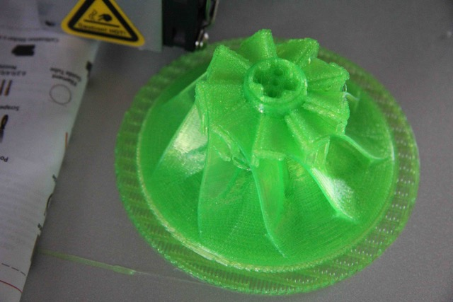

# Todo: DIY Dust Extraction - Consider to 3D print an impeller based brushless out runner motor driven vacuum module?

```#9dec1d98``` *As of 2018-08-24 15:40*

[mail plain/text](mail.txt)


It seems I should be able to build a vacuum module for my indoor shed dust extraction system that is based on a 3D printed impeller driven by a brushless out-runner motor?

==&gt; Also see “Todo: DIY Dust Cyclone - Consider to understand Dyson vacuum to design a good dust cyclone separator?"

1) Consider this thingiverse impeller model that seems to be designed for a brushless out runner motor (<https://www.thingiverse.com/thing:590416>)?

==&gt; This model seems to provide all the parts for a fully functional impeller with housing?


==&gt; This seems to be a youtube video showing this impeller running (<https://youtu.be/LQTW7RxqRWc>)?

2) Consider to study this thingiverse impeller model (<https://www.thingiverse.com/thing:2828349>)?

==&gt; The fins seems nicely designed (are there any science behind this design)?


==&gt; It seems to be designed for some outrunner motor?


180824 I 3D-printed this model with success :)




