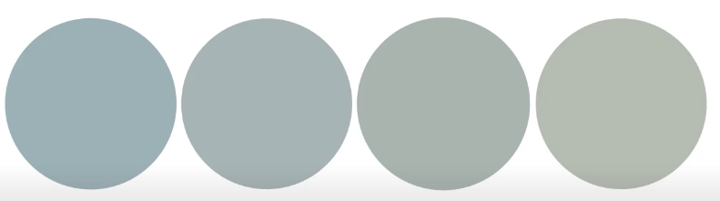
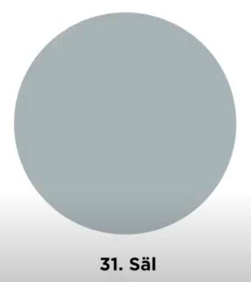
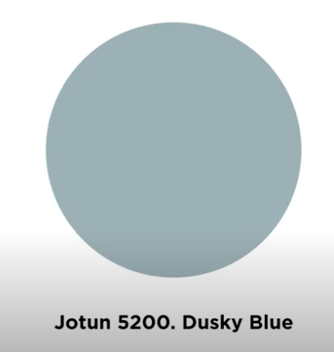
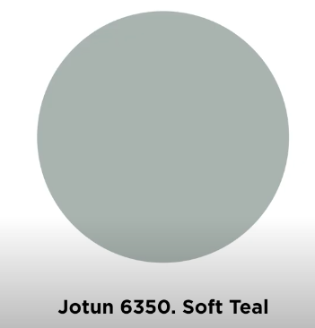
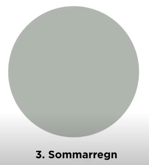
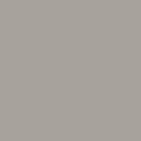
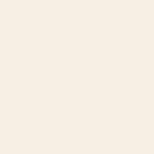
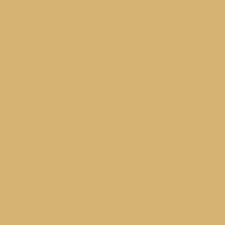
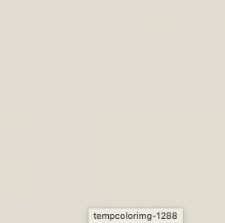

# Todo: Consider what we can learn about "teal" colours from Swedish youtube Hildur blad video "FIN FÄRG TILL VÄGGARNA: Så hittar du den perfekta blågröna färgen att måla väggar med"?

```#9df4102c``` *As of 2020-11-21 19:27*

[mail plain/text](mail.txt)


I have used and want to use more "teal" like colours in my home decoration.

> ==&gt; Also see "Todo: Consider to document how I have painted my Apartment?"

1) Consider the Swedish youtube video "FIN FÄRG TILL VÄGGARNA: Så hittar du den perfekta blågröna färgen att måla väggar med" (<https://youtu.be/1xISgWIz3-4> )?

> So, the English title of this video would be "BEAUTIFUL COLOURS FOR YOUR WALLS: How you find the perfect teal colour for your walls".

> At around 3:00 she seems to suggest that an NCS darkness code of 30 would give you a colour that is neither light nor dark. And a NCS chromatic value of around 05-10 would give you a colour that is more "grey" than an actual colour. So e.g., **S 3005-B20G** is a teal colour that is soothingly neither light nor dark and more "greyish" than an actual colour.

> At around 3:40 she seems to state "Alcro 31. Säl". She guesses without knowing that a close NCS colour would be 30 in blackness and 05..10 in chromatic strength with a colour of blue with a faint green tinting. I get that to be NCS 3005-B10G to NCS 3010-B20G somewhere?

> She also suggests Jotun 5200. Dusky Blue (Compare my bedroom window wall Jotun Tender Green

> She suggests Jotun 6350. Soft Teal as a good more green teal colour.

> Finally she suggests NCS S 3005-B80G as a Teal colour that she likes.

> At around 5:00 she shows teh TEal colours she has talked about from blue to yellow tinted.

>   
> Hildur Blad suggested Teal colours from "Blue-ish", over "Green-ish" to the right "Yellow-ish" (All being NCS darkness and Chroma index around 3005...)

2) Consider to list the colour samples suggested in the video "FIN FÄRG TILL VÄGGARNA: Så hittar du den perfekta blågröna färgen att måla väggar med"?

> >   
> > NCS S 3005-B20G

>   
> Alcro 31. Säl copied from Huldur Blad Video (<https://youtu.be/1xISgWIz3-4?t=227> )

> WARNING: Of course we can NOT trust the colour captured from the video (but we can get a feel for what she is talking about)

> She also suggests Jotun 5200. Dusky Blue (Compare my bedroom window wall Jotun Tender Green

>   
> Jotun 5200. Dusky Blue (NCS 3010-B, RGB #9EADB2. Compare my living room NCS S 1002-B**)**

> She suggests Jotun 6350. Soft Teal as a good more green teal colour.

>   
> Jotun 6350. Soft Teal (NCS 3706-B93G, RGB #9AA49E. Compare my bedroom window wall Jotun 6351. "Tender Green" NCS code 2405-B72G)

> Finally she suggests NCS S 3005-B80G as a Teal colour that she likes.

>   
> NCS S 3005-B80G

> ==&gt; Hildur Blad "favorite" teal Alcro 31. Säl. with guessed NCS code NCS 3005-B10G to NCS 3010-B20G

> ...  
> NCS S 3010-B10G .. NCS S 3010-B30G

> NOTE: There is no 'S' (Standard) 3005- nor 3020- of this colour tone on the web-shop of [ncscouour.com](http://ncscouour.com)?

>   
> Alcro 3. Sommarregn (A warmer more "Yellow" teal)

3) Consider to list colour samples of the colours I have up to 201121 painted my walls with?

> ==&gt; Kitchen Tiles (also see apartment entry door)

> ...  
> S 3500-N .. S 3502-Y

> NOTE: The kitchen tiles and the apartment entry door are shiny so maybe the ColourPIN SE does not read the colour fully correct?

> ==&gt; Living room wall and shelves

>   
> NCS S 1002-B

> ==&gt; Bedroom window wall

> ......  
> NCS **S 2005-B80G** ... NCS S 2010-B70G .. NCS S 3010-B70G (Compare Jotun "Tender Green" (Jot 6351) is NCS code **2405-B72G** (<https://www.jotun.com/no/no/b2c/professional/jotun-proff/ncs-codes.aspx> )?

> ==&gt; Stove and stove wall

>   
> NCS S 0502-Y

> ==&gt; Inside window frame and apartment wall mouldings

>   
> S 0603-Y20R (Close to "Nordsjövit" NCS S 0603-Y03R)

> NOTE: Maybe the window frames has been "yellowed" from being exposed to sunlight (or from ageing)?

> NOTE: Compare with "standard" S 0502-Y (Stockholmsvit, Antikvit, Nikotinvit...) and "Nordsjövit" NCS S 0603-Y03R (<https://minredning.se/vitt-ar-vitt-ar-inte-vitt/> )?

> ==&gt; Apartment doors

>   
> NCS S 0603-G80Y

> ==&gt; Kitchen cupboards

>   
> NCS S 1002-Y (Compare with "standard Swedish cupboards and mouldings NCS 0502-Y")

> ==&gt; Bathroom floor tilings

>   
> NCS S 2002-Y

> ==&gt; Apartment Entry door

> ..   
> NCS 2500-N .. S2502-Y

4) Consider the colours of the walls outside my apartment, E.g., the stairwell and elevator door and frame that leads to my apartment?

>   
> NCS S 2030-Y10R (Stairwell short wall)

>   
> NCS S 1002-Y (Stairwell large walls)

> NOTE: For some reason the Yellow S 1002-Y looks a fait shade of lime green in the light of the stairwell!

> Q: Does the NCS S 1002-Y yellow get tinted towards green by reflection from the walls with orange NCS S 2030-Y10R?

> ==&gt; Balcony outdoor window frames

>   
> NCS S 4000-N

...


