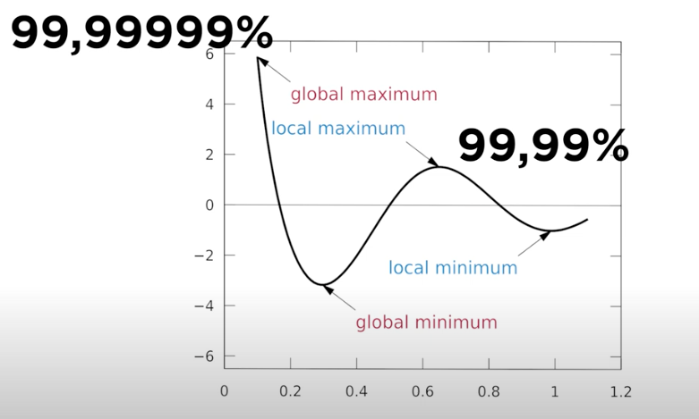

# Todo: Consider you should act so that the good life you could have is in the set of possible outcomes (dare to leave your current local maximum to bet for a better one)?

```#9eed7dfe``` *As of 2020-10-15 19:20*

[mail plain/text](mail.txt)


1) Consider the vintergatan video where he explains he scrapped the previous design because with it the set of possible outcomes of the old design did NOT contain the required outcome (<https://youtu.be/M4jwmAB3wpM?t=1486> )

>   
> *Youtube channel "Vintergatan" arguing the old machine design had a local maximum (best performance) of 99,99% which would never be enough to make the machine "playable"*

2) Consider we can make the same argument about how you should interact with reality (to aim at your overall "best life" and not get stuck at the "best" given where you are now)?

> *So, the basic idea here is that the life you can have given the circumstances you find yourself in may in fact not be the good life you could have? If so, we can argue that it is not enough for you to "live up to your potential" as this will only allow you to reach your life "local maximum". This "local maximum" is defined by the circumstances you are unwilling to change. Like, if you decide to stick with your current job, then the "best" life you can have may be correlated with the job you have. But there may be a "better" life for you if you quit your job to do something else.*

> *Now, the thing to observe and be aware of here is that when you change your circumstances and put yourself in another environment with new possibilities you only change what is in the set of possible outcomes. And even if your new set of possible outcomes contains a "better life" there is no guarantee that you will be able to get that life!*

> *I like this way of modelling how I, as a living actor interacting with reality, is in a dance with reality more than holding the reins to life. How I act changes the circumstances of reality. And the circumstances of reality changes how I affected, react to it and care about it. Which in turn changes how I act. And so the dance continues and my reality and my role in it kind of self-organises into some new more or less stable set of circumstances. And the goal is to simultaneously navigate and have emerge the good life I can have!*

> *...*

...


