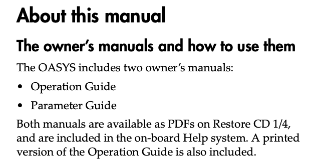

# Todo: Korg OASYS 88 - Consider to delve into the documentation of my Korg OASYS 88 to see what I can learn if I actually study the manuals?

```#9f557166``` *As of 2021-03-14 00:25*

[mail plain/text](mail.txt)


1) Korg seems to list a quite extensive lift of files that goes with the OASYS music workstattion (<https://www.korg.com/us/support/download/product/1/167/> )?

> ### Manuals

  
> ###

> ###

  
> [PDFOASYS/Introductory Tour2015.01.01 / PDF : 161.4KB](https://www.korg.com/us/support/download/manual/1/167/3412/)

> ###

> ###

  
> [PDFOASYS/Operation Guide2015.06.01 / PDF : 7.5MB](https://www.korg.com/us/support/download/manual/1/167/1634/)

> ###

> ###

  
> [PDFOASYS/Parameter Guide2015.06.01 / PDF : 28.6MB](https://www.korg.com/us/support/download/manual/1/167/1635/)

> ###

> ###

  
> [PDFOASYS/Voice Name List（PRODUCER.PCG)2015.06.01 / PDF : 88.6KB](https://www.korg.com/us/support/download/manual/1/167/1636/)

> ###

> ###

  
> [PDFOASYS/Voice Name List2015.06.01 / PDF : 9.3MB](https://www.korg.com/us/support/download/manual/1/167/1637/)

> ###

> ###

  
> [PDFOASYS/CX-3 EXi Guided Tour2015.06.01 / PDF : 102.2KB](https://www.korg.com/us/support/download/manual/1/167/2198/)

> ###

> ###

  
> [PDFOASYS/software version history2015.06.01 / PDF : 100.1KB](https://www.korg.com/us/support/download/manual/1/167/2199/)

> ###

> ###

  
> [PDFOASYS/Installation Guide2015.06.01 / PDF : 96.0KB](https://www.korg.com/us/support/download/manual/1/167/2200/)

> ###

> ###

  
> [PDFOASYS/FAQ's2015.06.01 / PDF : 712.8KB](https://www.korg.com/us/support/download/manual/1/167/2201/)

> ### Software

  
> ###

> ###

  
> [WinOASYS/Logic Environment1.02015.01.01 / ZIP : 63.9KB](https://www.korg.com/us/support/download/software/1/167/3413/)

> ###

> ###

  
> [URLOASYS/System Updater 1.33a2015/01/01](https://www.korg.com/us/support/download/link/1/167/3414/)

> ###

> ###

  
> [Mac / WinOASYS/System Updater1.112015.01.01 / ZIP : 82.9MB](https://www.korg.com/us/support/download/software/1/167/3415/)

2) It seems the Korg OASYS Operations Guide states there are two main "manuals" (<https://cdn.korg.com/us/support/download/files/c98a409a30468f60b02a1ec968b56466.pdf?response-content-disposition=inline%3Bfilename%2A%3DUTF-8%27%27OASYS_OG_v1_3_E5.pdf&response-content-type=application%2Fpdf%3B>)



...


